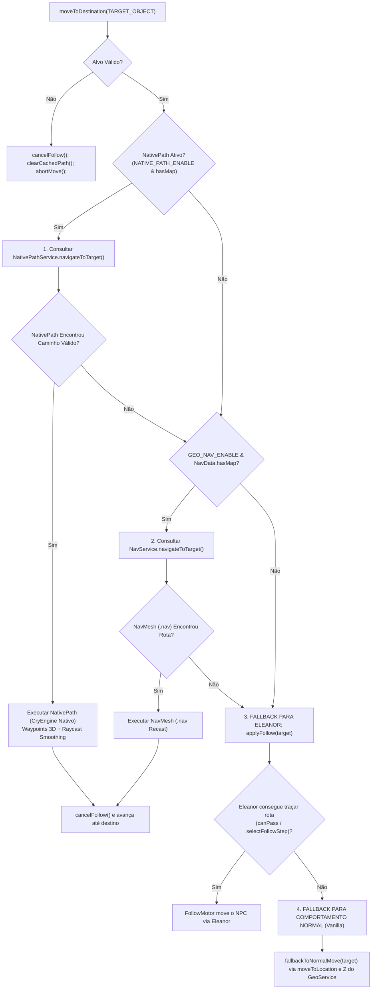

## Funcionamento de escolha de caminhos = NPC

### 1. Configuração de Pathfinding no `NpcMoveController`

Configuração da cadeia de 4 camadas na perseguição de alvos (`Destination.TARGET_OBJECT`) e movimentação a ponto (`Destination.POINT`):

#### Detalhes de Implementação no `NpcMoveController`:
1. **Camada 1 (Native-Path - CryEngine Nativo `*-path.dat`)**:
   - Se `NativePathConfig.NATIVE_PATH_ENABLE` estiver ativado e o mapa possuir `*-path.dat`:
   - Chama `NativePathService.getInstance().navigateToTarget(owner, creature)`.
   - Utiliza as malhas de navegação nativas da CryEngine extraídas diretamente dos mapas do cliente.
   - Aplica algoritmo A* tridimensional nativo com raycasting string-pulling smoothing.
   - Cancela o `FollowMotor` da Eleanor (`cancelFollow()`) para evitar concorrência de controle de movimento.
2. **Camada 2 (Fallback: NavMesh Recast `.nav`)**:
   - Se `native-path` estiver desativado, o mapa não possuir `.dat` nativo, ou a consulta nativa não encontrar caminho navegável:
   - Se `GeoDataConfig.GEO_NAV_ENABLE` estiver ativo e existir arquivo `.nav`:
   - Invoca `NavService.getInstance().navigateToTarget(owner, creature)`.
3. **Camada 3 (Fallback: Eleanor / Line-of-Sight Geometry)**:
   - Se `native-path` e `navmesh` falharem ou estiverem desativados:
   - Limpa `cachedPath` e aciona `applyFollow(target)`.
   - O `FollowMotor` da Eleanor assume o rastreamento ponto a ponto e detecção de obstáculos geométrica.
4. **Camada 4 (Fallback: Comportamento Normal / Vanilla)**:
   - Se Eleanor não puder mover ou não encontrar rota transitável (`_targetPosition == null`), o próprio `FollowMotor` invoca `owner.getMoveController().fallbackToNormalMove(target)`.
   - `fallbackToNormalMove` usa o sistema vanilla com `GeoService.getZ` e movimentação direta sem malha.

---
