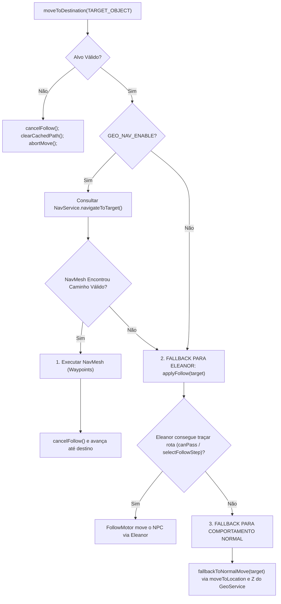

## Funcionamento de escolha de caminhos = NPC

### 1. Configuração de Pathfinding no `NpcMoveController`

Configurar a cadeia de 3 camadas na perseguição de alvos (`Destination.TARGET_OBJECT`):

#### Detalhes de Implementação no `NpcMoveController`:
1. **Camada 1 (NavMesh)**:
   - Se `GeoDataConfig.GEO_NAV_ENABLE` estiver ativado, chama `NavService.getInstance().navigateToTarget(owner, creature)`.
   - Se retornar caminho navegável (não nulo e não falha), cancela o `FollowMotor` da Eleanor (`cancelFollow()`) para evitar conflito de threads e consome os waypoints via `moveToLocation`.
   - Se o alvo se mover mais de $1.5\text{m}$, invalida o cache do caminho para recalcular a rota via NavMesh.
2. **Camada 2 (Fallback: Eleanor)**:
   - Se NavMesh estiver desativado, o mapa não possuir malha `.nav`, o alvo for aéreo, ou o cálculo retornar nulo/bloqueado:
   - Limpa `cachedPath` e aciona `applyFollow(target)`.
   - O `FollowMotor` da Eleanor assume o rastreamento.
3. **Camada 3 (Fallback: Comportamento Normal / Vanilla)**:
   - Se Eleanor não puder mover ou não encontrar rota transitável (`_targetPosition == null`), o próprio `FollowMotor` invoca `owner.getMoveController().fallbackToNormalMove(target)`.
   - `fallbackToNormalMove` usa o sistema nativo do emulador com `GeoService.getZ` e movimentação direta.

---
