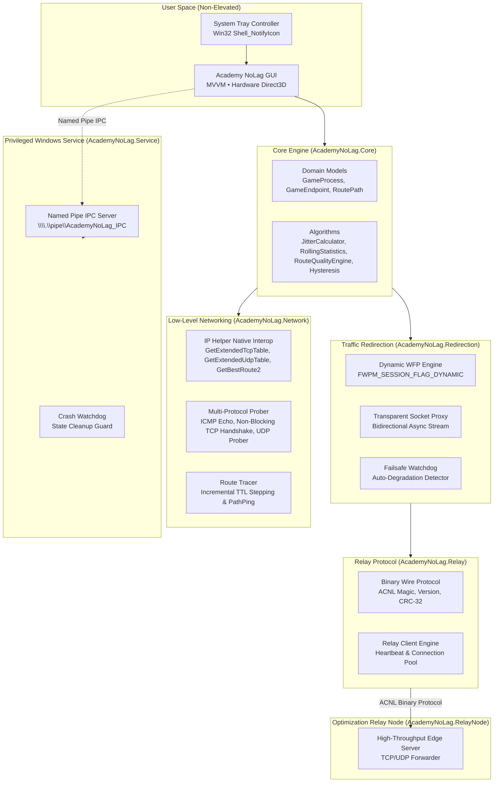

# Academy NoLag — Architecture Specification

This document details the software architecture, modular separation, design patterns, threading model, and inter-process communication mechanisms of **Academy NoLag**.

---

## 1. Architectural Philosophy

Academy NoLag is engineered around five fundamental principles:

1. **Zero Degradation / Zero Regression**:
   The network optimizer must never introduce processing overhead or queuing delays that exceed the latency benefits it achieves. Every packet path operates on strict latency budgets with bounded memory allocations.
2. **Zero Synthetic Metrics (No Faking)**:
   Every millisecond of latency, jitter deviation, or packet loss reported to the user is derived from real, empirical network probing.
3. **Decoupled Responsibilities**:
   Game detection is strictly decoupled from endpoint discovery; endpoint discovery is decoupled from route analysis; route analysis is decoupled from the redirection engine.
4. **Privilege Separation**:
   The desktop GUI executes with standard user privileges (`asInvoker`). Privileged network operations (e.g., Windows Filtering Platform rule registration) are delegated to a dedicated background service via secure local IPC.
5. **Fail-Safe by Default**:
   If an optimization node fails, packet loss occurs, or the client process abruptly crashes, the system instantly and automatically restores standard Windows default routing.

---

## 2. Layered Component Architecture

---

## 3. Subsystem Breakdown

### 3.1 AcademyNoLag.Core
- **Purpose**: Houses pure domain models, mathematical formulas, statistical estimators, and abstractions.
- **Key Modules**:
  - `JitterCalculator`: Implements RFC 3550 interarrival jitter smoothing:
    $$J_i = J_{i-1} + \frac{|D(i-1, i)| - J_{i-1}}{16}$$
  - `RollingStatistics`: Fixed-capacity circular buffer ($N=60$ samples) computing Min, Mean, Median (P50), P90, P95, P99, Variance, Standard Deviation, and Packet Loss Rate.
  - `RouteQualityEngine`: Normalizes disparate network parameters into an internal 0–100 quality score with configurable weights.
  - `HysteresisComparator`: State machine protecting against route flapping. Requires minimum 7.0% improvement and $\ge 4.0\text{ ms}$ lower latency sustained across at least 3 consecutive cycles.

### 3.2 AcademyNoLag.Network
- **Purpose**: Direct Win32 / P-Invoke native integration with Windows network stacks.
- **Key Modules**:
  - `IpHlpApi`: Exposes `GetExtendedTcpTable`, `GetExtendedUdpTable`, `GetAdaptersAddresses`, `GetBestRoute2`, and `IcmpSendEcho`.
  - `IcmpProber`: High-precision ICMP Echo prober.
  - `TcpConnectProber`: High-resolution TCP 3-way handshake measurement via non-blocking socket connect with immediate RST teardown (`LingerOption(true, 0)`).
  - `GatewayProber`: Continuously monitors the default gateway to isolate LAN congestion from internet transit congestion.
  - `DnsBenchmarkProber`: Measures resolver response times and consistency.
  - `RouteTracer`: Hop-by-hop traceroute using incremental TTL stepping.

### 3.3 AcademyNoLag.Detection
- **Purpose**: Autonomous process monitoring and socket correlation.
- **Key Modules**:
  - `GameDetector`: Scans active processes at 2-second intervals, matching against known game profiles.
  - `EndpointDiscoveryEngine`: Correlates target PID to open TCP connections and UDP sockets at 500ms intervals, categorizing endpoints into Authentication, GameServer, Chat, and CDN.
  - `ProfileManager`: Manages built-in and user-custom game profiles.

### 3.4 AcademyNoLag.Relay & RelayNode
- **Purpose**: Custom binary encapsulation protocol (`AcademyRelay`) and edge forwarding node.
- **Wire Protocol Header (26 bytes)**:
  - `[0..3]` Magic `0x41434E4C` ("ACNL")
  - `[4]` Protocol Version (`0x01`)
  - `[5]` Command (`0x01=Hello`, `0x02=HelloAck`, `0x03=Data`, `0x04=Ping`, `0x05=Pong`, `0x06=KeepAlive`, `0x07=Teardown`)
  - `[6..9]` Session ID (`uint32`)
  - `[10..17]` Timestamp Ticks (`int64`)
  - `[18..21]` Payload Length (`int32`)
  - `[22..25]` CRC-32 Checksum (`uint32`)
  - `[26..N]` Payload

### 3.5 AcademyNoLag.Redirection
- **Purpose**: Process-isolated traffic redirection.
- **Architecture**:
  - Transparent TCP/UDP socket proxy.
  - Windows Filtering Platform dynamic session (`FWPM_SESSION_FLAG_DYNAMIC`), guaranteeing that if the application or service process exits, the Windows kernel cleans up all redirection rules automatically.

### 3.6 AcademyNoLag.App (WPF GUI)
- **Pattern**: Strict Model-View-ViewModel (MVVM).
- **Rendering**: Hardware-accelerated Direct3D vector Canvas graphs rendering at 60 FPS without UI thread blockage.
- **System Tray**: Windows taskbar notify icon with minimize-to-tray, status balloons, and context menu.

---

## 4. Threading and Concurrency Model

1. **UI Thread**:
   - Handles user input, navigation, and visual data binding.
   - Never performs synchronous network I/O, socket connects, or blocking process scans.
2. **Background Engine Loop**:
   - Executes periodic detection, telemetry probing, and hysteresis evaluation on background worker threads using `Task.Run` and `CancellationToken`.
3. **Socket I/O Pipelines**:
   - All network transfers use asynchronous, non-blocking APIs (`Socket.ConnectAsync`, `ReceiveAsync`, `SendAsync`) combined with `ArrayPool<byte>.Shared` memory pooling.
