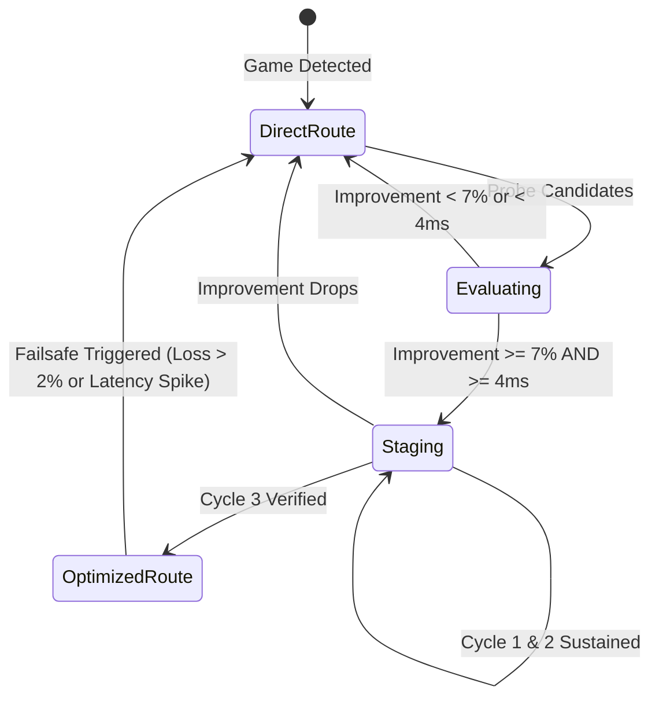

# Academy NoLag — Mathematical Route Optimization & Quality Engine

This document defines the formal mathematical models, jitter calculations, composite scoring algorithms, hysteresis rules, and failsafe criteria that govern routing decisions in **Academy NoLag**.

---

## 1. Jitter Calculation Model (RFC 3550 Standard)

Network jitter represents the statistical variance in packet arrival latency. Unstable latency disrupts combat timing, animation synchronization, and hit registration in games like Aion Classic.

### 1.1 The Mathematical Formulation
Following RFC 3550 Section 6.4.1 (RTP Specification), interarrival jitter $J$ is calculated from successive packet transit delays:

Let $S_i$ be the departure timestamp of packet $i$, and $R_i$ be the arrival timestamp of packet $i$. The difference in transit time between successive packets $i-1$ and $i$ is:

$$D(i-1, i) = (R_i - R_{i-1}) - (S_i - S_{i-1})$$

When sampling round-trip probes where $RTT_i = R_i - S_i$, the deviation simplifies to:

$$D(i-1, i) = |RTT_i - RTT_{i-1}|$$

The smoothed statistical jitter $J_i$ is updated recursively using an exponentially weighted moving average with a smoothing coefficient of $\frac{1}{16}$ ($0.0625$):

$$J_i = J_{i-1} + \frac{|D(i-1, i)| - J_{i-1}}{16}$$

This smoothing filter provides responsiveness to sudden latency degradation while dampening momentary single-packet anomalies.

---

## 2. Formal Route Quality Scoring Algorithm

Route optimization must NEVER optimize exclusively for minimum ping. A route with 40 ms RTT and 3% packet loss is catastrophic for gaming compared to a stable 46 ms route with 0% packet loss.

### 2.1 Component Sub-Scores (Normalized 0 to 100)

1. **Latency Sub-Score ($S_{\text{lat}}$)**:
   Accounts for both mean RTT and 95th percentile RTT ($P_{95}$) to penalize latency spikes:
   $$\text{RTT}_{\text{eff}} = 0.40 \cdot \text{RTT}_{\text{mean}} + 0.60 \cdot \text{RTT}_{P_{95}}$$
   $$S_{\text{lat}} = \text{clamp}\left(100.0 - \frac{\text{RTT}_{\text{eff}}}{2.0},\ 0.0,\ 100.0\right)$$

2. **Packet Loss Sub-Score ($S_{\text{loss}}$)**:
   Packet loss degrades player movement, skill queues, and causes rubber-banding. Loss is penalized severely:
   $$S_{\text{loss}} = \text{clamp}\left(100.0 - (\text{Loss\%} \times 25.0),\ 0.0,\ 100.0\right)$$
   *(Note: 4% packet loss drops the sub-score to 0).*

3. **Jitter Sub-Score ($S_{\text{jit}}$)**:
   Penalizes arrival variance:
   $$S_{\text{jit}} = \text{clamp}\left(100.0 - (\text{Jitter}_{\text{ms}} \times 3.333),\ 0.0,\ 100.0\right)$$
   *(Note: 30 ms jitter drops the sub-score to 0).*

4. **Stability Sub-Score ($S_{\text{stab}}$)**:
   Penalizes standard deviation ($\sigma$):
   $$S_{\text{stab}} = \text{clamp}\left(100.0 - (\sigma \times 4.0),\ 0.0,\ 100.0\right)$$

5. **Node Health Sub-Score ($S_{\text{node}}$)**:
   Reflects current CPU/network load on the candidate relay server ($0\text{ to }100\%$).

### 2.2 Composite Route Quality Formula

The composite quality score $Q$ is computed using normalized weights summing to $1.0$:

$$Q = w_{\text{lat}} \cdot S_{\text{lat}} + w_{\text{loss}} \cdot S_{\text{loss}} + w_{\text{jit}} \cdot S_{\text{jit}} + w_{\text{stab}} \cdot S_{\text{stab}} + w_{\text{node}} \cdot S_{\text{node}}$$

**Default Calibrated Weights**:
- $w_{\text{lat}} = 0.40$ (40%)
- $w_{\text{loss}} = 0.30$ (30%)
- $w_{\text{jit}} = 0.15$ (15%)
- $w_{\text{stab}} = 0.10$ (10%)
- $w_{\text{node}} = 0.05$ (5%)

---

## 3. Hysteresis Switching Logic (Preventing Ping-Ponging)

Frequent route switching during gameplay can cause brief TCP stalls, sequence renumbering issues, or connection resets. Academy NoLag strictly avoids route fluttering through a stateful hysteresis algorithm.

### 3.1 Transition Rules:
1. **Direct $\rightarrow$ Optimized**:
   - The candidate path quality score must be strictly higher: $Q_{\text{opt}} > Q_{\text{dir}}$.
   - Improvement threshold:
     $$\Delta \text{RTT} \ge 4.0\text{ ms} \quad \text{OR} \quad \frac{\Delta \text{RTT}}{\text{RTT}_{\text{dir}}} \times 100 \ge 7.0\%$$
   - Candidate packet loss must not exceed direct route packet loss: $\text{Loss}_{\text{opt}} \le \text{Loss}_{\text{dir}}$.
   - Condition must hold continuously for $N = 3$ consecutive evaluation cycles ($3\text{ seconds}$).
2. **Immediate Failsafe Reversion ($\text{Optimized} \rightarrow \text{Direct}$)**:
   - If optimized route exhibits packet loss $\ge 2.0\%$ above the direct route.
   - Or if optimized latency spikes by $\ge 15.0\text{ ms}$ over the direct route.
   - Fallback is executed within $2$ cycles ($2\text{ seconds}$), instantly tearing down proxy rules and returning traffic to default Windows routing.
