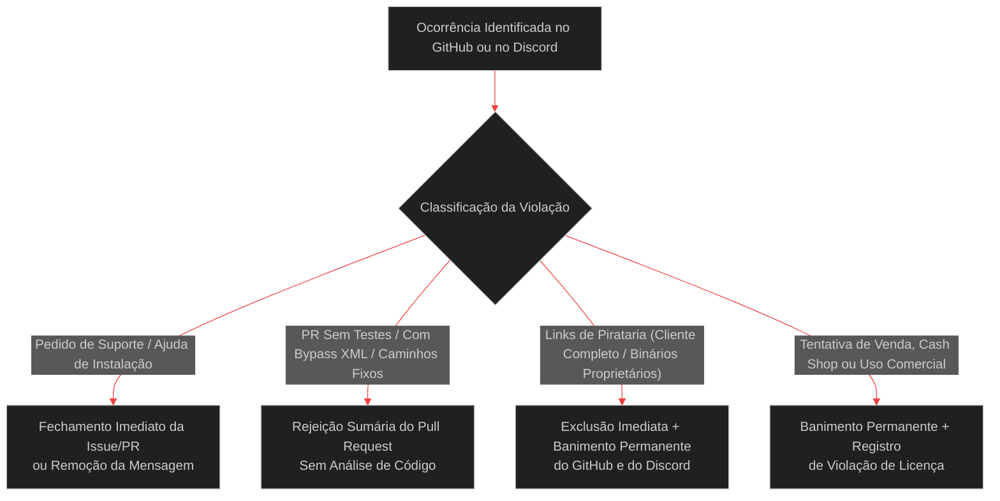

# Código de Conduta da Comunidade Técnica — AION CLASSIC 5.0 EMULADOR

  
  

  
  
  

> [!IMPORTANT]
> **PROPÓSITO DESTE CÓDIGO DE CONDUTA:**  
> O **Aion Classic 5.0 — Emulador Oficial** é um ambiente estritamente técnico de estudo em engenharia de software, sistemas distribuídos em **Java 25 LTS**, supervisão nativa em **Rust** e física tridimensional **CryEngine Native-Path**. Este Código de Conduta aplica-se a todas as interações no GitHub (`Issues`, `Pull Requests`, `Commits`) e no servidor oficial do Discord (`https://discord.gg/Sjdrsg3gcb`).

---

## 1. Diretrizes de Postura Técnica Esperada

1. **Rigor Científico e Comprovação Empírica:** Toda discussão técnica ou submissão de código deve ser acompanhada de dados objetivos: versão do cliente (`Aion Classic 5.0 EU — PE32+ bin64`), evidências de pacotes de rede (`Wireshark - Oficial Classic 5.0`), validação de tabelas extraídas do cliente oficial (`Client 5.0 - Dados Extraidos`) e compilação limpa sem erros no Maven (`Java 25 LTS`) e Cargo (`Rust`).
2. **Respeito à Política de Zero Suporte (*AS-IS*):** Compreenda que os mantenedores não prestam consultoria nem auxílio de instalação, configuração de MySQL/MariaDB ou operação de servidores (consulte [`SUPPORT.md`](./SUPPORT.md)).
3. **Preservação do Padrão Arquitetural e Linguístico:** Mantenha toda a documentação técnica e mensagens de commit estritamente em Português Brasil, sem emojis, sem caminhos de disco fixos (*hardcoded*), utilizando diagramas Mermaid, alertas nativos do Markdown e mantendo a sincronização rigorosa entre `Código Fonte - Emulador` e `Emulador - Produto Final` (consulte [`CONTEXT.md`](./CONTEXT.md)).
4. **Respeito à Regra de Acesso ao Discord:** Aguarde a aprovação (*merge*) de uma contribuição real via Pull Request com `Discord-User: @seu_usuario` para ter acesso de escrita liberado no Discord.

---

## 2. Condutas Estritamente Proibidas e Sanções Aplicáveis

| Infração | Nível de Gravidade | Medida Administrativa |
| :--- | :---: | :--- |
| **Solicitar suporte técnico, ajuda para configurar banco MySQL, cliente ou compilar o emulador** |  | Fechamento sumário da *Issue* ou exclusão da mensagem por violação da cláusula *AS-IS*. |
| **Submeter Pull Request sem validação, com caminhos fixos (`C:\`, `D:\`), bypass de XML ou sem atualizar `Emulador - Produto Final`** |  | Fechamento imediato do Pull Request e manutenção do bloqueio no Discord. |
| **Publicar links para download de clientes completos, instaladores proprietários ou chaves privadas** |  | Remoção imediata do conteúdo e banimento definitivo do GitHub e do Discord. |
| **Oferecer serviços pagos, venda de emulador, assinaturas, Cash Shop ou uso comercial** |  | Banimento definitivo e revogação imediata da licença de pesquisa. |
