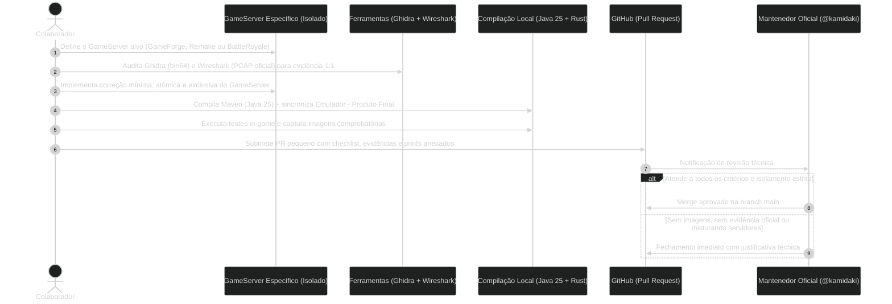

# Guia de Contribuição e Diretrizes de Engenharia — AION CLASSIC 5.0 EMULADOR

<p align="center">
  <a href="./CONTRIBUTING.md"></a>
  <a href="./CONTEXT.md"></a>
  <a href="./SECURITY.md"></a>
</p>

<p align="center">
  
  
  
  
</p>

> [!CAUTION]
> # LEITURA OBRIGATÓRIA ANTES DE SUBMETER QUALQUER CÓDIGO OU PULL REQUEST
> 1. **NÃO SÃO ACEITOS PULL REQUESTS SEM TESTES E IMAGENS COMPROBATÓRIAS:** Todo Pull Request deve obrigatoriamente anexar capturas de tela e registros de execução comprovando o funcionamento prático real da alteração.
> 2. **VALIDAÇÃO OBRIGATÓRIA CONTRA O SERVIDOR OFICIAL:** Toda mecânica, comportamento, cálculo ou pacote deve ser estritamente validado e comparado contra o **servidor oficial Aion Classic Gameforge**. É inaceitável qualquer submissão sem evidência concreta de que o valor está idêntico ao oficial.
> 3. **CONFIRMAÇÃO OBRIGATÓRIA VIA GHIDRA E WIRESHARK:** Toda alteração de rede, offsets, fórmulas de combate ou lógica interna do cliente deve trazer evidências extraídas de descompilação no **Ghidra** (módulos PE32+ de 64 bits em `bin64`) e capturas reais no **Wireshark** (`Ferramentas e Documentos/Client e Coletas/Wireshark - Oficial Classic 5.0/`).
> 4. **REJEIÇÃO SUMÁRIA DE PRS NÃO CONFORMES:** Submissões que misturem sistemas diferentes, alterem múltiplos GameServers juntos, contenham caminhos fixos (`C:\`, `D:\`), usem bypass em Java para dados faltantes em XMLs, ou não forneçam imagens serão fechadas imediatamente sem análise.

---

## 1. Regras Inegociáveis de Isolamento de GameServers

Cada GameServer deste ecossistema (`game-server-gameforge`, `game-server-remake`, `game-server-battleroyale`) é uma entidade **totalmente isolada, autônoma e independente**:

1. **Validação Prévia Obrigatória:**
   - Antes de iniciar qualquer alteração ou leitura de código relacionada a GameServer, é mandatório validar em qual GameServer a correção ou melhoria será efetuada.
   - **É terminantemente inaceitável ler ou alterar todos os GameServers genericamente.**
2. **Independência Total de Sistemas e Mecânicas:**
   - Cada servidor possui e possuirá mecânicas, regras de progressão e sistemas intencionalmente diferentes entre si.
   - O `game-server-gameforge` (GSID 1) preserva a experiência oficial 5.0 da Gameforge.
   - O `game-server-remake` (GSID 2) implementa balanceamento reformulado e customizações próprias.
   - O `game-server-battleroyale` (GSID 3) implementa modos competitivos de arena e sobrevivência.
3. **Proibição Absoluta de Consulta Cruzada:**
   - NUNCA corrija um problema em um GameServer consultando outro GameServer, exceto quando isso for expressamente solicitado pelo usuário.
4. **Consulta Obrigatória ao Usuário:**
   - Caso o usuário ou chamado não especifique claramente em qual servidor a intervenção deve ocorrer, pergunte SEMPRE ao usuário antes de prosseguir, mesmo sob nível máximo de autonomia.
5. **Auditoria de Conclusão de Tarefa:**
   - Ao concluir qualquer tarefa ou PR, certifique-se e declare explicitamente que nenhum arquivo de outros GameServers foi alterado ou excluído sem autorização prévia.
6. **Componentes Compartilhados (`chat-server`, `login-server`, `version.dll`):**
   - Devem ser desenhados e implementados pensando sempre no funcionamento conjunto com cada GameServer isoladamente.
   - Uma alteração em um componente compartilhado jamais pode causar mau funcionamento em outros GameServers.
   - Caso uma alteração estrutural no `chat-server`, `login-server` ou `version.dll` demande compatibilização nos GameServers, este é o **único momento autorizado** para ajustar múltiplos GameServers, e a alteração deve restringir-se **exclusivamente à camada de conectividade e comunicação de rede, NUNCA afetando gameplay ou mecânicas internas**.
7. **Proibição de Subidas Simultâneas em Múltiplos GameServers:**
   - NUNCA suba alterações para todos os GameServers no mesmo Pull Request. Cada PR deve focar em um único GameServer ou na camada de infraestrutura compartilhada.

---

## 2. Padrão de Pull Requests: Pequenos, Mínimos e Atômicos

Seguindo as melhores práticas de engenharia reversa e preservação:

- **Escopo Único e Mínimo:** Cada Pull Request deve resolver um único problema ou implementar uma única melhoria bem delimitada.
- **Proibição de Mistura de Sistemas:** NUNCA misture alterações de sistemas diferentes (ex: inventário + chat, ou skills + auction) em um único Pull Request.
- **Evidências Visuais e Técnicas Obrigatórias:**
  - Anexe prints/vídeos do funcionamento in-game na interface do cliente Aion Classic 5.0.
  - Anexe trechos descompilados no **Ghidra** ou disasm correspondente comprovando a estrutura oficial.
  - Anexe o frame hexadecimal ou dissecção de pacotes no **Wireshark** comprovando paridade byte a byte com o tráfego oficial.
- **Compilação Limpa Obrigatória:**
  - `mvn clean package` (Java 25 LTS) com 100% de sucesso.
  - Supervisor Rust compilado via `cargo check` ou `cargo build --release` sem warnings de erro.
  - `version.dll` compilada via MSVC v143 (x64/x86) se houver alteração em C/C++.
- **Sincronização Código-Fonte $\leftrightarrow$ Produto Final:** Toda alteração no código deve vir acompanhada da sincronização em `Emulador - Produto Final` e `Patch final - Client 5.0`.

---

## 3. Matriz de Requisitos de Pull Request

| Requisito | Exigência Técnica | Motivo da Inegociabilidade |
| :--- | :--- | :--- |
| **Identificação do GameServer** | Informar expressamente se o PR afeta `GameForge`, `Remake` ou `BattleRoyale`. | Evita contaminação e divergência acidental entre modalidades. |
| **Evidência Oficial** | Comparação direta com o servidor oficial Aion Classic Gameforge. | Elimina suposições e mantém a fidelidade histórica 1:1. |
| **Captura Ghidra / Wireshark** | Logs de rede reais (`.pcap`) e offsets de classes C++ em `bin64`. | Garante que opcodes, structs e constantes estão corretos. |
| **Imagens Comprobatórias** | Prints de tela nítidos demonstrando o comportamento correto em execução. | Comprova que o código foi testado antes de ser submetido. |
| **Escopo Atômico** | PR mínimo focado em um único bug ou funcionalidade. | Facilita a revisão, auditoria de segurança e rollback caso necessário. |
| **Zero Caminhos Hardcoded** | Caminhos 100% relativos sem referências a unidades locais (`C:\`, `D:\`). | Garante a portabilidade em qualquer estação de trabalho ou CI/CD. |
| **Zero Bypass XML** | Correção de dados estáticos direto nos XMLs canônicos via `parsersXML`. | Impede a degradação da base Java com código fictício. |
| **Commits em Português** | Mensagens de uma linha técnica em Português Brasil sem emojis. | Mantém o padrão histórico de rastreabilidade do repositório. |

---

## 4. Fluxo de Trabalho de Contribuição



---

## 5. Padrão Obrigatório de Mensagem de Commit

As mensagens de commit devem ser redigidas **estritamente em Português do Brasil**, sem emojis, com uma linha técnica por alteração e escopo bem definido:

```gitcommit
fix(gameforge): corrigir calculo de resistencia magica baseado em captura do oficial
feat(remake): adicionar tabela de recompensas de instancia isolada no schema aionclassic_gs2
fix(version.dll): corrigir resolucao dinamica de ips sem sequestrar loginserver no boot
fix(chat-server): sincronizar canais de comunicacao para compatibilidade com os tres gameservers
```

---

## 6. Template Obrigatório de Pull Request

Ao abrir um Pull Request, preencha integralmente o formulário de [PULL_REQUEST_TEMPLATE.md](.github/PULL_REQUEST_TEMPLATE.md) disponível no repositório. Submissões com seções em branco ou sem imagens serão sumariamente recusadas.
