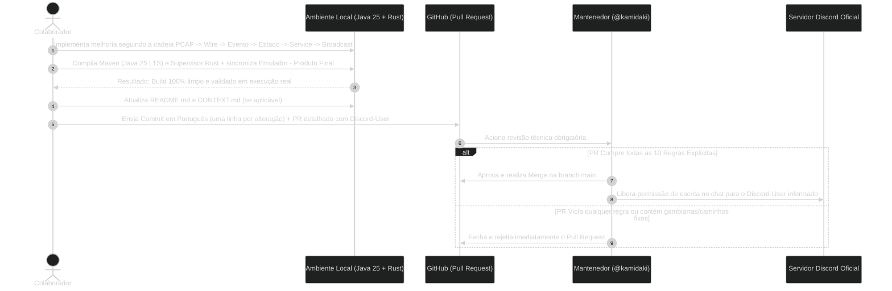

# Guia de Contribuição e Regras Explícitas de Pull Request — AION CLASSIC 5.0 EMULADOR

<p align="center">
  <a href="./CONTRIBUTING.md"></a>
  <a href="./CONTEXT.md"></a>
</p>

<p align="center">
  
  
  
  
</p>

> [!CAUTION]
> **LEITURA OBRIGATÓRIA ANTES DE SUBMETER QUALQUER CÓDIGO OU PULL REQUEST:**  
> 1. **NENHUM SUPORTE OU AJUDA SERÁ CONCEDIDA:** O projeto é disponibilizado como é (*AS-IS*), exclusivamente para testes, preservação histórica e estudos de engenharia (consulte [`SUPPORT.md`](./SUPPORT.md)).  
> 2. **REJEIÇÃO IMEDIATA DE PRs INCOMPLETOS:** Qualquer Pull Request enviado sem compilação limpa (`mvn clean package` + `cargo build --release`), sem sincronizar os artefatos em `Emulador - Produto Final`, contendo caminhos de disco fixos (`C:\`, `D:\`), utilizando *workarounds* em Java para suprir falta de dados nos XMLs, ou fora do padrão de commits em Português Brasil será **fechado e rejeitado imediatamente sem análise**.

---

## 1. Fluxo de Trabalho e Desbloqueio do Bate-Papo no Discord



---

## 2. As 10 Regras Explícitas de Pull Request

| # | Regra Obrigatória | Exigência Técnica de Auditoria |
| :---: | :--- | :--- |
| **01** | **Fidelidade à Cadeia Causal de Eventos** | Nenhum pacote (`CM_*` / `SM_*`) deve ser implementado isoladamente. Respeite o fluxo: `Captura (PCAP) -> Protocolo (Wire) -> Evento -> Estado (World/Entity) -> Sistema (Service) -> Resposta (Broadcast)`. |
| **02** | **Evidência Real Baseada em PCAPs e Cliente 5.0** | Toda implementação de protocolo ou mecânica deve basear-se nas capturas reais (`Ferramentas e Documentos/Client e Coletas/Wireshark - Oficial Classic 5.0/`) e nos dados extraídos (`Client 5.0 - Dados Extraidos/`). |
| **03** | **Proibição Absoluta de Bypass por Dados XML Faltantes** | É terminantemente proibido criar *fallbacks* ou valores mágicos no Java para suprir falta de templates. Corrija os XMLs via `parsersXML` e sincronize `Código Fonte - Emulador` e `Emulador - Produto Final`. |
| **04** | **Portabilidade Absoluta e Zero Caminhos Hardcoded** | É proibido fixar letras de unidade de disco (`C:\`, `D:\`, `E:\`) em qualquer arquivo (`.java`, `.rs`, `.cpp`, `.cs`, `.py`, `.bat`, `.json`, `.xml`, `.md`). Use sempre caminhos relativos e o runtime `java-deployment` integrado. |
| **05** | **Stack Java 25 LTS Pura (Zero Javolution)** | Utilize exclusivamente coleções e recursos nativos do Java 25 (`java.util`, `java.util.concurrent`, Virtual Threads). Nunca introduza dependências legadas como `javolution.*`. |
| **06** | **Sincronização Obrigatória com `Emulador - Produto Final`** | Toda modificação em `Código Fonte - Emulador`, no supervisor Rust ou em `version.dll` deve ser compilada e publicada em `Emulador - Produto Final` e `Patch final - Client 5.0`. |
| **07** | **Autoridade Exclusiva CryEngine Native-Path** | A navegação 3D utiliza exclusivamente `com.lostacademy.nativepath` (`*-path.dat` 0.5m com A* Zero-GC). Não reintroduza motores legados em tempo de execução. |
| **08** | **Padrão Estrito de Commits em Português** | Mensagens de commit devem ser escritas **estritamente em Português Brasil**, com **uma linha por alteração**, de forma concisa, técnica e sem emojis. |
| **09** | **Identificação do Usuário do Discord** | Inclua `Discord-User: @seu_usuario` na descrição do Pull Request para liberação de escrita no servidor oficial do Discord após o *merge*. |
| **10** | **Zero Segredos ou Arquivos Temporários de Execução** | Jamais versione `database.properties` com senhas pessoais de produção, diretórios `target/`, `logs/` ou caches `.WebView2/`. |

---

## 3. Padrão Obrigatório de Mensagem de Commit

> [!IMPORTANT]
> Conforme definido em [`CONTEXT.md`](./CONTEXT.md) e [`README.md`](./README.md), os commits devem estar estritamente em Português Brasil e descrever cada alteração relevante em uma linha individual e objetiva:

```gitcommit
Configura java-deployment com Java 25 LTS embarcado e referencia relativa no supervisor Rust
Move cache do WebView2 para AppData com limpeza e recriacao automatica a cada inicializacao
Adiciona documentacao padrao de governanca e seguranca na raiz do repositorio
```

---

## 4. Comparativo Rápido: O Que é Aceito vs. O Que é Rejeitado

| Submissão Aceitável (Aprovável) | Submissão Inaceitável (Fechamento Imediato) |
| :--- | :--- |
| Código Java 25 / Rust / C++ compilado e sincronizado com `Emulador - Produto Final`. | Alterar apenas o código-fonte sem atualizar os binários correspondentes ou enviar código que não compila. |
| Correção de dados estáticos diretamente nos XMLs via `parsersXML` a partir das extrações oficiais 5.0. | Criar `if (template == null)` com valores fictícios hardcoded no código Java. |
| Caminhos 100% relativos (`java-deployment/bin/java.exe`, `./libs/*`) e uso de `AppData` para cache temporário. | Inserir caminhos fixos como `C:\Program Files\Java\...` ou `D:\AION CLASSIC...` no código ou em arquivos `.json`. |
| Commits em Português Brasil no formato de uma linha técnica por alteração. | Commits em inglês, mensagens genéricas (`fix`, `update`) ou uso de emojis. |
