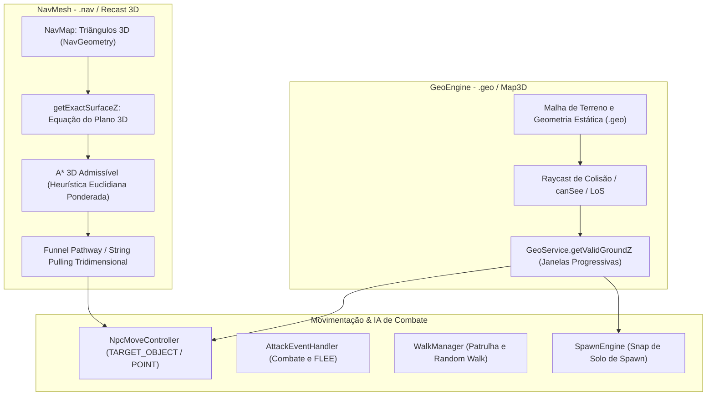

## Funcionamento de Navegação e Movimento dos NPCs (Aion Classic 5.0)

Este documento detalha a arquitetura completa de geometria, navegação tridimensional (`GeoEngine` + `NavMesh`), combate aéreo / fuga (`FLEE`), recuperação de obstáculos no retorno ao spawn e validação de altura em solo.

---

### 1. Visão Geral da Arquitetura de Geometria e Navegação

O emulador emprega duas camadas integradas e coordenadas para navegação espacial e colisão:

1. **NavMesh 3D (`.nav`) — Sistema Primário de Navegação e Superfície**:
   - Carrega as malhas de polígonos triangulados geradas pelo Recast (`data/nav/`).
   - Cada triângulo (`NavGeometry`) armazena seus 3 vértices e seu vetor normal $N = (N_x, N_y, N_z)$.
   - A altura exata de qualquer coordenada horizontal $(x, y)$ sobre o triângulo é calculada rigorosamente pela equação contínua do plano tridimensional:
     $$z = z_0 - \frac{N_x(x - x_0) + N_y(y - y_0)}{N_z}$$
   - Isso elimina qualquer degrau artificial, flutuação ou afundamento em rampas, ladeiras, pontes estreitas e escadas espirais.
   - O algoritmo A* em `NavHelper` utiliza custo e heurística euclidianos tridimensionais verdadeiros ($\sqrt{\Delta x^2 + \Delta y^2 + \Delta z^2}$ com peso admissível 1.05), garantindo que conexões verticais entre múltiplos andares e escadas em caracol sejam percorridas degrau a degrau sem atalhos irreais através de tetos ou vazios.

2. **GeoEngine (`.geo`) — Colisão Física e Auxiliar de Linha de Visão**:
   - Fornece detecção de obstáculos sólidos, paredes, portas e checagem de linha de visão (`canSee`).
   - Fornece o método `getValidGroundZ` com janelas progressivas verticais (`+2/-3m`, `+6/-10m`, `+15/-25m`) para encontrar solo firme em locais onde não há malha `.nav`, sem colidir com tetos a 50m de altitude.

---

### 2. Correções Implementadas e Comportamento dos Sistemas

#### 2.1. Validação Automática de Altura de Spawn (NPCs Terrestres)
- **Problema anterior**: NPCs cadastrados em `static_data/spawns` com valores de Z defasados ou aproximados podiam nascer enterrados no chão ou flutuando.
- **Solução**:
  - `SpawnEngine.resolveSpawnGroundZ()`: Quando um NPC terrestre nasce (`bringIntoWorld`), o servidor consulta `NavService.getNavSurfaceZ` e `GeoService.getValidGroundZ` dentro da janela segura de tolerância de solo (`[-5m, +6m]`).
  - O valor de Z é corrigido atomicamente no objeto e em seu `SpawnTemplate` em memória. Spawns aéreos e NPCs voadores são preservados intactos.
  - Comando `//fixspawn` (`FixSpawn.java`): Aprimorado para utilizar a elevação do administrador como piso de referência e projetar no NavMesh/GeoEngine no $(X, Y)$ exato do NPC. Suporta `//fixspawn player` para forçar Z do administrador e `//fixspawn geo` para projetar no relevo.

#### 2.2. Correção do Crash do Cliente com `.enemy all`
- **Causa raiz identificada**: Em `PlayerController.onChangedPlayerAttributes()`, era enviado o pacote `SM_PLAYER_INFO` contendo o próprio `objectId` do jogador para seu próprio cliente. No protocolo de rede do Aion Classic 5.0, `SM_PLAYER_INFO` é destinado exclusivamente ao spawn de jogadores remotos; receber este pacote com a própria identidade corrompia o mapa de entidades do cliente C++ gerando um crash imediato (`Client disconnected: client crash or connection loss`).
- **Solução**:
  - `PlayerController.sendPlayerInfoPackets(player)` agora possui guarda explícita: se `player.equals(getOwner())`, nunca envia `SM_PLAYER_INFO` para o próprio cliente.
  - `onChangedPlayerAttributes()` atualiza os atributos e estados locais com `SM_PLAYER_STATE`, `SM_MOTION` e atualização de ícones de efeito, deixando a atualização de visibilidade de outros jogadores e NPCs a cargo do ciclo seguro `clearKnownlist() -> updateKnownlist()`.

#### 2.3. Comportamento de Combate contra Alvo Voador (`FLEE`)
- **Regra do Ciclo de Vida**: `COMBAT -> PLAYER FLIES -> FLEE -> (PLAYER LANDS -> RESUME COMBAT | LEASH EXCEEDED -> RETURN HOME)`.
- **Reação Imediata**: `FlyController.startFly()`, `switchToGliding()`, `endFly()` e `onStopGliding()` agora notificam imediatamente os NPCs circundantes no `KnownList` do jogador que estejam em combate, eliminando o atraso de ~3 segundos.
- **Preservação de Ódio e Alvo**: Enquanto o monstro foge do jogador voador, ele **não** descarta o alvo nem limpa a lista de aggro (`AggroList`).
- **Movimentação NavMesh Fluida**: O método `selectAndMoveToFleeDestination()` testa múltiplos ângulos de fuga ($0^\circ, \pm 35^\circ, \pm 70^\circ, \pm 110^\circ, \pm 145^\circ$) buscando rotas transitáveis no NavMesh e atribui o destino final da rota ao `NpcMoveController.moveToPoint()`, garantindo que o NPC corra suavemente por toda a malha sem microteleportes.
- **Retomada de Combate**: Um monitor contínuo a cada 600ms checa o estado do jogador. Se o jogador pousar antes que o leash de perseguição (60m) seja extrapolado, o monstro retoma imediatamente o estado `AIState.FIGHT`, chama `moveToTargetObject()` e continua o combate normalmente.

#### 2.4. Recuperação de Obstáculos no Retorno ao Lar (`RETURNING`)
- **Problema anterior**: Ao tentar retornar ao ponto de spawn, se um obstáculo físico impedisse o caminho em linha reta e o NavMesh não tivesse rota direta, o NPC chamava `abortMove()`, parando a movimentação com `started = false` e ficando permanentemente congelado no estado `RETURNING`.
- **Solução**:
  - `recoverReturningMovement()`: Durante o estado `RETURNING`, caso encontre um obstáculo, o NPC consome sua pilha de passos históricos registrados (`lastSteps`), retrocedendo de volta pelo caminho seguro percorrido durante a perseguição.
  - Ao atingir a proximidade horizontal ($\le 0.6m$) de seu destino, `TargetEventHandler.onTargetReached()` é invocado com sucesso, transitando de volta para `AIState.IDLE` e restaurando sua vida e buffs.

#### 2.5. Caminhada Aleatória Validada em Solo (`WalkManager`)
- **Problema anterior**: O sorteio de pontos aleatórios de patrulha (`chooseNextRandomPoint`) podia selecionar coordenadas fora da malha ou em precipícios, aplicando `targetZ = owner.getZ()`, o que fazia os NPCs andarem no ar ou sob o chão.
- **Solução**:
  - São testados até 6 pontos candidatos no raio de caminhada.
  - Cada ponto é rigorosamente verificado contra a superfície do NavMesh e GeoEngine dentro de uma janela máxima de desnível ($\le 4m$).
  - O NPC apenas inicia a caminhada se o destino final for uma superfície navegável válida; se todos os candidatos falharem, o ciclo de caminhada aguarda o próximo intervalo ocioso com segurança.
