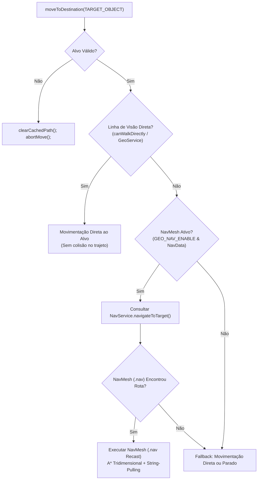

## Funcionamento de escolha de caminhos = NPC (Aion Classic 5.0)

### 1. Configuração de Pathfinding no `NpcMoveController`

Configuração da cadeia de navegação na perseguição de alvos (`Destination.TARGET_OBJECT`) e movimentação a ponto (`Destination.POINT`):

#### Detalhes de Implementação no `NpcMoveController`:
1. **NavMesh Recast `.nav` - Sistema Primário**:
   - Se `GeoDataConfig.GEO_NAV_ENABLE` estiver ativado e existir arquivo `.nav` para o mapa:
   - Chama `NavService.getInstance().navigateToTarget(owner, creature)` ou `navigateToLocation(owner, x, y, z)`.
   - Utiliza as malhas 3D trianguladas Recast (`data/nav/`) com suporte a múltiplos andares, rampas, escadas espirais e pontes estreitas.
   - Aplica algoritmo A* heurístico tridimensional com alisamento de rota (funnel pathway / string-pulling).
   - Utiliza controle de concorrência imutável via `AtomicReference<PathState>` com avanço atômico de waypoints.
2. **Clamping de Z e Retorno ao Spawn**:
   - `getNavSurfaceZ`: garante que criaturas não atravessem o relevo nem flutuem sobre pontes e desníveis.
   - `returnToLastStepOrSpawn`: navega de volta ao ponto de spawn utilizando o NavMesh `.nav` para contornar qualquer obstáculo.

---
