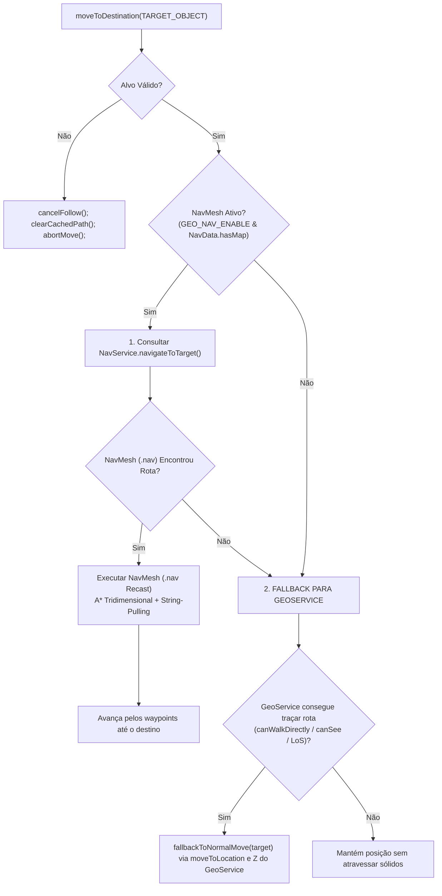

## Funcionamento de escolha de caminhos = NPC (Aion Classic 5.0)

### 1. Configuração de Pathfinding no `NpcMoveController`

Configuração da cadeia de 2 camadas na perseguição de alvos (`Destination.TARGET_OBJECT`) e movimentação a ponto (`Destination.POINT`):

#### Detalhes de Implementação no `NpcMoveController`:
1. **Camada 1 (NavMesh Recast `.nav` - Sistema Primário)**:
   - Se `GeoDataConfig.GEO_NAV_ENABLE` estiver ativado e existir arquivo `.nav` para o mapa:
   - Chama `NavService.getInstance().navigateToTarget(owner, creature)` ou `navigateToLocation(owner, x, y, z)`.
   - Utiliza as malhas 3D trianguladas Recast (`data/nav/`) com suporte a múltiplos andares, rampas, escadas espirais e pontes estreitas.
   - Aplica algoritmo A* heurístico tridimensional com alisamento de rota (funnel pathway / string-pulling).
   - O `GeoService` atua como auxiliar do `NavService` para detecção de portas dinâmicas fechadas e desníveis de relevo.
2. **Camada 2 (Fallback: GeoService / Line-of-Sight Geometry)**:
   - Se o mapa não possuir malha `.nav`, estiver desativado ou a rota NavMesh não for encontrada:
   - O fluxo desce diretamente para o `GeoService`.
   - Movimenta-se com `GeoService.getZ` e verificação de colisão física `canSee` / `canPass`.
3. **Eleanor Totalmente Desativado**:
   - Motores e threads da Eleanor foram desativados. Nenhuma classe utiliza mais `FollowMotor` ou `MovementProcessor`.

---
