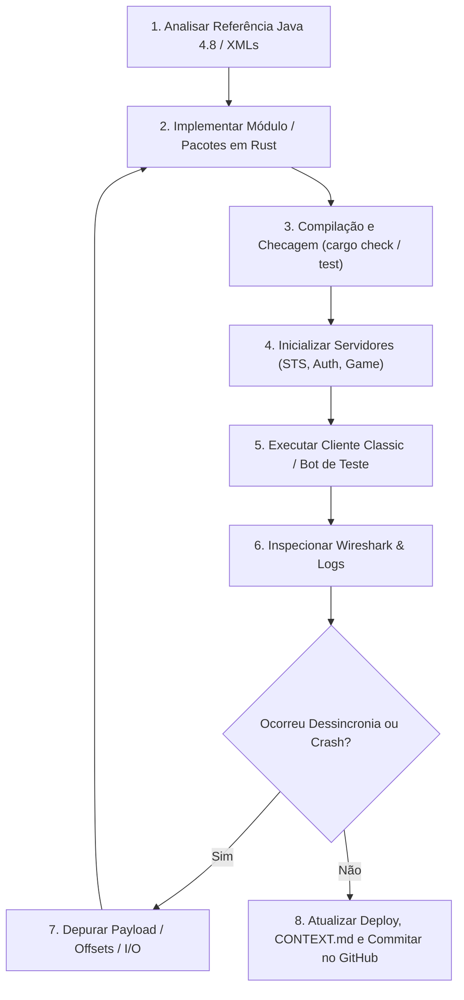

# ETAPA 00: VISÃO GERAL, ARQUITETURA E METODOLOGIA AUTÔNOMA

> **Status da Etapa**: Em Andamento  
> **Prioridade**: Crítica (Fundacional)  
> **Dependências**: Nenhuma

---

## 1. Propósito e Filosofia do Projeto

O objetivo principal deste projeto é a construção de um **Emulador de Servidor de Aion Classic 4.5** em **Rust** (`Emulador-Rust`), combinando:
1. **Performance Extrema & Concorrência Limpa**: Uso de I/O assíncrono moderno (`tokio`), canais de baixa latência (`crossbeam`) e manipulação de memória sem overhead de coleta de lixo.
2. **Confiabilidade & Anti-Crash**: Tratamento estruturado de pacotes (CM/SM) que impede que pacotes desconhecidos ou com tamanhos inconsistentes causem crash no cliente Aion Classic 4.5.
3. **Fidelidade de Mecânicas**: Utilização da arquitetura consagrada do **Emulador Java 4.8 Retail** (`JAVA EMU - 4.8 RETAIL`) como molde estrutural, adaptando para o protocolo e recursos modernos do Aion Classic 4.5.

---

## 2. Comparativo Estrutural: Java 4.8 Retail vs Aion Classic 4.5 Rust

| Aspecto | Java 4.8 Retail (Referência) | Aion Classic 4.5 Rust (Objetivo) |
| :--- | :--- | :--- |
| **Linguagem & Runtime** | Java 25 (JVM, Netty / Java NIO) | Rust (Nativo, `tokio`, `crossbeam`) |
| **Gerenciamento de Memória**| Garbage Collector com pausas periódicas | RAII, Zero-Cost Abstractions, Buffers pré-alocados |
| **Tratamento de Pacotes** | Classes `AionClientPacket` / `AionServerPacket` | Traits `AionClientPacket` / `AionServerPacket` com `nom`/`bytes` |
| **Protocolo de Login** | LoginServer tradicional NCSoft | Launcher Named Pipe $\rightarrow$ STS Server $\rightarrow$ Auth Server $\rightarrow$ GameServer |
| **Persistência** | DAO JDBC / HikariCP com MySQL | DAO Assíncrono com SQLite (`sqlx` / `rusqlite` / WAL mode) |
| **Sistemas Específicos** | Retail 4.8 (Beritra, Pangaea, etc.) | Classic 4.5 (Daeva Pass, Roupeiro/Wardrobe, Balanceamento Classic, Opcodes Estendidos) |

---

## 3. Diretório de Recursos e Ferramentas

| Ferramenta / Recurso | Caminho Absoluto | Como Utilizar |
| :--- | :--- | :--- |
| **Repositório GitHub** | `https://github.com/kamidaki/aion-classic-rust` | Repositório oficial do emulador para versionamento e controle de versão contínuo. |
| **Pasta de Deploy Limpa** | `D:\AION RUST\AionEMU\AionEMU\deploy` | Pasta de produção limpa com executáveis e inicializador de 1 clique (`INICIAR_SERVIDOR.bat`). |
| **Emulador Rust** | `D:\AION RUST\AionEMU\AionEMU\Emulador-Rust` | Código-fonte principal onde toda a implementação ocorre. |
| **Cliente Aion Classic** | `D:\AION RUST\AionEMU\AionEMU\Cliente\GFAion\aionclassic` | Executáveis do jogo (`bin64/AION.bin`, `aion.exe`) e arquivos `.pak`/XML para testes e extração. |
| **Emulador Java 4.8** | `D:\AION RUST\AionEMU\AionEMU\JAVA EMU - 4.8 RETAIL` | **Guia Mestre de Design**: Estrutura de pacotes, controllers, services e cálculos matemáticos. |
| **Wireshark** | `E:\Programas instalados - Leves\Wireshark` | Captura de tráfego de rede entre cliente oficial e servidor para validação de payloads. |
| **GeoBuilder** | `F:\Servidor Aion\SERVIDOR RETAIL 7.7\GeoBuilder` | Ferramenta para extrair GeoData, NavMesh e mapas de colisão a partir dos `.pak` do cliente. |
| **Valkyrie 2.8 Classic** | `F:\Servidor Aion\Aion 2.8 Classic Projeto VALKYRIE\Aion 2.8 Classic Projeto VALKYRIE\aionsdo-master` | Código Java auxiliar de versão Classic para conferência de especificidades. |

---

## 4. O Protocolo de Execução Autônoma do Agente

> [!IMPORTANT]
> O Agente de IA deve operar de forma proativa e autônoma, validando cada mudança no código através do seguinte loop contínuo de trabalho:

### Regras Mandatórias para o Agente:
1. **Nunca Deixar Pacotes sem Tratamento Resiliente**: Se o cliente enviar um opcode ainda não implementado, o servidor deve registrar o opcode em nível `WARN/DEBUG` e responder com confirmação padrão segura caso o opcode seja bloqueante, impedindo o travamento do cliente.
2. **Uso de `write_all` / Flush Correto**: Nunca usar chamadas parciais de socket que possam truncar pacotes grandes (como listas de NPCs ou inventários).
3. **Testes Contínuos**: Executar o launcher e o cliente para confirmar que a interface abre, o personagem é selecionado, entra no mapa e as ações são processadas sem desconexão.
4. **Atualização da Pasta de Deploy**: Ao validar novas funcionalidades, rodar `scripts\publicar_deploy.ps1` para sincronizar os executáveis na pasta `deploy/`.
5. **Versionamento Contínuo Obrigatório no GitHub**:
   - O agente NUNCA deve esquecer de versionar no GitHub após cada progresso ou correção bem-sucedida.
   - Realizar `git add .`, criar commit detalhado (`git commit -m "..."`) e enviar com `git push` para o repositório oficial [https://github.com/kamidaki/aion-classic-rust](https://github.com/kamidaki/aion-classic-rust), garantindo facilidade de rollback e rastreamento.

---

## 5. Sequenciamento Estrito do Plano de Desenvolvimento

O desenvolvimento DEVE seguir estritamente a sequência numerada abaixo:

- **[00_VISAO_GERAL_E_METODOLOGIA.md](file:///d:/AION%20RUST/AionEMU/AionEMU/Docs-Refs/PLANO-DESENVOLVIMENTO/00_VISAO_GERAL_E_METODOLOGIA.md)**: Fundamentos e Metodologia.
- **[01_INFRAESTRUTURA_REDE_SEGURANCA_PROTOCOLOS.md](file:///d:/AION%20RUST/AionEMU/AionEMU/Docs-Refs/PLANO-DESENVOLVIMENTO/01_INFRAESTRUTURA_REDE_SEGURANCA_PROTOCOLOS.md)**: Pipeline de Rede e Encriptação.
- **[02_AUTENTICACAO_STS_LOGIN_PERSONAGEM.md](file:///d:/AION%20RUST/AionEMU/AionEMU/Docs-Refs/PLANO-DESENVOLVIMENTO/02_AUTENTICACAO_STS_LOGIN_PERSONAGEM.md)**: Autenticação, Criação e Persistência de Personagens.
- **[03_MOTOR_MUNDO_SPATIAL_ENTIDADES.md](file:///d:/AION%20RUST/AionEMU/AionEMU/Docs-Refs/PLANO-DESENVOLVIMENTO/03_MOTOR_MUNDO_SPATIAL_ENTIDADES.md)**: Grid Espacial, KnownList e Entidades.
- **[04_SISTEMA_MOVIMENTACAO_FISICA_GEOENGINE.md](file:///d:/AION%20RUST/AionEMU/AionEMU/Docs-Refs/PLANO-DESENVOLVIMENTO/04_SISTEMA_MOVIMENTACAO_FISICA_GEOENGINE.md)**: Movimentação, Voo, Gliding e GeoEngine.
- **[05_STATUS_ATRIBUTOS_SISTEMA_VIDA.md](file:///d:/AION%20RUST/AionEMU/AionEMU/Docs-Refs/PLANO-DESENVOLVIMENTO/05_STATUS_ATRIBUTOS_SISTEMA_VIDA.md)**: Atributos, Modificadores e Regeneração.
- **[06_ITENS_INVENTARIO_EQUIPAMENTOS_ECONOMIA.md](file:///d:/AION%20RUST/AionEMU/AionEMU/Docs-Refs/PLANO-DESENVOLVIMENTO/06_ITENS_INVENTARIO_EQUIPAMENTOS_ECONOMIA.md)**: Itens, Cube, Warehouse, Trade e Economia.
- **[07_SISTEMA_DE_COMBATE_E_HABILIDADES_SKILLENGINE.md](file:///d:/AION%20RUST/AionEMU/AionEMU/Docs-Refs/PLANO-DESENVOLVIMENTO/07_SISTEMA_DE_COMBATE_E_HABILIDADES_SKILLENGINE.md)**: SkillEngine, Combate e EffectEngine.
- **[08_IA_DE_NPCS_MONSTROS_E_SPAWNENGINE.md](file:///d:/AION%20RUST/AionEMU/AionEMU/Docs-Refs/PLANO-DESENVOLVIMENTO/08_IA_DE_NPCS_MONSTROS_E_SPAWNENGINE.md)**: SpawnEngine, IA de Monstros, Aggro e Drops.
- **[09_DIALOGOS_MISSOES_QUESTENGINE.md](file:///d:/AION%20RUST/AionEMU/AionEMU/Docs-Refs/PLANO-DESENVOLVIMENTO/09_DIALOGOS_MISSOES_QUESTENGINE.md)**: Diálogos HTML e QuestEngine completo.
- **[10_SISTEMAS_SOCIAIS_GUILDAS_ABYSS_PVP.md](file:///d:/AION%20RUST/AionEMU/AionEMU/Docs-Refs/PLANO-DESENVOLVIMENTO/10_SISTEMAS_SOCIAIS_GUILDAS_ABYSS_PVP.md)**: Chat, Grupos, Legiões, Abyss e PvP.
- **[11_INSTANCIAS_MASMORRAS_E_EVENTOS.md](file:///d:/AION%20RUST/AionEMU/AionEMU/Docs-Refs/PLANO-DESENVOLVIMENTO/11_INSTANCIAS_MASMORRAS_E_EVENTOS.md)**: Instâncias dinâmicas e Masmorras PvE.
- **[12_COLETA_ARTESANATO_E_CRAFTING.md](file:///d:/AION%20RUST/AionEMU/AionEMU/Docs-Refs/PLANO-DESENVOLVIMENTO/12_COLETA_ARTESANATO_E_CRAFTING.md)**: Coleta, Extração de Éter e 7 Profissões de Artesanato.
- **[13_PETS_MINIONS_SUMMONS_E_TRAPS.md](file:///d:/AION%20RUST/AionEMU/AionEMU/Docs-Refs/PLANO-DESENVOLVIMENTO/13_PETS_MINIONS_SUMMONS_E_TRAPS.md)**: Mascotes funcionais, Espíritos de Invocador e Armadilhas.
- **[14_HABITACOES_HOUSING_E_DECORACAO.md](file:///d:/AION%20RUST/AionEMU/AionEMU/Docs-Refs/PLANO-DESENVOLVIMENTO/14_HABITACOES_HOUSING_E_DECORACAO.md)**: Estúdios, Casas, Leilões e Decoração.
- **[15_OBJETOS_INTERATIVOS_CLIMA_E_AMBIENTE.md](file:///d:/AION%20RUST/AionEMU/AionEMU/Docs-Refs/PLANO-DESENVOLVIMENTO/15_OBJETOS_INTERATIVOS_CLIMA_E_AMBIENTE.md)**: Kisks, Portas Estáticas, Vento (Windstreams) e Clima.
- **[16_SERVICOS_WEB_LOJA_INGAME_E_PASSE_BATALHA.md](file:///d:/AION%20RUST/AionEMU/AionEMU/Docs-Refs/PLANO-DESENVOLVIMENTO/16_SERVICOS_WEB_LOJA_INGAME_E_PASSE_BATALHA.md)**: Loja Web, Daeva Pass, Roupeiro (Wardrobe) e Presença.
- **[17_AGENDAMENTOS_CRON_EVENTOS_E_SIEGE_GUERRA.md](file:///d:/AION%20RUST/AionEMU/AionEMU/Docs-Refs/PLANO-DESENVOLVIMENTO/17_AGENDAMENTOS_CRON_EVENTOS_E_SIEGE_GUERRA.md)**: Cron, Sieges de Fortalezas, Bases e Chefes Mundiais.
- **[18_ARENAS_CAMPOS_BATALHA_E_AUTOGROUP.md](file:///d:/AION%20RUST/AionEMU/AionEMU/Docs-Refs/PLANO-DESENVOLVIMENTO/18_ARENAS_CAMPOS_BATALHA_E_AUTOGROUP.md)**: Matchmaking, Arenas PvP (1v1, FFA, Glory) e Dreadgion.
- **[19_SISTEMAS_ADMIN_ANTIHACK_E_MONITORAMENTO.md](file:///d:/AION%20RUST/AionEMU/AionEMU/Docs-Refs/PLANO-DESENVOLVIMENTO/19_SISTEMAS_ADMIN_ANTIHACK_E_MONITORAMENTO.md)**: GM Toolkit, Punições, Anti-Hack e Métricas.
- **[20_MAPEAMENTO_COMPLETO_PACOTES_CM_SM_4_5.md](file:///d:/AION%20RUST/AionEMU/AionEMU/Docs-Refs/PLANO-DESENVOLVIMENTO/20_MAPEAMENTO_COMPLETO_PACOTES_CM_SM_4_5.md)**: Dicionário exaustivo de todos os pacotes CM (189+) e SM (239+).
- **[21_VALIDACAO_AUTONOMA_TESTES_E_DEPLOY.md](file:///d:/AION%20RUST/AionEMU/AionEMU/Docs-Refs/PLANO-DESENVOLVIMENTO/21_VALIDACAO_AUTONOMA_TESTES_E_DEPLOY.md)**: Protocolo de Testes Automatizados e Deploy de Produção.

