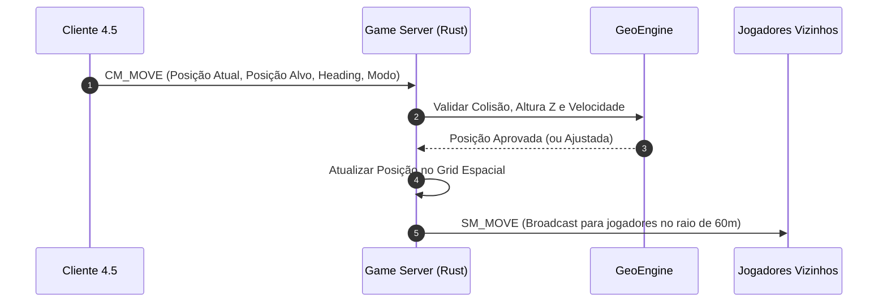

# ETAPA 04: SISTEMA DE MOVIMENTAÇÃO, FÍSICA E GEOENGINE

> **Status da Etapa**: Concluída  
> **Prioridade**: Alta (Jogabilidade & Integridade Física)  
> **Dependências**: [03_MOTOR_MUNDO_SPATIAL_ENTIDADES.md](file:///d:/AION%20RUST/AionEMU/AionEMU/Docs-Refs/PLANO-DESENVOLVIMENTO/03_MOTOR_MUNDO_SPATIAL_ENTIDADES.md)  
> **Referência Principal em Java**: `com.aionemu.gameserver.network.aion.clientpackets.CM_MOVE`, `com.aionemu.gameserver.controllers.movement`, `com.aionemu.gameserver.geoEngine`  
> **Ferramenta Auxiliar**: `GeoBuilder` em `F:\Servidor Aion\SERVIDOR RETAIL 7.7\GeoBuilder`

---

## 1. Protocolo de Movimentação no Aion Classic 4.5

A movimentação de jogadores e entidades é enviada continuamente pelo cliente para sincronização do mundo e validação de rota.



---

## 2. Estrutura dos Pacotes de Movimento

### 2.1 Pacote `CM_MOVE` (`C_MOVE_NEW` - Opcode 48)
- `x, y, z` (`f32`): Posição atual de origem.
- `heading` (`u8`): Direção angular do personagem ($0 \text{ a } 255$, onde $256 = 360^\circ$).
- `target_x, target_y, target_z` (`f32`): Posição final de destino.
- `movement_type` (`u8`): Máscara de flags de locomoção:
  - `0x00`: Parado / Em repouso.
  - `0x01`: Andando / Correndo no solo.
  - `0x02`: Pulando / Caindo livre.
  - `0x04`: Planando (Gliding com asas abertas).
  - `0x08`: Voando (Voo ativo com controle tridimensional de altitude).
  - `0x10`: Windstream (Rota de fluxo de vento de alta velocidade).

### 2.2 Pacote `SM_MOVE` (`S_MOVE_NEW` - Opcode 55)
- Envia o ID da entidade em movimento + as mesmas coordenadas de origem/destino e máscara de flags para os jogadores no `KnownList`.

### 2.3 Correção Forçada de Posição (`SM_POSITION_SELF` / `S_BLINK` - Opcode 21)
- Utilizado para rubberbanding / desync rollback quando o jogador tenta atravessar paredes ou mover-se em velocidade ilegal.

---

## 3. Integração com a GeoEngine e Colisão 3D

A integridade do jogo depende da validação de terreno, Line of Sight (Linha de Visão) e colisão contra obstáculos.

```
       [Jogador] ---------------- LoS (Raycast) --------------> [Monstro]
           \                                                       /
            \----> [Colisor / Parede de Pedra] (Interrompe LoS) --/
```

### 3.1 Extração de GeoData via `GeoBuilder`
- O `GeoBuilder` localizado em `F:\Servidor Aion\SERVIDOR RETAIL 7.7\GeoBuilder` processa os arquivos de mapas e malhas 3D do cliente e gera arquivos binários otimizados de colisão (`.geo`).
- Mapas com suporte a voo 3D (ex: Reshanta / Abyss) possuem malhas completas volumétricas (Octrees). Mapas terrestres possuem malha triangular de relevo e bounding boxes de estruturas.

### 3.2 Funções Essenciais da GeoEngine em Rust:
```rust
pub trait GeoService: Send + Sync {
    /// Retorna a altura real do solo (Z) nas coordenadas X, Y do mapa
    fn get_z(&self, world_id: u32, x: f32, y: f32) -> f32;
    
    /// Verifica se há linha de visão direta desobstruída entre duas entidades (Raycasting)
    fn can_see(&self, world_id: u32, from: Vector3<f32>, to: Vector3<f32>) -> bool;
    
    /// Valida se uma posição está dentro de uma zona de voo autorizada
    fn is_fly_zone(&self, world_id: u32, pos: Vector3<f32>) -> bool;
    
    /// Calcula o caminho de waypoints para NPCs contornando obstáculos (A* / NavMesh)
    fn find_path(&self, world_id: u32, start: Vector3<f32>, end: Vector3<f32>) -> Vec<Vector3<f32>>;
}
```

---

## 4. Sistema de Queda, Voo e Anti-Cheat

1. **Dano de Queda**:
   - Calcular velocidade vertical de queda e distância percorrida sem planar. Se $\Delta Z > 15\text{ metros}$, aplicar dano percentual de HP ao atingir o solo; se $\Delta Z > 40\text{ metros}$, aplicar morte por impacto.
2. **Dreno de Flight Points (FP)**:
   - Em modo de voo (`0x08`) ou gliding (`0x04`), consumir $1\text{ FP por segundo}$ (ajustável por atributos). Ao zerar o FP, fechar as asas e forçar queda livre.
3. **Anti-Speedhack**:
   - Calcular distância euclidiana percorrida entre dois pacotes $D = \sqrt{\Delta X^2 + \Delta Y^2 + \Delta Z^2}$.
   - Se $\frac{D}{\Delta t} > \text{VelocidadeMax} \times 1.2$, descartar movimento e emitir `SM_POSITION_SELF`.

---

## 5. Validação Autônoma da Etapa 04

### Roteiro de Testes:
1. **Teste de Caminhada e Corrida**:
   - Mover o personagem em Pandaemonium e Poeta; conferir suavidade de movimento no cliente e logs de coordenadas do servidor.
2. **Teste de Voo e Planagem (Gliding)**:
   - Pular de um penhasco, abrir as asas (Barra de Espaço) e validar a ativação do modo gliding, desaceleração vertical e dreno de FP.
3. **Teste de Validação de Altura Z**:
   - Caminhar por rampas e escadas de Pandaemonium e confirmar que o personagem acompanha o declive do solo sem afundar na textura ou flutuar.
