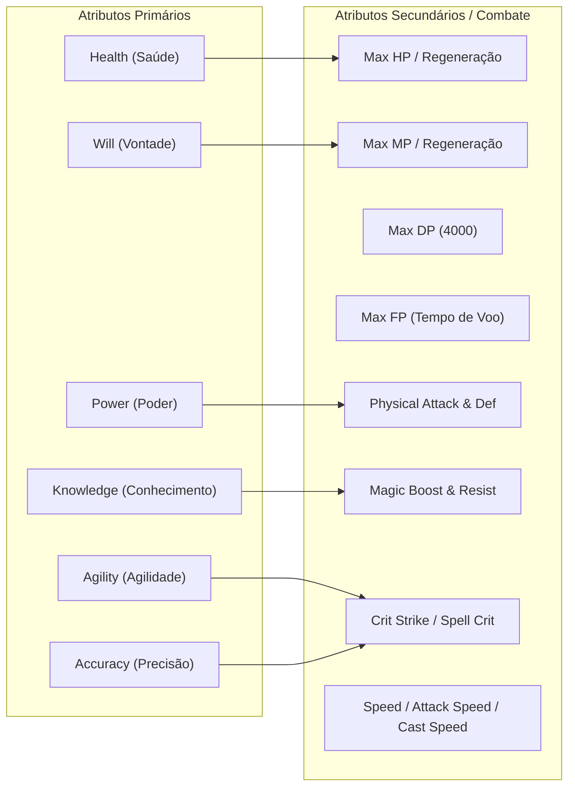

# ETAPA 05: MOTOR DE ATRIBUTOS, STATUS E SISTEMA DE VIDA (LIFESTATS)

> **Status da Etapa**: Concluída  
> **Prioridade**: Alta (Fundação de Progressão e Combate)  
> **Dependências**: [03_MOTOR_MUNDO_SPATIAL_ENTIDADES.md](file:///d:/AION%20RUST/AionEMU/AionEMU/Docs-Refs/PLANO-DESENVOLVIMENTO/03_MOTOR_MUNDO_SPATIAL_ENTIDADES.md)  
> **Referência Principal em Java**: `com.aionemu.gameserver.model.stats`, `com.aionemu.gameserver.services.LifeStatsRestoreService`, `com.aionemu.gameserver.network.aion.serverpackets.SM_STATS_INFO`

---

## 1. Arquitetura do Modelo de Atributos do Aion

O Aion possui uma estrutura de atributos rica com interdependências entre atributos primários, secundários e modificadores dinâmicos.

---

## 2. Motor de Modificadores Dinâmicos (`StatEngine`)

Em Rust, o cálculo de cada atributo é determinístico e composto por camadas de modificadores:

$$\text{ValorFinal} = \left( \text{ValorBase} + \sum \text{BonusAditivo} \right) \times \left( 1 + \sum \text{BonusPercentual} \right)$$

### 2.1 Fontes de Modificadores:
1. **Base da Classe & Nível**: Carregados a partir de `client_stats.xml` e templates de jogador.
2. **Equipamentos**: Armas, armaduras, acessórios, asas e pedras incrustadas (Manastones/Godstones).
3. **Passivas & Stigmas**: Bônus passivos adquiridos por nível ou slots de stigma equipados.
4. **Efeitos Temporários (Buffs/Debuffs)**: Pergaminhos de velocidade, comida, feitiços de suporte (ex: *Blessing of Stone*, *Word of Wind*).
5. **Títulos**: Bônus ativos do título selecionado pelo jogador (`TitleService`).

---

## 3. Sistema de Vida e Regeneração (`LifeStats`)

### 3.1 Tabela de Pontos Vitais:
- **HP (Health Points)**: Vida do personagem. Ao atingir 0, aciona o estado de morte e o pacote `CM_REVIVE`.
- **MP (Mana Points)**: Energia para execução de magias e habilidades.
- **DP (Divine Points)**: Acumulado de $0 \text{ a } 4.000$. Ganho ao derrotar monstros ou causar dano; usado para habilidades supremas de DP. Zerado ao deslogar ou morrer.
- **FP (Flight Points)**: Medido em segundos (ex: 60s a 180s). Drenado durante voo/gliding e regenerado no solo.

### 3.2 Tique de Regeneração Contínua:
- O servidor roda um timer periódico (ex: a cada 6 segundos, ou 3 segundos para regeneração rápida):
  - **Em Pé / Normal**: Regenera $(\text{HP Regen Base} + \text{Bonus})$ por tique.
  - **Sentado / Descansando** (`CM_EMOTION` estado Sentado): Regenera $3\times$ mais rápido.
  - **Em Combate**: A regeneração natural é suspensa ou reduzida em 80%.

---

## 4. Pacotes de Sincronização de Status com o Cliente

| Opcode Classic 4.5 | Pacote | Função e Payload |
| :---: | :--- | :--- |
| `0x01` (1) | `SM_STATS_INFO` (`S_STATUS`) | **Payload Completo**: Envia todos os atributos, defesas, velocidades, ataques principais e secundários, resistências e status de DP/FP. |
| `0x03` (3) | `SM_STATUPDATE_HP` (`S_HIT_POINT`) | Atualização rápida do HP atual e máximo do jogador local. |
| `0x04` (4) | `SM_STATUPDATE_MP` (`S_MANA_POINT`) | Atualização rápida do MP atual e máximo do jogador local. |
| `0x05` (5) | `SM_ATTACK_STATUS` (`S_HIT_POINT_OTHER`) | Notificação visual de alteração de HP para jogadores e monstros ao redor (para a barra de vida sobre a cabeça). |
| `0x06` (6) | `SM_STATUPDATE_DP` (`S_DP`) | Atualização do DP atual e DP máximo. |
| `0x08` (8) | `SM_STATUPDATE_EXP` (`S_EXP`) | Atualização de XP ganho, XP para o próximo nível e taxa de descanso (Energy of Repose). |

---

## 5. Validação Autônoma da Etapa 05

### Roteiro de Testes:
1. **Inspeção de UI no Cliente**:
   - Abrir a janela de perfil do personagem (`P`) no cliente Classic 4.5.
   - Confirmar se todos os valores (HP, MP, DP, Ataque, Defesa, Crítico, Velocidade de Ataque) aparecem preenchidos e corretos para a classe e nível atual, sem campos zerados ou com valores corrompidos.
2. **Teste de Regeneração**:
   - Reduzir o HP do personagem via comando GM ou teste.
   - Sentar o personagem (`X` ou botão de descanso) e validar se o HP e MP sobem a cada tique até 100%.
3. **Teste de Dreno de FP**:
   - Levantar voo com asas e verificar se a barra circular de FP decresce de forma fluida até o fechamento automático.
