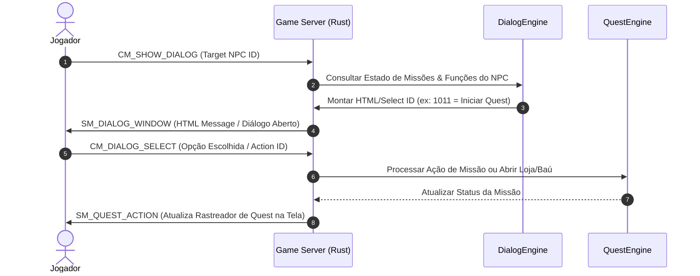
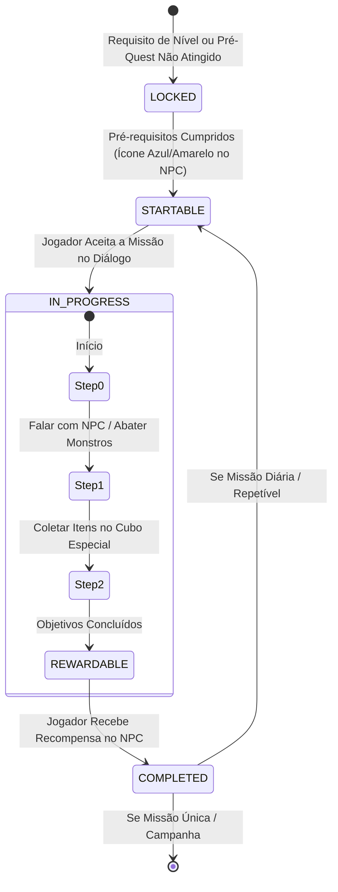

# ETAPA 09: DIÁLOGOS DE NPCS, MISSÕES E QUESTENGINE

> **Status da Etapa**: Concluída  
> **Prioridade**: Alta (Narrativa e Progressão do Jogador)  
> **Dependências**: [03_MOTOR_MUNDO_SPATIAL_ENTIDADES.md](file:///d:/AION%20RUST/AionEMU/AionEMU/Docs-Refs/PLANO-DESENVOLVIMENTO/03_MOTOR_MUNDO_SPATIAL_ENTIDADES.md), [06_ITENS_INVENTARIO_EQUIPAMENTOS_ECONOMIA.md](file:///d:/AION%20RUST/AionEMU/AionEMU/Docs-Refs/PLANO-DESENVOLVIMENTO/06_ITENS_INVENTARIO_EQUIPAMENTOS_ECONOMIA.md), [08_IA_DE_NPCS_MONSTROS_E_SPAWNENGINE.md](file:///d:/AION%20RUST/AionEMU/AionEMU/Docs-Refs/PLANO-DESENVOLVIMENTO/08_IA_DE_NPCS_MONSTROS_E_SPAWNENGINE.md)  
> **Referência Principal em Java**: `com.aionemu.gameserver.questEngine`, `com.aionemu.gameserver.services.DialogService`, `com.aionemu.gameserver.services.QuestService`

---

## 1. Arquitetura do Sistema de Diálogos HTML

Os NPCs do Aion comunicam-se através de páginas de diálogo embutidas no cliente com identificadores de página (*Page IDs / Select IDs*).



---

## 2. Estrutura e Ciclo de Vida de Missões (Quest Lifecycle)



---

## 3. Categorias de Missões no Aion Classic 4.5

1. **Missões de Campanha (*Campaigns*)**:
   - Missões douradas de história regional obrigatórias.
   - Concedem títulos especiais, expansão de estigma, asas e a transformação de humano em Daeva (Nível 9 $\rightarrow$ 10).
2. **Missões Comuns (*Standard Quests*)**:
   - Missões secundárias de NPCs para auxílio de leveling, kinah e itens.
3. **Ordens de Serviço (*Work Orders / Craft Quests*)**:
   - Missões de fabricação de artesanato (Alquimia, Culinária, Armaduras, Armas, Alfaiataria, etc.) que fornecem materiais e receitas.
4. **Missões Diárias & Semanais**:
   - Missões vinculadas a organizações faccionais (ex: Silver Mane, Black Cloud Traders) com moedas de recompensa.

---

## 4. Gatilhos de Eventos do QuestEngine em Rust

O motor de missões deve escutar eventos do servidor via padrão Observer / Event Dispatcher:

```rust
pub trait QuestHandler: Send + Sync {
    /// Disparado ao interagir com NPC
    fn on_dialog(&self, env: &QuestEnv) -> bool;
    
    /// Disparado ao abater monstro com ID específico
    fn on_kill(&self, env: &QuestEnv) -> bool;
    
    /// Disparado ao coletar item de recurso ou interagir com objeto
    fn on_item_use(&self, env: &QuestEnv) -> bool;
    
    /// Disparado ao entrar em coordenadas/zonas de gatilho
    fn on_zone_enter(&self, env: &QuestEnv) -> bool;
    
    /// Disparado ao concluir a exibição de uma cutscene no cliente
    fn on_movie_end(&self, env: &QuestEnv) -> bool;
}
```

---

## 5. Mapeamento de Pacotes de Missões e Persistência

### 5.1 Pacotes do Protocolo:
| Opcode Classic 4.5 | Pacote | Finalidade |
| :---: | :--- | :--- |
| `0x34` (52) | `CM_SHOW_DIALOG` | Jogador clica no NPC para abrir diálogo. |
| `0x35` (53) | `CM_CLOSE_DIALOG` | Jogador fecha a janela de diálogo. |
| `0x36` (54) | `CM_DIALOG_SELECT` (`C_HACTION`) | Jogador clica em uma resposta de diálogo ou botão de recompensa. |
| `0x3C` (60) | `SM_DIALOG_WINDOW` (`S_NPC_HTML_MESSAGE`) | Envia a página de diálogo HTML e botões disponíveis. |
| `0x47` (71) | `SM_QUEST_LIST` (`S_LOAD_WORKINGQUEST`) | Lista de missões ativas e concluídas enviada no login. |

### 5.2 Tabela de Persistência (`player_quests` no SQLite):
```sql
CREATE TABLE IF NOT EXISTS player_quests (
    player_id INTEGER NOT NULL,
    quest_id INTEGER NOT NULL,
    status TEXT NOT NULL,          -- 'LOCKED', 'STARTABLE', 'IN_PROGRESS', 'REWARDABLE', 'COMPLETED'
    quest_vars INTEGER DEFAULT 0,  -- Máscara de passos e contadores de abates
    complete_count INTEGER DEFAULT 0,
    next_repeat_time TIMESTAMP,
    PRIMARY KEY(player_id, quest_id),
    FOREIGN KEY(player_id) REFERENCES characters(id) ON DELETE CASCADE
);
```

---

## 6. Validação Autônoma da Etapa 09

### Roteiro de Testes:
1. **Teste da Primeira Campanha Inicial**:
   - Criar um personagem nível 1 em Poeta ou Ishalgen.
   - Clicar no NPC inicial de campanha; validar abertura correta do diálogo HTML.
   - Aceitar a missão e verificar se o rastreador de missões na tela lateral direita (`HUD`) atualiza com o objetivo.
2. **Teste de Abate e Contagem de Monstros**:
   - Abater os monstros requisitados pela missão; verificar se a cada abate uma mensagem na tela exibe o progresso (ex: `1/3`, `2/3`, `3/3`).
3. **Teste de Entrega e Recompensa**:
   - Retornar ao NPC; selecionar a opção de conclusão; conferir recebimento de XP, Kinah e item de recompensa no inventário.
