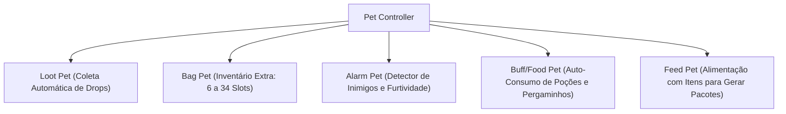

# ETAPA 13: MASCOTES (PETS), MINIONS, INVOCAÇÕES (SUMMONS) E ARMADILHAS

> **Status da Etapa**: Concluída  
> **Prioridade**: Média-Alta (Suporte a Classes e Utilidades)  
> **Dependências**: [03_MOTOR_MUNDO_SPATIAL_ENTIDADES.md](file:///d:/AION%20RUST/AionEMU/AionEMU/Docs-Refs/PLANO-DESENVOLVIMENTO/03_MOTOR_MUNDO_SPATIAL_ENTIDADES.md), [07_SISTEMA_DE_COMBATE_E_HABILIDADES_SKILLENGINE.md](file:///d:/AION%20RUST/AionEMU/AionEMU/Docs-Refs/PLANO-DESENVOLVIMENTO/07_SISTEMA_DE_COMBATE_E_HABILIDADES_SKILLENGINE.md)  
> **Referência Principal em Java**: `com.aionemu.gameserver.services.toypet`, `com.aionemu.gameserver.services.summons`, `com.aionemu.gameserver.model.gameobjects.Summon`, `com.aionemu.gameserver.model.gameobjects.Pet`, `com.aionemu.gameserver.model.gameobjects.Trap`

---

## 1. Sistema de Mascotes Funcionais (ToyPet Engine)

Os mascotes no Aion fornecem utilidades vitais através de bolsas extras, auto-saque e alarmes de perigo.

### 1.1 Ciclo de Alimentação e Humor (`PetMoodService` & `PetFeedProgress`):
- O jogador alimenta o mascote com materiais ou itens descartáveis.
- A cada refeição, o nível de saciedade sobe até gerar uma recompensa (Moedas, Asas cosméticas, Tinturas, Pedras de Encantamento).
- O mascote possui estados de humor (*Joyful, Playful, Hungry*) acionados por carinho e interação (`CM_PET_EMOTE`).

---

## 2. Invocação de Elementais e Espíritos (Spiritmaster Summons)

O Invocador (*Spiritmaster*) depende diretamente de entidades invocadas com IA dedicada:

| Elemental | Tipo de Dano | Papel em Combate |
| :--- | :--- | :--- |
| **Fire Spirit** | Fogo / Corpo a Corpo | Alto dano físico e ataque em fúria. |
| **Earth Spirit** | Terra / Defensivo | Alto HP e Defesa Física (Tanque / Provocação). |
| **Water Spirit** | Água / Longo Alcance | Dano mágico à distância e redução de resistências. |
| **Wind Spirit** | Vento / Alta Velocidade | Alta taxa de acerto crítico e velocidade de ataque. |
| **Magma / Tempest** | Supremos de DP | Espíritos gigantes com habilidades devastadoras de área. |

### 2.1 Painel de Controle de Comandos de Invocação:
- **Atacar (*Attack Order*)**: O espírito foca o alvo selecionado pelo mestre.
- **Seguir (*Follow*)**: O espírito cessa ataques e acompanha o mestre.
- **Manter Posição (*Stay*)**: O espírito permanece imóvel guardando uma coordenada.
- **Desinvocar (*Release*)**: Despawn limpo do espírito.

---

## 3. Sistema de Armadilhas (Traps) e Servos Estáticos

- **Armadilhas de Ranger e Assassin (`TrapService`)**:
  - Entidades invisíveis posicionadas no solo (Spike Trap, Poison Trap, Sleep Trap, Snare Trap, Explosion Trap).
  - Possuem raio de detecção de proximidade ($2\text{ a }3\text{ metros}$). Ao detectar um inimigo, detonam imediatamente aplicando dano e efeitos de controle (*CC*).
- **Servos e Cristais Mágicos (Servants / Homings de Cleric/Sorcerer)**:
  - Entidades estáticas que disparam projéteis automáticos ou curas periódicas.

---

## 4. Mapeamento de Pacotes de Pets e Invocação

| Opcode Classic 4.5 | Pacote | Função |
| :---: | :--- | :--- |
| `0x15` (21) | `CM_PET_EMOTE` | Interação de carinho, comando ou animação do mascote. |
| `0x16` (22) | `CM_PET` | Spawn, despawn, renomeação ou abertura de bolsa de pet. |
| `0x49` (73) | `SM_SUMMON_PANEL_REMOVE` | Fecha a barra de comandos de invocação. |
| `0x80` | `SM_PET` (`S_FUNCTIONAL_PET`) | Broadcast do spawn de mascote ao lado do jogador. |

---

## 5. Validação Autônoma da Etapa 13

### Roteiro de Testes:
1. **Teste de Spawn e Bolsa de Pet**:
   - Invocar mascote de inventário (ex: *Shugo Bag Pet*); abrir a janela da mochila extra; guardar e retirar itens.
2. **Teste de Invocação de Espírito (Spiritmaster)**:
   - Conjurar *Summon Fire Spirit*; dar comando de ataque contra monstro; verificar se o espírito corre, executa golpes e obedece ao comando de retorno.
3. **Teste de Armadilha (Trap)**:
   - Posicionar uma armadilha no chão; atrair um monstro para cima da coordenada; validar detonação imediata e aplicação do debuff de dano/lentidão.
