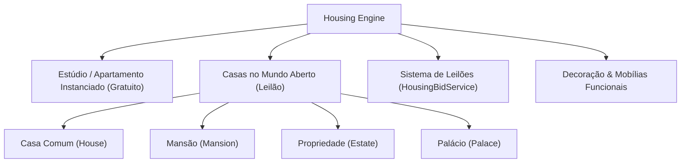

# ETAPA 14: SISTEMA DE HABITAÇÃO (HOUSING), LEILÕES E DECORAÇÃO

> **Status da Etapa**: Concluída  
> **Prioridade**: Média (Personalização e Conforto)  
> **Dependências**: [03_MOTOR_MUNDO_SPATIAL_ENTIDADES.md](file:///d:/AION%20RUST/AionEMU/AionEMU/Docs-Refs/PLANO-DESENVOLVIMENTO/03_MOTOR_MUNDO_SPATIAL_ENTIDADES.md), [06_ITENS_INVENTARIO_EQUIPAMENTOS_ECONOMIA.md](file:///d:/AION%20RUST/AionEMU/AionEMU/Docs-Refs/PLANO-DESENVOLVIMENTO/06_ITENS_INVENTARIO_EQUIPAMENTOS_ECONOMIA.md)  
> **Referência Principal em Java**: `com.aionemu.gameserver.services.HousingService`, `com.aionemu.gameserver.services.HousingBidService`, `com.aionemu.gameserver.model.house`, `com.aionemu.gameserver.network.aion.serverpackets.SM_HOUSE_UPDATE`

---

## 1. Arquitetura do Sistema de Habitação (Housing)

O Aion oferece moradias completas em zonas residenciais dedicadas (*Elian* para Elyos e *Pernon* para Asmodians).

---

## 2. Leilões e Manutenção de Casas (`HousingBidService`)

1. **Ciclos Semanais de Leilão**:
   - Casas desocupadas entram em leilão toda semana.
   - Jogadores dão lances em Kinah. O maior lance ao final do cronômetro arremata a propriedade.
2. **Taxa Semanal de Manutenção (Aluguel)**:
   - Toda semana é cobrada uma taxa fixa em Kinah.
   - Caso o jogador fique inadimplente por 2 semanas consecutivas, o servidor desapropria o imóvel e o coloca novamente em leilão.

---

## 3. Mobílias e Decorações Funcionais

As mobílias não são apenas cosméticas; elas possuem lógicas de jogo ativas:

| Mobília Funcional | Efeito e Lógica de Negócio |
| :--- | :--- |
| **Baú de Gavetas (*Storage Drawers*)** | Expande o armazém do jogador com 1 a 4 gavetas de inventário adicional. |
| **Jukebox Musical** | Executa trilhas sonoras selecionadas dentro da casa para os visitantes. |
| **Cama de Repouso** | Acelera o ganho de *Energy of Repose* (bônus de XP) enquanto o jogador descansa. |
| **Mordomo / Empregada (Butler)** | NPC residencial para troca de mobílias, venda de utilidades e recepção. |
| **Livro de Visitas (*Guestbook*)** | Permite que outros jogadores deixem mensagens e curtidas na casa. |

---

## 4. Mapeamento de Pacotes de Habitação

| Opcode Classic 4.5 | Pacote | Finalidade |
| :---: | :--- | :--- |
| `0x1E` (30) | `CM_HOUSE_SCRIPT` | Salva scripts de interação e regras de permissão de portas. |
| `0x3D` (61) | `SM_HOUSE_UPDATE` (`S_PUT_BUILDINGS`) | Renderiza a fachada da casa, telhados, cercas e jardins no mapa. |
| `0x48` (72) | `SM_KEY` / `SM_HOUSE_EDIT` | Abre modo de edição/posicionamento de mobílias interiores. |
| `0x48` (72) | `CM_HOUSE_KICK` | Expulsa visitantes indesejados da residência. |

---

## 5. Validação Autônoma da Etapa 14

### Roteiro de Testes:
1. **Teste de Entrada no Estúdio**:
   - Usar a pedra de teletransporte para o Estúdio residencial em Elian/Pernon; validar carregamento do mapa e spawn no interior do apartamento.
2. **Teste de Posicionamento de Mobília**:
   - Abrir o menu de decoração (`H`); selecionar um sofá e posicionar no piso; confirmar que o objeto persiste após relogar.
3. **Teste de Jukebox**:
   - Interagir com a Jukebox; selecionar uma faixa musical; validar início da reprodução sonora.
