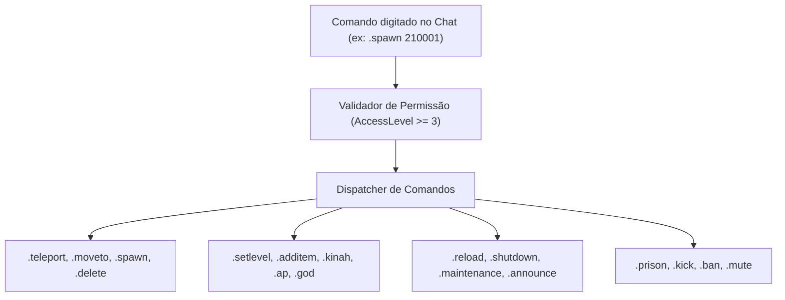

# ETAPA 19: SISTEMAS DE ADMINISTRAÇÃO (GM), ANTI-HACK E MONITORAMENTO

> **Status da Etapa**: Concluída  
> **Prioridade**: Alta (Segurança, Gestão e Estabilidade)  
> **Dependências**: [01_INFRAESTRUTURA_REDE_SEGURANCA_PROTOCOLOS.md](file:///d:/AION%20RUST/AionEMU/AionEMU/Docs-Refs/PLANO-DESENVOLVIMENTO/01_INFRAESTRUTURA_REDE_SEGURANCA_PROTOCOLOS.md), [04_SISTEMA_MOVIMENTACAO_FISICA_GEOENGINE.md](file:///d:/AION%20RUST/AionEMU/AionEMU/Docs-Refs/PLANO-DESENVOLVIMENTO/04_SISTEMA_MOVIMENTACAO_FISICA_GEOENGINE.md), [07_SISTEMA_DE_COMBATE_E_HABILIDADES_SKILLENGINE.md](file:///d:/AION%20RUST/AionEMU/AionEMU/Docs-Refs/PLANO-DESENVOLVIMENTO/07_SISTEMA_DE_COMBATE_E_HABILIDADES_SKILLENGINE.md)  
> **Referência Principal em Java**: `com.aionemu.gameserver.services.AdminService`, `com.aionemu.gameserver.services.PunishmentService`, `com.aionemu.gameserver.services.antihack`

---

## 1. Ferramentas de Administração (GM Toolkit)

O servidor deve prover um sistema de permissões hierárquicas ($0 \text{ a } 4$) para comandos executados diretamente no chat do jogo (`CM_BUILDER_COMMAND` / `CM_CHAT_MESSAGE_PUBLIC`):

### 1.1 Níveis de Acesso:
- `0`: Jogador Comum (apenas comandos utilitários como `.unstuck` e `.info`).
- `1`: Monitor / Ajudante (visualização de status e logs de chat).
- `2`: Gamemaster de Eventos (`.teleport`, `.spawn`, `.announce`).
- `3`: Gamemaster Sênior (gestão completa de itens, atributos e punições).
- `4`: Administrador do Servidor (controle de shutdown, recarregamento a quente de XMLs e controle de banco).

---

## 2. Motor Anti-Hack Nativo em Rust (`antihack`)

O servidor oficial é vulnerável a clientes modificados se o emulador não validar o estado físico:

| Proteção | Vetor de Ataque | Lógica de Detecção e Ação no Rust |
| :--- | :--- | :--- |
| **No-Animation / Attack Speed Hack** | Cliente corta animações de ataque para bater $5\times$ mais rápido. | Medir o intervalo $\Delta t$ entre dois `CM_ATTACK`. Se $\Delta t < \text{AttackSpeedStat} \times 0.85$, rejeitar o pacote de ataque. |
| **No-Cooldown Hack** | Cliente envia `CM_CASTSPELL` ignorando recarga de magias. | Validar no `SkillCooldownManager` se o timestamp atual é maior que $T_{\text{cooldown}}$. Se inválido, cancelar o cast silenciosamente. |
| **Speedhack / Teleport-Hack** | Cliente envia coordenadas distantes em frações de segundo. | Calcular distância percorrida vs velocidade permitida. Acima do limite, disparar `SM_POSITION_SELF` (rollback imediato). |
| **Fly-Hack** | Cliente ativa modo de voo em áreas proibidas. | Consultar `GeoEngine::is_fly_zone`. Se falso e o modo de voo for ativado, forçar cancelamento de voo e queda. |
| **Packet Flood / Injeção** | Tentativa de estourar buffers TCP com pacotes malformados. | Rate limiting de pacotes por conexão ($>150\text{ pacotes/seg} \rightarrow \text{Desconexão preventiva}$). |

---

## 3. Sistema de Punições (`PunishmentService`)

- **Prisão (*Prison*)**: Teletransporta o jogador infrator para o mapa de prisão sem permissão de chat, teletransporte ou habilidades, com contador regressivo de tempo real.
- **Mute de Chat**: Silencia o jogador em todos os canais de comunicação pública.
- **Banimento**: Registro em tabela `banned_accounts` com bloqueio por ID de conta, IP e Hardware ID (HWID).

---

## 4. Métricas e Monitoramento de Performance

O servidor Rust deve expor métricas internas para telemetria em tempo real:
- **Tick Rate**: Média de latência do loop principal (alvo: $<1\text{ms}$ por tique).
- **Uso de Memória**: Alocação de buffers e número de entidades ativas.
- **Profundidade de Filas Crossbeam**: Monitoramento de acúmulo de mensagens entre threads de I/O e lógica de jogo.

---

## 5. Validação Autônoma da Etapa 19

### Roteiro de Testes:
1. **Teste de Comandos de GM**:
   - Conectar com conta de acesso 4; executar `.spawn 210001` (monstro de teste) e `.additem 182400001 1000`; validar spawn instantâneo e recebimento de Kinah.
2. **Teste de Detecção Anti-Speedhack**:
   - Forçar envio de pacote `CM_MOVE` com salto de 200 metros em 10 milissegundos; verificar se o servidor rejeita o pacote e puxa o personagem de volta com `SM_POSITION_SELF`.
3. **Teste de Comando de Prisão**:
   - Executar `.prison <nick> 60`; verificar teletransporte forçado para a cela e bloqueio de ações até o término do cronômetro.
