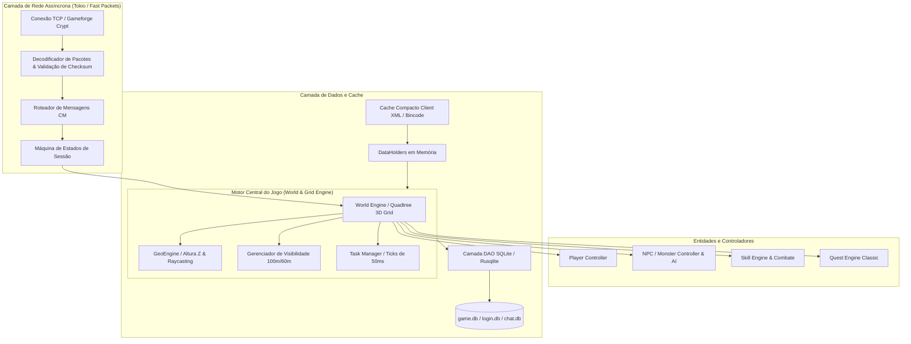
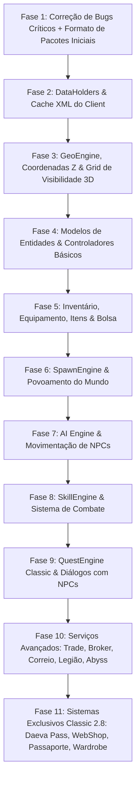

# Plano de Jogo - Arquitetura Geral e Índice de Migração (Java 4.8 / 2.8 -> Rust Classic 4.5)

Este documento estabelece o índice mestre, a arquitetura de camadas e o roteiro cronológico de migração de todos os sistemas, módulos, pacotes de rede e dados do emulador AION Classic Rust, utilizando como referências principais o **Java Emulator 4.8 Retail** (estrutura, ordem de pacotes e estabilidade de fluxo), o **Java Emulator 2.8 Classic CHS** (sistemas exclusivos do Classic) e as **Coletas Reais de Pacotes Wireshark do Servidor Oficial Gameforge**.

---

## 1. Visão Geral da Arquitetura do GameServer em Rust

A arquitetura do emulador em Rust é desenhada com foco em altíssima performance, baixa latência (sub-milissegundo para processamento de pacotes), segurança de concorrência com Tokio e consumo mínimo de memória RAM através de cache estático compacto e zero-copy.

---

## 2. Índice dos Documentos do Plano de Jogo

| Documento | Módulo / Área | Origem de Referência | Descrição Resumida |
| :--- | :--- | :--- | :--- |
| **`01_DIAGNOSTICO_E_SOLUCAO_BUGS_CRITICOS_ATUAIS.md`** | Correções Imediatas | Logs & Wireshark 4.5 | Diagnóstico e correção do personagem invisível/vermelho, câmera atolada no chão, Z-altitude, botão Check Name, Quit/Reconnect e taxa de uso. |
| **`02_NETWORK_PROTOCOLOS_CM_SM.md`** | Rede & Protocolo | Java 4.8 `network/aion` | Mapeamento completo dos pacotes Client (CM) e Server (SM), opcodes, criptografia Gameforge e fluxos de sessão. |
| **`03_WORLD_GRID_E_INSTANCE_ENGINE.md`** | Mundo & Instâncias | Java 4.8 `world/` & `instance/` | Grid espacial 3D, quadtree, zonas, regiões, gestão de instâncias solo/grupo e canais. |
| **`04_GEOENGINE_E_COLISAO_ALTURA.md`** | Geometria & Física | Java 4.8 `geoEngine/` | Extração de mapas de altura, malhas de colisão Z, raycasting 3D, linha de visão (LoS) e correção de spawn/queda. |
| **`05_MODELS_E_ENTIDADES_DO_JOGO.md`** | Modelos de Dados | Java 4.8 `model/` | Hierarquia completa de objetos (`Player`, `Npc`, `Monster`, `Item`, `Summon`, `Pet`, `Kisk`, etc.). |
| **`06_CONTROLLERS_E_ACOES.md`** | Controladores | Java 4.8 `controllers/` | Lógicas de ação para jogador, NPCs, monstros, coleta de materiais e portas. |
| **`07_AI_ENGINE_E_COMPORTAMENTOS.md`** | Inteligência Artificial | Java 4.8 `ai/` (AI2) | Máquina de estados finita da IA, tabela de ódio (Aggro/Hate Table), patrulhas (Waypoints) e chefes de masmorra. |
| **`08_SKILL_ENGINE_E_COMBATE.md`** | Combate & Skills | Java 4.8 `skillengine/` | Fórmulas de dano físico/mágico, acerto/crítico/parry/block, buffs, debuffs, chains, stigmas e cooldowns. |
| **`09_SPAWN_ENGINE_E_POVOAMENTO.md`** | Povoamento do Mundo | Java 4.8 `spawnengine/` | Carregamento de spawns estáticos/dinâmicos, CSV de spawns, respawn timers e pools de monstros/NPCs. |
| **`10_SERVICES_SISTEMAS_DO_JOGO.md`** | Serviços Centrais | Java 4.8 `services/` | Todos os 59 serviços (Inventário, Trade, Broker, Legião, Abyss, Correio, Cerco, Craft, Teleporte, etc.). |
| **`11_QUEST_ENGINE_MISSOES_CLASSIC.md`** | Missões Classic | Java 2.8 / 4.8 `questEngine/` | Sistema de missões adaptado estritamente para a estrutura Classic, diálogos, cutscenes e recompensas. |
| **`12_DATAHOLDERS_E_CACHE_CLIENT_XML.md`** | Cache de Dados Estáticos | `Produto Final/data/client/` | Parser SAX de alto desempenho direto dos XMLs brutos do cliente, sem conversões lentas de Java, com cache em bincode. |
| **`13_TASK_MANAGER_E_TIMERS.md`** | Loops Temporizados | Java 4.8 `taskmanager/` | Agendador de tarefas, world ticks (50ms), regeneração de HP/MP, periodic save e cron jobs. |
| **`14_DAO_E_PERSISTENCIA_SQLITE.md`** | Persistência & Banco | Java 4.8 `dao/` | Mapeamento seguro das 86 tabelas SQLite com Rusqlite, transações WAL e atomicidade. |
| **`15_EXCLUSIVOS_CLASSIC_2.8_E_WEBSHOP.md`** | Sistemas Classic 2.8 | Java 2.8 `services/` | Daeva Pass, Atreian Passport, WorldShop/Black Cloud, Siel Aura, Wardrobe e tabela de spawns/kits iniciais por raça/classe. |

---

## 3. Grafo de Dependências e Ordem Sequencial de Implementação

A ordem de execução deve seguir rigorosamente as dependências entre camadas para garantir estabilidade e testes contínuos:

### Detalhamento das Etapas:

1. **Etapa 1 (Fundação Imediata)**: Resolução dos problemas de pacote de criação, verificação de nome (`CM_CHECK_NICKNAME`), pacote de entrada no mundo com aparência 100% válida e teleporte inicial correto.
2. **Etapa 2 (Dados)**: Carregador dos arquivos XML do cliente (`client_items.xml`, `client_npcs.xml`, `client_skills.xml`, `client_world_*.xml`) gerando arquivos `.bin` ultra-rápidos de cache.
3. **Etapa 3 (Mundo)**: GeoEngine com altura Z precisa e World Grid gerenciando quem enxerga quem a cada 50ms.
4. **Etapa 4 (Entidades)**: Estruturas `Player`, `Npc`, `Monster` com controllers para sincronizar posições, vida, mana e status.
5. **Etapa 5 (Itens)**: Sistema de inventário, cubos de expansão, armazém e equipamento com cálculo de stats derivados.
6. **Etapa 6 (Spawns)**: Povoamento com os milhares de NPCs e monstros a partir de `spawns.csv` e XMLs de zona.
7. **Etapa 7 (IA)**: IA dos monstros reagindo a agressão, patrulhando rotas e perseguindo alvos.
8. **Etapa 8 (Combate)**: Cálculo de acertos, dano físico e mágico, animações de skill, efeitos temporários e buffs.
9. **Etapa 9 (Quests)**: Máquina de estados de missões classic, diálogos de NPCs e cutscenes.
10. **Etapa 10 (Serviços)**: Trocas entre jogadores, correio com anexos, corretor de mercado, legiões e guerras de cerco.
11. **Etapa 11 (Classic 2.8)**: Battle Pass com missões de temporada, calendário diário, loja de cosméticos e energia de Siel.
