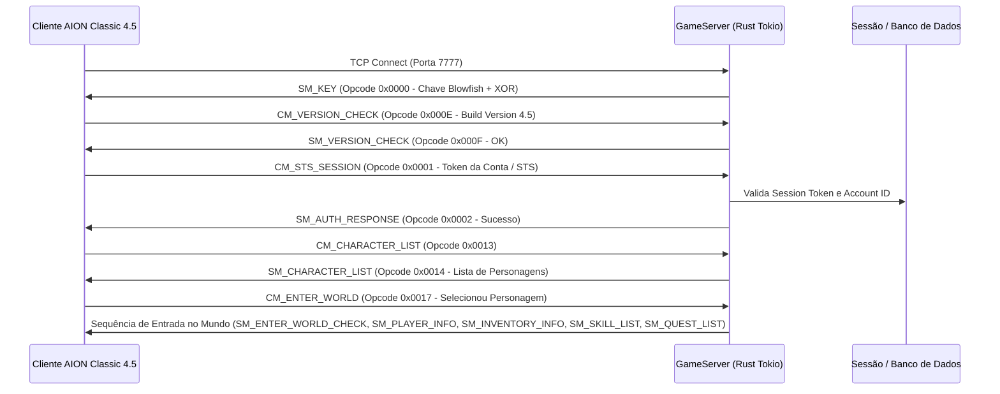

# Plano de Jogo - Camada de Rede & Protocolos (CM / SM)

Este documento detalha a arquitetura de rede, decodificação de pacotes, tabela de opcodes e ciclo de vida de conexão entre o cliente AION Classic 4.5 e o GameServer em Rust, mapeando cada pacote de `com/aionemu/gameserver/network/aion` (Java 4.8) para Rust.

---

## 1. Arquitetura de Rede em Rust

A camada de rede é implementada sobre **Tokio Async I/O**, utilizando `tokio::net::TcpListener` e canais assíncronos (`tokio::sync::mpsc`).

---

## 2. Estrutura do Pacote e Criptografia Gameforge

Cada pacote TCP é composto por:
1. **Tamanho (2 bytes, LE)**: Comprimento total do pacote incluindo os 2 bytes de cabeçalho.
2. **Opcode (2 bytes, LE)**: Identificador da mensagem (CM = Cliente -> Servidor, SM = Servidor -> Cliente).
3. **Payload (N bytes)**: Corpo de dados criptografado via XOR estático / dinâmico com chave de sessão.

---

## 3. Tabela Comparativa de Opcodes: Java 4.8 vs Classic 4.5 (Wireshark Oficial)

### A. Pacotes de Conexão, Autenticação e Seleção de Personagens

| Pacote | Opcode Java 4.8 | Opcode Classic 4.5 (Oficial) | Direção | Descrição |
| :--- | :--- | :--- | :--- | :--- |
| `SM_KEY` | `0x0000` | `0x0000` | S $\rightarrow$ C | Envio da chave de criptografia de sessão |
| `CM_VERSION_CHECK` | `0x000E` | `0x000E` | C $\rightarrow$ S | Checagem de versão do cliente |
| `SM_VERSION_CHECK` | `0x000F` | `0x000F` | S $\rightarrow$ C | Confirmação de compatibilidade |
| `CM_STS_SESSION` | `0x0001` | `0x0001` | C $\rightarrow$ S | Autenticação via Gameforge STS token |
| `SM_AUTH_RESPONSE` | `0x0002` | `0x0002` | S $\rightarrow$ C | Resultado da autenticação |
| `CM_CHARACTER_LIST` | `0x0013` | `0x0013` | C $\rightarrow$ S | Solicitação da lista de personagens |
| `SM_CHARACTER_LIST` | `0x0014` | `0x0014` | S $\rightarrow$ C | Envio da lista formatada |
| `CM_CHECK_NICKNAME` | `0x001E` | `0x0028` | C $\rightarrow$ S | Checagem de disponibilidade de nome |
| `SM_NICKNAME_RESPONSE` | `0x001F` | `0x0029` | S $\rightarrow$ C | Retorno de disponibilidade de nome |
| `CM_CREATE_CHARACTER` | `0x0026` | `0x0027` | C $\rightarrow$ S | Envio dos 140 bytes de criação |
| `SM_CREATE_CHARACTER` | `0x0027` | `0x0028` | S $\rightarrow$ C | Confirmação de criação |
| `CM_DELETE_CHARACTER` | `0x0020` | `0x0021` | C $\rightarrow$ S | Solicitação de exclusão de personagem |
| `SM_DELETE_CHARACTER` | `0x0021` | `0x0022` | S $\rightarrow$ C | Confirmação de exclusão / timer de delete |
| `CM_ENTER_WORLD` | `0x0017` | `0x0017` | C $\rightarrow$ S | Entrada no mundo com o personagem selecionado |
| `SM_ENTER_WORLD_CHECK` | `0x000C` | `0x000D` | S $\rightarrow$ C | Inicialização do mapa e mundo |
| `CM_QUIT` | `0x0047` | `0x0048` | C $\rightarrow$ S | Solicitação de saída do jogo |
| `SM_QUIT_RESPONSE` | `0x0048` | `0x0049` | S $\rightarrow$ C | Countdown de saída |
| `CM_RECONNECT` | `0x0049` | `0x004A` | C $\rightarrow$ S | Voltar para a tela de personagens |
| `SM_RECONNECT_KEY` | `0x004A` | `0x004B` | S $\rightarrow$ C | Token para reconexão ao lobby |

---

### B. Pacotes de Mundo, Movimentação e Visibilidade

| Pacote | Opcode Java 4.8 | Opcode Classic 4.5 (Oficial) | Direção | Descrição |
| :--- | :--- | :--- | :--- | :--- |
| `CM_MOVE` | `0x0029` | `0x002A` | C $\rightarrow$ S | Posição, direção, velocidade e flags de movimento (andar, correr, voar, deslizar) |
| `SM_MOVE` | `0x002A` | `0x002B` | S $\rightarrow$ C | Broadcast de movimento para jogadores ao redor |
| `SM_PLAYER_SPAWN` | `0x003F` | `0x0040` | S $\rightarrow$ C | Spawn do jogador local no mundo |
| `SM_PLAYER_INFO` | `0x0040` | `0x0041` | S $\rightarrow$ C | Envio da aparência e dados de outro jogador visível |
| `SM_NPC_INFO` | `0x0045` | `0x0046` | S $\rightarrow$ C | Spawn de NPC/Monstro na área de visão |
| `SM_DELETE_OBJECT` | `0x0048` | `0x0049` | S $\rightarrow$ C | Remoção de entidade fora do campo de visão |
| `SM_REQUEST_TELEPORT` | `0x0014` | `0x0014` | S $\rightarrow$ C | Teleporte forçado / carregamento de mapa |
| `CM_TELEPORT_DONE` | `0x0015` | `0x0015` | C $\rightarrow$ S | Notificação de cliente pronto após teleporte |

---

### C. Pacotes de Combate, Skills e Status

| Pacote | Opcode Java 4.8 | Opcode Classic 4.5 (Oficial) | Direção | Descrição |
| :--- | :--- | :--- | :--- | :--- |
| `CM_TARGET_SELECT` | `0x0030` | `0x0031` | C $\rightarrow$ S | Seleção de alvo (monstro, NPC, player) |
| `SM_TARGET_SELECTED` | `0x0031` | `0x0032` | S $\rightarrow$ C | Confirmação de alvo para o HUD |
| `CM_ATTACK` | `0x0033` | `0x0034` | C $\rightarrow$ S | Ataque básico auto-attack |
| `SM_ATTACK_STATUS` | `0x0034` | `0x0035` | S $\rightarrow$ C | Resultado do ataque (Dano, Crítico, Block, Parry, Miss) |
| `CM_USE_SKILL` | `0x0020` | `0x0021` | C $\rightarrow$ S | Disparo de habilidade |
| `SM_SKILL_CASTING` | `0x002A` | `0x002A` | S $\rightarrow$ C | Início de conjuração / barra de cast |
| `SM_SKILL_SUCCEDED` | `0x002B` | `0x002B` | S $\rightarrow$ C | Sucesso do disparo da skill e efeitos no alvo |
| `SM_ABNORMAL_STATUS` | `0x0031` | `0x0031` | S $\rightarrow$ C | Aplicação de buffs/debuffs (Stun, Silence, etc.) |
| `SM_STATS_INFO` | `0x0055` | `0x0056` | S $\rightarrow$ C | Atualização de HP, MP, DP, Ataque e Defesa |

---

### D. Pacotes de Inventário, Itens e Comércio

| Pacote | Opcode Java 4.8 | Opcode Classic 4.5 (Oficial) | Direção | Descrição |
| :--- | :--- | :--- | :--- | :--- |
| `SM_INVENTORY_INFO` | `0x0061` | `0x0062` | S $\rightarrow$ C | Carga inicial da bolsa e equipamentos |
| `CM_EQUIP_ITEM` | `0x0063` | `0x0064` | C $\rightarrow$ S | Equipar item em slot |
| `CM_UNEQUIP_ITEM` | `0x0064` | `0x0065` | C $\rightarrow$ S | Desequipar item para a bolsa |
| `SM_INVENTORY_UPDATE` | `0x0066` | `0x0067` | S $\rightarrow$ C | Atualização de quantidade/slot de item |
| `CM_BUY_SELL` | `0x0032` | `0x0033` | C $\rightarrow$ S | Compra ou venda em NPC Merchant |
| `SM_STORE_SALE_INFO` | `0x00FC` | `0x00FD` | S $\rightarrow$ C | Lista de itens da loja NPC |
| `SM_USER_SELL_HISTORY` | `0x00A5` | `0x00A6` | S $\rightarrow$ C | Lista de recompra (Buyback de itens vendidos) |

---

## 4. Estrutura Modular em Rust

Os pacotes serão organizados na pasta `game-server/src/network/`:
* `packet_reader.rs`: Leitura segura de tipos primitivos (`u8`, `u16`, `u32`, `u64`, `f32`, `String UTF-16LE`).
* `packet_writer.rs`: Construção dinâmica com buffer pré-alocado.
* `client_packets/`: Um submódulo por subsistema (`auth.rs`, `character.rs`, `movement.rs`, `combat.rs`, `trade.rs`, `quest.rs`, etc.).
* `server_packets/`: Construtores de pacotes de saída com serialização zero-alloc.
