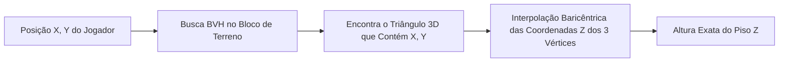

# Plano de Jogo - GeoEngine, Colisão Z & Linha de Visão (LoS)

Este documento estabelece o motor de física e geometria do GameServer em Rust (migração de `com/aionemu/gameserver/geoEngine/`), responsável pelo cálculo de altura do terreno ($Z$), detecção de colisão tridimensional, linha de visão (Line of Sight - LoS) e prevenção de quedas no vazio.

---

## 1. Mapeamento de Classes Java 4.8 $\rightarrow$ Rust

| Classe Java 4.8 | Módulo em Rust | Responsabilidade |
| :--- | :--- | :--- |
| `geoEngine.GeoEngine` | `geo::geo_engine.rs` | Ponto de entrada do sistema de geometria e raycasting |
| `geoEngine.models.GeoMap` | `geo::geo_map.rs` | Malha 3D e heightmap de um mapa carregado |
| `geoEngine.collision.CollisionTree` | `geo::bvh_tree.rs` | Árvore BVH (Bounding Volume Hierarchy) para busca rápida de triângulos |
| `geoEngine.math.Vector3f` | `geo::vector3.rs` | Operações vetoriais 3D (produto escalar, produto vetorial, distância) |
| `geoEngine.math.Ray` | `geo::ray.rs` | Raio 3D para cálculo de interseção e Linha de Visão |

---

## 2. Cálculo de Altura do Terreno (Coordenada Z)

Um dos maiores problemas em emuladores sem GeoEngine é que o jogador ou NPC "afunda" no chão ou fica flutuando no ar. O GeoEngine em Rust resolve isso através de interpolação baricêntrica sobre a malha de triângulos:



### Fórmula de Interpolação Baricêntrica em Rust:
```rust
pub fn calculate_z_on_triangle(v0: &Vector3, v1: &Vector3, v2: &Vector3, x: f32, y: f32) -> f32 {
    let det = (v1.y - v2.y) * (v0.x - v2.x) + (v2.x - v1.x) * (v0.y - v2.y);
    if det.abs() < 1e-6 {
        return v0.z;
    }
    let l0 = ((v1.y - v2.y) * (x - v2.x) + (v2.x - v1.x) * (y - v2.y)) / det;
    let l1 = ((v2.y - v0.y) * (x - v2.x) + (v0.x - v2.x) * (y - v2.y)) / det;
    let l2 = 1.0 - l0 - l1;
    l0 * v0.z + l1 * v1.z + l2 * v2.z
}
```

---

## 3. Linha de Visão (Line of Sight - LoS) & Raycasting

Para evitar que magos ou arqueiros atirem através de paredes, portas fechadas, montanhas ou pilares:
1. O servidor traça um raio $\vec{R}(t) = \vec{P}_{\text{origem}} + t \cdot \vec{D}$ entre os olhos do atacante ($Z + 1.8\text{m}$) e o centro do alvo.
2. A árvore BVH testa interseção do raio contra todas as caixas delimitadoras e triângulos de colisão no caminho.
3. Se houver colisão antes de atingir o alvo, o ataque falha com o pacote `SM_ATTACK_STATUS` / `SM_SKILL_CANCEL` com código de erro `CANNOT_SEE_TARGET`.

---

## 4. Físicas de Queda, Natação e Deslizamento (Gliding)

* **Dano de Queda**: Calculado pela diferença de altitude entre o início da queda e o ponto de impacto no chão:
  $$\text{Dano} = \begin{cases} 0 & \text{se } \Delta Z \le 5\text{m} \\ \text{MaxHP} \times \frac{\Delta Z - 5}{30} & \text{se } 5\text{m} < \Delta Z \le 35\text{m} \\ \text{Morte Imediata} & \text{se } \Delta Z > 35\text{m} \end{cases}$$
* **Deslizamento (Gliding)**: Quando a flag de planar é ativada (`CM_MOVE`), a velocidade vertical de queda é fixada em $V_z = -1.5\text{m/s}$ e a velocidade horizontal mantida com consumo periódico de Flight Time.
