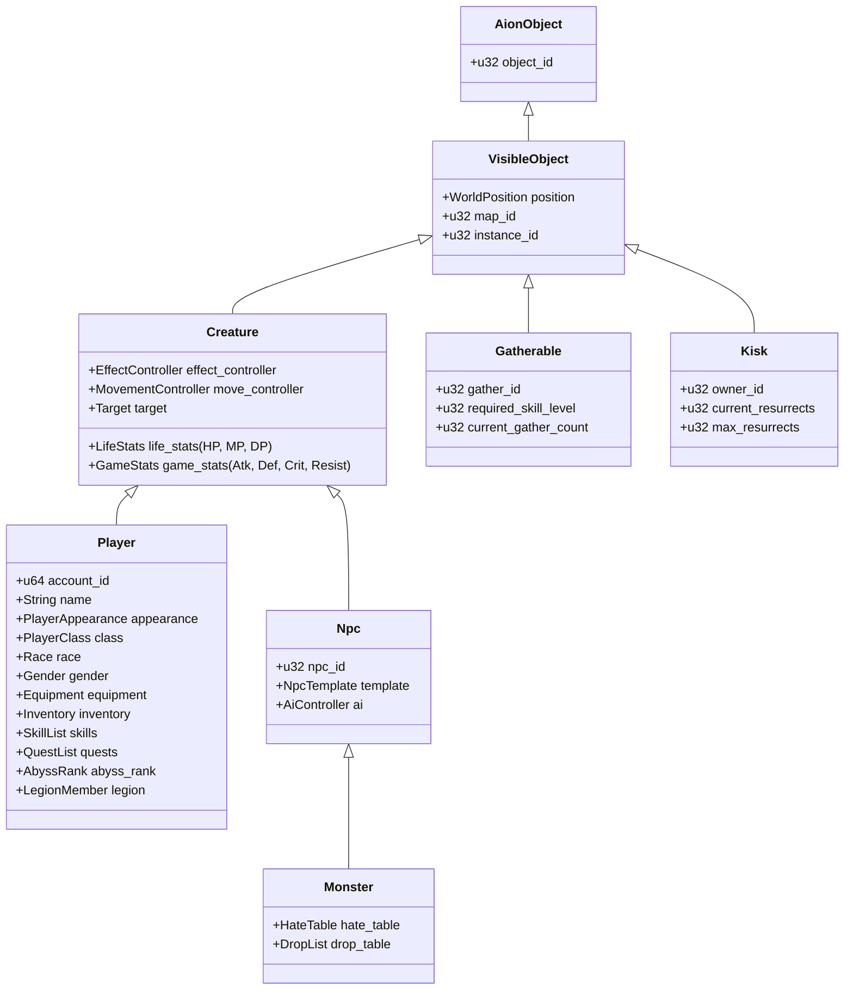

# Plano de Jogo - Modelos de Dados & Hierarquia de Entidades

Este documento define a hierarquia de objetos, structs de dados e modelos em memória do emulador em Rust, mapeando integralmente o pacote `com/aionemu/gameserver/model/` do Java 4.8.

---

## 1. Hierarquia de Entidades



---

## 2. Structs Principais em Rust

### A. Jogador (`Player`)
```rust
pub struct Player {
    pub object_id: u32,
    pub account_id: i64,
    pub name: String,
    pub race: Race,                 // Elyos (0), Asmodian (1)
    pub player_class: PlayerClass,   // Warrior, Gladiator, Templar, ..., Luminess
    pub gender: Gender,             // Male (0), Female (1)
    pub appearance: PlayerAppearance, // 140 bytes binários
    pub position: WorldPosition,
    pub stats: PlayerStats,
    pub inventory: Inventory,
    pub equipment: Equipment,
    pub skills: SkillList,
    pub quests: QuestList,
    pub abyss: AbyssRank,
    pub titles: TitleList,
    pub cube_slots: u8,             // Cubo básico: 27 + expansões até 108
    pub warehouse_slots: u8,
    pub client_id: u16,             // ID de sessão de rede
}
```

### B. Atributos do Personagem (`PlayerStats`)
* **Atributos Primários**: Power, Health, Agility, Accuracy, Knowledge, Will.
* **Atributos Secundários**:
  * `HP_MAX`, `MP_MAX`, `DP_MAX` (4000).
  * `MAIN_HAND_PHYSICAL_ATTACK`, `OFF_HAND_PHYSICAL_ATTACK`.
  * `PHYSICAL_ACCURACY`, `PHYSICAL_CRITICAL`.
  * `PHYSICAL_DEFENSE`, `BLOCK`, `PARRY`, `EVASION`.
  * `MAGIC_BOOST` (Poder Mágico), `MAGIC_ACCURACY` (Precisão Mágica), `MAGIC_RESIST` (Resistência Mágica).
  * `MOVEMENT_SPEED` (Velocidade Normal $6.0\text{m/s}$, Voo $9.0\text{m/s}$, Correndo $12.0\text{m/s}$).
  * `ATTACK_SPEED` (Intervalo entre golpes básicos em ms).
  * `CAST_TIME_BOOST` (Redução percentual de tempo de conjuração).

### C. NPCs e Monstros (`Npc` & `Monster`)
```rust
pub struct Npc {
    pub object_id: u32,
    pub npc_id: u32,
    pub position: WorldPosition,
    pub spawn_template: SpawnTemplate,
    pub stats: NpcStats,
    pub ai: Box<dyn AiEngine>,
    pub hate_table: Option<HateTable>,
    pub is_dead: bool,
    pub respawn_at: Option<Instant>,
}
```
