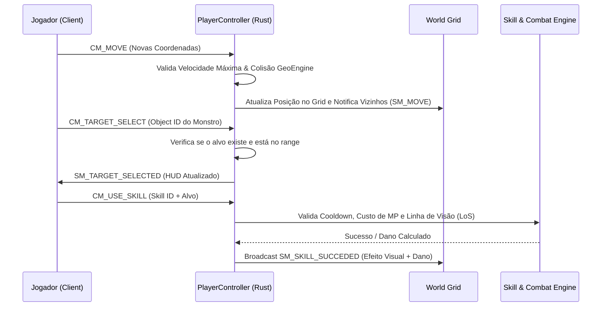

# Plano de Jogo - Controladores & Ações do Jogo (Controllers)

Este documento define os controladores de ação de cada entidade viva do jogo (migração de `com/aionemu/gameserver/controllers/` do Java 4.8 para Rust).

---

## 1. Mapeamento de Classes Java 4.8 $\rightarrow$ Rust

| Classe Java 4.8 | Módulo em Rust | Responsabilidade |
| :--- | :--- | :--- |
| `controllers.PlayerController` | `controllers::player_ctrl.rs` | Processa comandos e ações disparadas pelo jogador |
| `controllers.NpcController` | `controllers::npc_ctrl.rs` | Ações de NPCs comuns (venda, teleporte, diálogos) |
| `controllers.MonsterController` | `controllers::monster_ctrl.rs` | Combate, aggro, perseguição e morte de monstros |
| `controllers.GatherableController`| `controllers::gather_ctrl.rs` | Coleta de minérios, plantas e éter |
| `controllers.DoorController` | `controllers::door_ctrl.rs` | Abertura e fechamento de portões de masmorras e fortalezas |
| `controllers.effect.EffectController` | `controllers::effect_ctrl.rs` | Gerencia buffs, debuffs e status temporários na entidade |
| `controllers.movement.MovementController`| `controllers::move_ctrl.rs` | Validação de movimento, anti-speedhack e interpolação |

---

## 2. Fluxos Principais do `PlayerController`

---

## 3. Fluxo de Coleta (`GatherableController`)

Ao clicar em um recurso (Herb, Ore, Aether):
1. **Validação**: Verifica se o jogador tem a habilidade necessária (Essencetapping ou Aethertapping) com nível compatível e se possui a ferramenta equipada (ex: chapéu de extração).
2. **Barra de Progresso**: O servidor envia o pacote de canalização `SM_GATHER_STATUS` com tempo de extração ($3\text{ a }5\text{ segundos}$).
3. **Cálculo de Sucesso**:
   $$\text{Chance de Sucesso} = \min\left(95\%, 50\% + (\text{SkillLevel} - \text{ResourceLevel}) \times 2\%\right)$$
4. **Resultado**: Se sucesso, entrega os materiais na bolsa via `InventoryService` e concede pontos de experiência de coleta; se o número máximo de coletas do nó esgotar (ex: 3 vezes), o nó desaparece e entra em cooldown de respawn.
