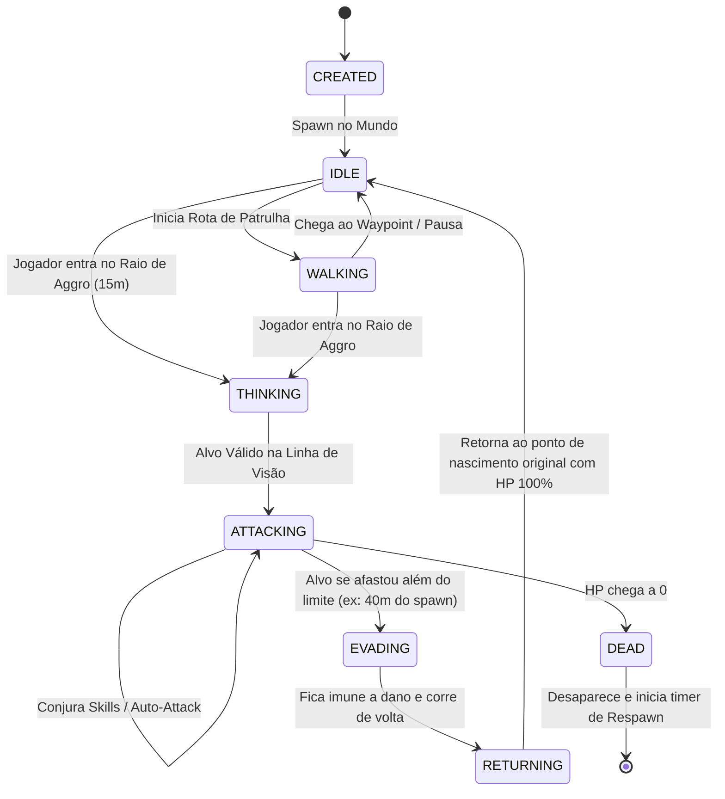

# Plano de Jogo - Motor de Inteligência Artificial & Comportamentos (AI Engine)

Este documento descreve o motor de Inteligência Artificial para NPCs, monstros, chefes de masmorra e guardas (migração de `com/aionemu/gameserver/ai/` - AI2 do Java 4.8 para Rust).

---

## 1. Mapeamento de Classes Java 4.8 $\rightarrow$ Rust

| Classe Java 4.8 | Módulo em Rust | Responsabilidade |
| :--- | :--- | :--- |
| `ai2.AbstractAI` | `ai::abstract_ai.rs` | Estrutura base de eventos, callbacks e temporizadores da IA |
| `ai2.NpcAI2` | `ai::npc_ai.rs` | IA padrão de NPCs estáticos e interativos |
| `ai2.MonsterAI2` | `ai::monster_ai.rs` | IA de combate, perseguição e gestão de aggro |
| `ai2.AggressiveNpcAI2` | `ai::aggressive_ai.rs` | IA de monstros agressivos que atacam por aproximação |
| `ai2.HateTable` | `ai::hate_table.rs` | Tabela de ódio (gerenciamento de alvos prioritários) |
| `ai2.event.AIEventType` | `ai::events.rs` | Eventos recebidos pela IA (`ATTACKED`, `SEE_PLAYER`, `TARGET_LOST`, etc.) |
| `ai2.scenario.WalkManager` | `ai::walk_manager.rs` | Navegação por rotas de patrulha (Waypoints) |

---

## 2. Máquina de Estados Finita da IA (FSM)



---

## 3. Tabela de Ódio (Hate Table / Aggro)

Cada monstro mantém uma tabela com todos os atacantes:

```rust
pub struct HateEntry {
    pub entity_id: u32,
    pub hate_points: u32,
    pub last_damage_time: Instant,
}

pub struct HateTable {
    pub entries: HashMap<u32, HateEntry>,
}
```

### Regras de Geração de Ódio:
* **Dano Direto**: $+1\text{ ponto de Hate}$ para cada $1\text{ ponto de dano}$ causado.
* **Cura de Aliados**: Quando um clérigo cura um jogador que está atacando o monstro, o clérigo recebe $+0.5\text{ de Hate}$ por ponto de cura.
* **Skills de Provocação (Taunt)**: Templários e Gladiadores possuem habilidades que injetam $+5000\text{ a }+20000\text{ de Hate}$ instantaneamente para forçar o monstro a virar o alvo.
* **Troca de Alvo**: O monstro sempre ataca o jogador com maior valor de Hate. Se o alvo atual morrer ou usar habilidade de desvencilhamento (ex: Feign Death ou Hide), o monstro foca no segundo colocado da lista.

---

## 4. IA de Chefes de Masmorra (Boss AI & Fases)

Chefes de masmorra possuem scripts especializados baseados na porcentagem de vida:
* **Fase 1 (100% - 75% HP)**: Auto-attack básico e skills frontais em cone (cleave).
* **Fase 2 (75% - 50% HP)**: Grita no chat da masmorra (`SM_SYSTEM_MESSAGE` / `SM_EMOTION`), aplica buffs de fúria e invoca 4 lacaios (adds).
* **Fase 3 (50% - 25% HP)**: Conjuração de grandes ataques de área (AoE) com 3 segundos de canalização, exigindo que os jogadores corram para fora do círculo de impacto.
* **Fase 4 (25% - 0% HP - Enrage)**: Velocidade de ataque aumentada em 50% e dano aumentado em 100%.
