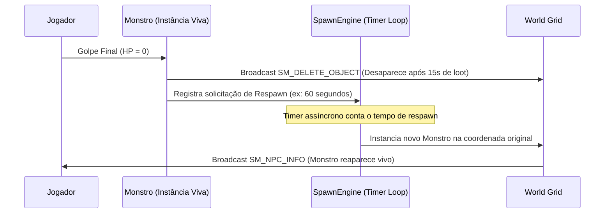

# Plano de Jogo - SpawnEngine & Povoamento do Mundo (Spawns)

Este documento define o motor de povoamento do mundo com monstros, NPCs, guardas, vendedores, pontos de coleta e chefes de raid (migração de `com/aionemu/gameserver/spawnengine/` do Java 4.8 para Rust).

---

## 1. Mapeamento de Classes Java 4.8 $\rightarrow$ Rust

| Classe Java 4.8 | Módulo em Rust | Responsabilidade |
| :--- | :--- | :--- |
| `spawnengine.SpawnEngine` | `spawn::spawn_engine.rs` | Carregador central e orquestrador de nascimento de entidades |
| `spawnengine.model.SpawnGroup` | `spawn::spawn_group.rs` | Grupo de spawns vinculados a um mapa ou evento |
| `spawnengine.model.SpawnTemplate` | `spawn::spawn_template.rs` | Definição estática de um ponto de spawn (mapa, npc_id, x, y, z, h, respawn_time) |
| `spawnengine.model.SiegeSpawn` | `spawn::siege_spawn.rs` | Spawns que só aparecem quando uma fortaleza pertence aos Elyos ou Asmodians |
| `spawnengine.model.RiftSpawn` | `spawn::rift_spawn.rs` | Spawns de guardas e fendas de invasão entre facções |

---

## 2. Origem dos Dados de Spawns

Os spawns do emulador são carregados de duas fontes complementares:
1. **`Produto Final/data/spawns.csv`**:
   * Contém mais de **$1.250$ pontos de spawn oficiais** com payloads de estado, rotação exata e dados de aparência capturados diretamente da Gameforge.
   * Formato: `mapa, npc_id, nome_id, x, y, z, payload_hex`
2. **`Produto Final/data/client/world/client_world_*.xml`**:
   * Contém a totalidade dos NPCs de cidades (Sanctum, Pandaemonium, Kaisinel, Marchutan), fortalezas do Abyss, masmorras e zonas abertas.

---

## 3. Estrutura de Spawns em Memória em Rust

```rust
pub struct SpawnTemplate {
    pub spawn_id: u32,
    pub npc_id: u32,
    pub map_id: u32,
    pub instance_id: u32,
    pub x: f32,
    pub y: f32,
    pub z: f32,
    pub heading: u8,
    pub respawn_time: u32,       // Tempo de respawn em segundos (ex: 60s monstro normal, 3600s elite)
    pub respawn_variance: u32,   // Variação aleatória (ex: +/- 15s)
    pub walker_route_id: Option<u32>, // ID da rota de patrulha
    pub state: u8,               // 0 = Normal, 1 = Invisível até trigger, etc.
}
```

---

## 4. Ciclo de Vida de Respawn de Monstros


