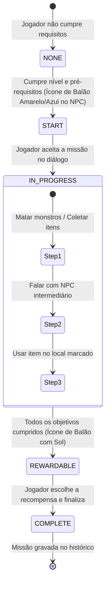

# Plano de Jogo - QuestEngine & Missões do Classic

Este documento estabelece o motor de missões, diálogos interativos, cutscenes e recompensas (migração de `com/aionemu/gameserver/questEngine/` do Java 4.8/2.8 para Rust).

---

## 1. Regra Fundamental: Uso Estrito das Missões do Classic

> [!IMPORTANT]
> As missões da versão Retail 4.8 possuem cadeias e NPCs totalmente diferentes (muitas zonas clássicas foram reformuladas na 4.8).
> Portanto, a **lógica do motor de missões** é migrada da arquitetura limpa do 4.8, mas todos os **dados, IDs de missão e passos** são extraídos exclusivamente do **Classic (2.8 e XMLs do Client em `Produto Final/data/client/dialogs`)**.

---

## 2. Máquina de Estados da Missão (Quest State Machine)



---

## 3. Tipos de Gatilhos de Missão (Quest Triggers)

O `QuestEngine` em Rust implementa handlers reativos assíncronos:

```rust
pub trait QuestHandler: Send + Sync {
    /// Disparado quando o jogador clica em um NPC
    fn on_dialog(&self, player: &mut Player, npc_id: u32, dialog_id: u32) -> QuestResult;

    /// Disparado quando o jogador mata um monstro específico
    fn on_kill(&self, player: &mut Player, monster_id: u32) -> QuestResult;

    /// Disparado quando o jogador usa um item da bolsa (ex: carta, poção de quest)
    fn on_item_use(&self, player: &mut Player, item_id: u32) -> QuestResult;

    /// Disparado quando o jogador entra em uma coordenada ou zona de gatilho
    fn on_area_enter(&self, player: &mut Player, zone_id: u32) -> QuestResult;

    /// Disparado quando termina a exibição de um vídeo/cutscene
    fn on_movie_end(&self, player: &mut Player, movie_id: u32) -> QuestResult;
}
```

---

## 4. Missões Críticas do Classic

1. **Missões de Ascensão (Daeva Ascension - Nível 9 $\rightarrow$ 10)**:
   * Elyos: *Ascension* (Quest `1006`) $\rightarrow$ Transforma em Daeva, teleporte para Sanctum, escolha de classe avançada (ex: Warrior $\rightarrow$ Gladiator ou Templar) e entrega de asas.
   * Asmodian: *Ascension* (Quest `2008`) $\rightarrow$ Teleporte para Pandaemonium e entrega de asas.
2. **Missões de Liberação de Stigma (Nível 20)**:
   * Elyos: *A Sliver of Darkness* (Quest `1929`) $\rightarrow$ Desbloqueia os slots de Stigma.
   * Asmodian: *No Escaping Destiny* (Quest `2900`) $\rightarrow$ Desbloqueia os slots de Stigma.
3. **Missões de Campanha por Zona**:
   * Poeta (Quests `1001` a `1007`), Ishalgen (Quests `2001` a `2007`), Verteron, Altgard, Eltnen, Morheim, Heiron, Beluslan e Inggison/Gelkmaros.
