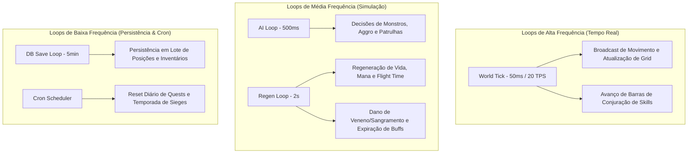

# Plano de Jogo - TaskManager & Loops Temporizados Assíncronos

Este documento estabelece o agendador de tarefas e os loops de sincronização temporal do GameServer em Rust (migração de `com/aionemu/gameserver/taskmanager/` do Java 4.8 para Rust com Tokio).

---

## 1. Mapeamento de Classes Java 4.8 $\rightarrow$ Rust

| Classe Java 4.8 | Módulo em Rust | Responsabilidade |
| :--- | :--- | :--- |
| `taskmanager.TaskManager` | `tasks::task_manager.rs` | Orquestrador de tarefas assíncronas em Tokio |
| `taskmanager.tasks.PacketBroadcaster` | `tasks::broadcast_task.rs` | Despacho em lote de pacotes de movimento a cada 50ms |
| `taskmanager.tasks.LifeStatsRestore` | `tasks::life_regen_task.rs`| Regeneração periódica de HP/MP/DP fora de combate (a cada 2s) |
| `taskmanager.tasks.AiTask` | `tasks::ai_loop_task.rs` | Processamento de decisão e patrulha da IA de monstros (a cada 500ms) |
| `taskmanager.tasks.PeriodicSave` | `tasks::db_sync_task.rs` | Sincronização em segundo plano no SQLite a cada 5 minutos |
| `services.CronJobService` | `tasks::cron_scheduler.rs` | Eventos com horários fixos (Cerco às 20h, reset diário de quests às 09h) |

---

## 2. Hierarquia de Frequência dos Loops Temporizados



---

## 3. Implementação dos Loops com Tokio Assíncrono

```rust
pub async fn start_world_loops(world: Arc<World>, db: Arc<Database>) {
    // 1. World Tick Loop (50ms - 20 TPS)
    let w1 = world.clone();
    tokio::spawn(async move {
        let mut interval = tokio::time::interval(Duration::from_millis(50));
        loop {
            interval.tick().await;
            w1.process_movement_and_visibility();
        }
    });

    // 2. Regeneration & Buff Tick Loop (2000ms)
    let w2 = world.clone();
    tokio::spawn(async move {
        let mut interval = tokio::time::interval(Duration::from_secs(2));
        loop {
            interval.tick().await;
            w2.process_regeneration_and_effects();
        }
    });

    // 3. AI Processing Loop (500ms)
    let w3 = world.clone();
    tokio::spawn(async move {
        let mut interval = tokio::time::interval(Duration::from_millis(500));
        loop {
            interval.tick().await;
            w3.process_ai_ticks();
        }
    });

    // 4. Periodic Database Sync (300s / 5min)
    let w4 = world.clone();
    let db1 = db.clone();
    tokio::spawn(async move {
        let mut interval = tokio::time::interval(Duration::from_secs(300));
        loop {
            interval.tick().await;
            w4.save_all_players_to_db(&db1);
        }
    });
}
```
