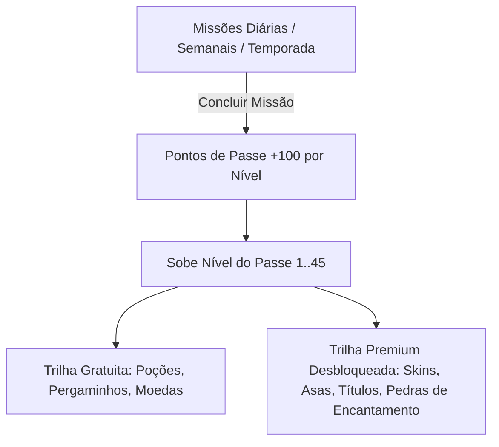

# Plano de Jogo - Exclusivos do Classic 2.8, WebShop & Spawns Iniciais

Este documento detalha os sistemas exclusivos da versão **AION Classic** que não existem na versão Retail 4.8 e foram extraídos e adaptados a partir do **Java Emulator 2.8 Classic CHS** e dos arquivos de dados do cliente em `Produto Final/data/client/PC/`.

---

## 1. Battle Pass / Daeva Pass

O Passe de Batalha do Classic substitui os antigos eventos manuais por uma progressão sazonal automática.

### Estrutura em Rust:
* **`battlepass_season.rs`**: Controla ID da temporada, datas de início/fim e nível máximo.
* **`battlepass_service.rs`**: Valida o cumprimento de objetivos (matar X monstros, fazer Y masmorras, coletar Z itens) e entrega recompensas via correio ou direto no inventário.
* **Tabelas do Banco**: `battlepass_season`, `battlepass_progress`, `battlepass_claimed_rewards`.

---

## 2. Atreian Passport (Calendário de Presença Diária)

* **Funcionamento**: A cada 24 horas (reset às 09:00 UTC), ao logar no jogo, o cliente abre o calendário mensal de 28 dias.
* **Recompensas Acumuladas**: O jogador clica no botão "Claim" do dia atual e recebe itens estáticos mapeados em `Produto Final/data/client/PC/client_login_event.xml`.
* **Pacotes de Rede**: `CM_CLAIM_ATTENDANCE` (0x0182) $\rightarrow$ `SM_ATTENDANCE_INFO` (0x0183).

---

## 3. WorldShop / Black Cloud Marketplace (Loja In-Game)

Diferente do 4.8 que dependia de navegadores web externos para shopping, o Classic possui a loja **Black Cloud** integrada diretamente na interface gráfica do cliente:
* **Moeda**: Quna / Toll Coins vinculadas à conta do jogador (`account_data.toll_coins`).
* **Categorias**:
  1. *Popular / Destaques*: Itens em promoção e pacotes de iniciante.
  2. *Cosméticos*: Skins de armadura, armas temáticas, tinturas raras e emotes.
  3. *Conveniência*: Cupons de expansão de cubo, pergaminhos de teleporte e amuletos de XP.
* **Pacotes de Rede**: `CM_WEBSHOP_LIST` $\rightarrow$ `SM_WEBSHOP_ITEMS` $\rightarrow$ `CM_WEBSHOP_BUY` $\rightarrow$ `SM_WEBSHOP_BUY_RESULT`.

---

## 4. Sistema de Guarda-Roupa (Wardrobe)

O sistema de Wardrobe do Classic permite que o jogador registre aparências visuais de armaduras e armas em um armário virtual:
* O item original é consumido e vira uma skin permanente registrada na conta.
* O jogador pode aplicar qualquer skin registrada aos seus itens equipados a qualquer momento pagando uma taxa simbólica em Kinah, sem perder os atributos do equipamento original.
* Mapeamento de dados em `Produto Final/data/client/PC/client_wardrobe_config.xml`.

---

## 5. Spawns Iniciais & Equipamentos por Raça e Classe

Para garantir que o nascimento inicial de cada personagem ocorra com $100\%$ de precisão e sem bugs de coordenada:

### Tabela de Coordenadas Iniciais Oficiais:
| Raça | Classe | Mapa de Spawn Inicial | Coordenadas X, Y, Z, Heading |
| :--- | :--- | :--- | :--- |
| **Elyos** | Todas as Classes Padrão | Kaisinel Academy (`110070000`) | $X = 457.0, Y = 251.0, Z = 127.04, H = 0$ |
| **Elyos** | Tutorial Poeta (Opcional) | Poeta (`210010000`) | $X = 2884.0, Y = 1042.0, Z = 104.5, H = 60$ |
| **Asmodian** | Todas as Classes Padrão | Marchutan Priory (`120080000`) | $X = 457.0, Y = 251.0, Z = 127.04, H = 0$ |
| **Asmodian**| Tutorial Ishalgen (Opcional) | Ishalgen (`220010000`) | $X = 574.0, Y = 2552.0, Z = 277.5, H = 90$ |
| **Qualquer** | Luminess (Nova Classe) | Kaisinel / Marchutan Academy | $X = 457.0, Y = 251.0, Z = 127.04, H = 0$ |

### Kit de Equipamento Inicial por Classe:
* **Warrior (Gladiator / Templar)**: Espada curta de treino, calças de pano/couro, túnica básica, 10x Bandagens e 10x Poções Menores de Vida.
* **Scout (Assassin / Ranger)**: Adaga de treino, calças de couro, armadura de couro, 10x Poções Menores de Vida.
* **Mage (Sorcerer / Spiritmaster)**: Orbe de treino ou Livro mágico, robe de treino, 10x Poções Menores de Mana.
* **Priest (Cleric / Chanter)**: Maça de treino, escudo básico de madeira, robe de treino, 10x Poções de Vida e Mana.
* **Luminess (Nova Classe)**: Espada mágica de Luminess, vestido/traje leve de Luminess, 10x Poções de Vida e Mana.
