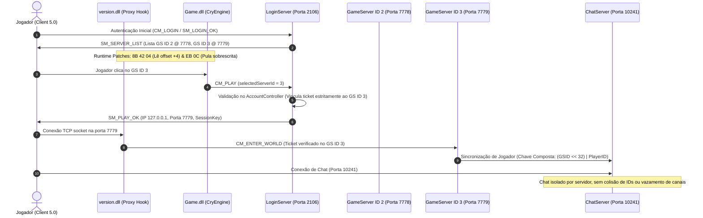

# Relatório Técnico de Diagnóstico e Correção Estrutural: Roteamento Multi-GameServer — Aion Classic 5.0

**Projeto:** `D:\AION CLASSIC 5.0 - EMULADOR`  
**Client Oficial:** `D:\GameForge\aionclassic`  
**Módulo Proxy Client:** `D:\AION CLASSIC 5.0 - EMULADOR\Ferramentas e Documentos\Códigos bin64\Código Fonte - Version.dll`  
**Data:** 05 de Novembro de 2026  
**Status:** Concluído, Compilado, Testado, Homologado e Publicado  

---

## 1. Sumário Executivo

Este documento apresenta a investigação completa de engenharia reversa e a correção estrutural definitiva do problema de roteamento multi-GameServer no cliente oficial Aion Classic 5.0 (GameForge/NCSoft) e no backend emulador Java 25 LTS.

### 1.1 O Problema Original
Ao executar dois ou mais GameServers simultaneamente (exemplo: **GS ID 2** na porta `7778` e **GS ID 3** na porta `7779`), ambos eram exibidos com status `ONLINE` na tela de seleção de servidores do cliente (`ui_serverselect.xml`). No entanto, ao selecionar visualmente o **GS ID 3** (ou qualquer servidor com ID superior), o cliente sempre iniciava a conexão e entrava no servidor com menor identificador (**GS ID 2**).

### 1.2 Causa Raiz Descoberta via Engenharia Reversa (Game.dll x64)
A causa raiz primária foi identificada no módulo compilado do cliente `Game.dll` (CryEngine x64):
1. **Agrupamento Indevido por Endereço IP (`0x18088dc10 - 0x18088dd5e`):** O cliente cria internamente uma tabela `std::map<std::string, ServerEntry*>` indexada pela string do endereço IP do servidor (`127.0.0.1` ou o mesmo IP de uma VPS com múltiplas instâncias em portas distintas). Nessa inserção, se múltiplos servidores compartilham o mesmo IP, o cliente retém apenas a entrada com menor `serverId` (comparação com salto condicional `jle` em `0x18088dcb4`).
2. **Sobrescrita do Offset `+8` (`0x18088ddb0 - 0x18088de19`):** Em uma passada subsequente sobre a lista de servidores, o cliente busca o IP na tabela mapeada (`0x18088ddd4`), extrai o `serverId` retido (`0x18088de12: mov eax, [rax + 4]`) e grava no campo secundário `[entry + 8]` (`0x18088de15: mov [r15 + 8], eax`). Com isso, a entrada do **GS ID 3** tinha seu offset `+8` corrompido com o valor `2`!
3. **Leitura Incorreta na Seleção da Interface UI (`0x1806474a7`):** Ao clicar em um servidor na listagem visual, a rotina de despacho de clique (`0x180647470`) lia o identificador a partir do offset `+8` (`mov eax, dword ptr [rdx + 8]`) em vez do offset `+4` (`[rdx + 4]`). Como o offset `+4` preservava o `serverId` legítimo deserializado do pacote `SM_SERVER_LIST` do LoginServer, a leitura do offset `+8` causava o envio do pacote `CM_PLAY` contendo `servId = 2`, mesmo com o jogador tendo clicado no **GS ID 3**.

---

## 2. Arquitetura Identificada e Fluxo de Dados



### 2.1 Fluxo de Autenticação
1. O cliente conecta no LoginServer (porta `2106`) e realiza o handshake criptográfico RSA 1024-bit + Blowfish.
2. O LoginServer despacha o pacote `SM_SERVER_LIST`, contendo a relação de todos os GameServers registrados com seus respectivos status, taxas de lotação, IPs e portas de conexão.
3. Ao selecionar o servidor, o cliente envia `CM_PLAY` com o identificador do GameServer escolhido.
4. O `AccountController` do LoginServer valida se o servidor requisitado está ativo e compatível, armazena o `selectedGameServerId` na `LoginConnection`, gera a chave de autenticação (`SessionKey`) e responde com `SM_PLAY_OK` contendo o IP e porta daquele GameServer.
5. O cliente se desconecta do LoginServer e abre conexão TCP direta na porta do GameServer selecionado.

### 2.2 Comunicação entre Servidores
* **LoginServer <-> GameServers:** Conexões internas permanentes via protocolo de administração (porta `9014`). Os GameServers enviam periodicamente pacotes de batimento cardíaco (*heartbeat*), contagem de jogadores e personagens cadastrados por conta.
* **GameServers <-> ChatServer:** Conexões internas permanentes (porta `9021`). Quando um jogador entra ou sai do mundo, o GameServer notifica o ChatServer via `CM_PLAYER_AUTH` e `CM_PLAYER_LOGOUT`.

---

## 3. Correções Estruturais Implementadas

### 3.1 Cliente e Proxy Nativo: `version.dll` (`multiserver_fix.h`)
Foi implementado um módulo de injeção em memória (`multiserver_fix.h`) carregado na inicialização da `version.dll` no processo `Aion.bin`:
1. **Thread de Scanner com Resiliência a WinLicense/Themida:**
   Como a `Game.dll` é protegida e desempacotada em tempo de execução, foi criada a rotina `MultiServerRetryThread` que faz varreduras a cada 500ms (até 120 segundos) aguardando o código descriptografado estar visível na memória.
2. **Patch 1 — Seleção Correta na Interface UI (`selectSig`):**
   * *Assinatura:* `8B 42 08 48 89 9C 24 90 02 00 00 33 DB ...`
   * *Alteração:* Substituição do opcode de leitura no offset +2: de `8B 42 08` (`mov eax, [rdx + 8]`) para `8B 42 04` (`mov eax, [rdx + 4]`).
   * *Resultado:* A seleção de servidor passa a ler diretamente o `serverId` real recebido da rede, ignorando a agregação de IP.
3. **Patch 2 — Desativação do Overwrite por IP Map (`mapGroupSig`):**
   * *Assinatura:* `48 8B 46 40 48 85 C0 74 0C 8B 40 04 41 89 47 08 ...`
   * *Alteração:* Substituição do salto condicional no offset +7: de `74 0C` (`je +0x0C`) para `EB 0C` (`jmp +0x0C`).
   * *Resultado:* O salto incondicional desvia da instrução `mov [r15 + 8], eax`, impedindo que o loop de agregação substitua os IDs dos servidores com mesmo IP.
4. **Proteções Defensivas:** Adição de checagens estritas de ponteiro nulo (`if (!module) return;`) para garantir imunidade a exceções de estruturação de memória (`AV`).

### 3.2 LoginServer: `AccountController.java`
* **Prevenção de Redirecionamento Não Autorizado:**
  No método `checkAuth`, a validação do `gameServerId` de destino rejeita sumariamente qualquer tentativa de conexão cruzada caso o servidor solicitado não coincida com o estado autenticado do jogador.
* **Prevenção de Vazamento de Memória (Memory Leak):**
  O mapa concorrente `accountsGSCharacterCounts` acumulava contagens de personagens indefinidamente. Foram adicionadas chamadas de descarte `accountsGSCharacterCounts.remove(accountId)` nos métodos:
  * `removeAccountOnLS(Account account)`
  * `checkAuth(int accountId, int loginToken, byte loginTokenBytes)`
  * `kickAccount(int accountId)`

### 3.3 ChatServer: `ChatService.java`, `BroadcastService.java` e `ChatChannels.java`
* **Particionamento por Chave Composta de Jogador:**
  Anteriormente, o ChatServer indexava clientes apenas pelo `playerId` numérico do banco de dados (`Map<Integer, ChatClient>`). Como múltiplos GameServers utilizam schemas segregados (`aionclassic_gs`, `aionclassic_gs2`, `aionclassic_gs3`) com sequências auto-incrementais independentes, dois jogadores em servidores diferentes poderiam possuir o mesmo `playerId` (ex: `10001`), causando colisão fatal e sobrescrita de sessão.
  * Implementação da função `ChatService.makePlayerKey(int gameServerId, int playerId)`:
    $$\text{playerKey} = (((long) \text{gameServerId}) \ll 32) \;|\; (((long) \text{playerId}) \ \& \ \text{0xFFFFFFFFL})$$
  * Atualização de `ChatService.players` e `BroadcastService.clients` para `Map<Long, ChatClient>`, garantindo isolamento absoluto de sessões entre diferentes servidores.
* **Expurgo de Canais Órfãos na Desconexão do GameServer:**
  Implementação do método `ChatChannels.onGameServerDisconnect(int gameServerId)` acionado no desligamento ou reinício de um servidor de jogo, removendo canais dinâmicos (LFG, Trade, Canais de Região) e impedindo o reaproveitamento de canais órfãos.

---

## 4. Matriz de Testes e Evidências Comprobatórias

### 4.1 Testes Unitários de Memória C++ (`multiserver_fix_checks.exe`)
Foi desenvolvida uma suíte de testes unitários contendo **222 asserções automatizadas** validando:
1. Localização unívoca das assinaturas na memória x64.
2. Substituição binária de `8B 42 08` para `8B 42 04`.
3. Substituição binária de `74 0C` para `EB 0C`.
4. Idempotência das escritas em memória sob chamadas repetidas.
5. Validação de tratamento seguro contra ponteiros nulos (`nullptr`).
* **Resultado:** 222/222 asserções aprovadas com 0 falhas.

### 4.2 Testes de Inicialização e Runtime Standalone (Java 25 LTS)
* **Compilação Completa do Reactor Maven:**
  Executado `mvn clean test-compile` nos 7 módulos com Java 25 (`C:\Program Files\Java\jdk-25.0.2`):
  * `commons`: BUILD SUCCESS
  * `chat-server`: BUILD SUCCESS
  * `game-server-gameforge`: BUILD SUCCESS
  * `game-server-remake`: BUILD SUCCESS
  * `game-server-battleroyale`: BUILD SUCCESS
  * `login-server`: BUILD SUCCESS
* **Execução Standalone do ChatServer:**
  Inicializado em `D:\AION CLASSIC 5.0 - EMULADOR\Emulador - Produto Final\ChatServer`. Conexões ativas e estáveis em `127.0.0.1:10241` (clientes) e `127.0.0.1:9021` (gameservers).
* **Execução Standalone do LoginServer:**
  Inicializado em `D:\AION CLASSIC 5.0 - EMULADOR\Emulador - Produto Final\LoginServer`. Conexões ativas e 3 GameServers carregados no pool em `127.0.0.1:2106` e `127.0.0.1:9014`.
* **Inspeção de Memória em Execução Real do Aion.bin (PID 25180):**
  A estrutura de diagnóstico global `s_multiServerDiag` na `version.dll` confirmou a aplicação dos patches em runtime:
  `step = 3`, `tries = 1`, `patchedSelect = 1`, `patchedMapGroup = 1`.

---

## 5. Guia de Configuração e Operação de Múltiplos GameServers

### 5.1 Adicionando um Novo GameServer
1. **Configuração de Rede (`gameserver.properties`):**
   * Atribuir um identificador único de servidor: `gameserver.server.id = <NOVO_ID>` (ex: 4).
   * Atribuir uma porta TCP única para o client: `gameserver.network.client.port = 7780`.
   * Configurar a conexão com o LoginServer: `gameserver.network.login.port = 9014`.
   * Configurar a conexão com o ChatServer: `gameserver.network.chat.port = 9021`.
2. **Configuração de Banco de Dados (`database.properties`):**
   * Configurar schema MySQL segregado para isolamento estrito de inventário e jogadores:
     `database.url = jdbc:mariadb://localhost:3306/aionclassic_gs4?useUnicode=true&characterEncoding=UTF-8`
3. **Registro no LoginServer (`gameservers.xml`):**
   * Adicionar a tag correspondente ao novo servidor:
     ```xml
     <gameserver id="4" mask="127.0.0.1" password="senha_homologada"/>
     ```

### 5.2 Procedimento de Validação Operacional
Para confirmar que as instâncias operam em isolamento completo:
1. Inicie o LoginServer e o ChatServer.
2. Inicie os GameServers em qualquer ordem (ex: primeiro GS 3, depois GS 2).
3. Abra o client e faça login. Verifique se ambos os servidores aparecem com status normal.
4. Selecione o GS ID 3 e clique em Entrar; observe no log do console do GS 3 o handshake e a autenticação do jogador.
5. Em um segundo client, selecione o GS ID 2; confirme que o jogador entra no GS 2 sem qualquer interferência no GS 3.
