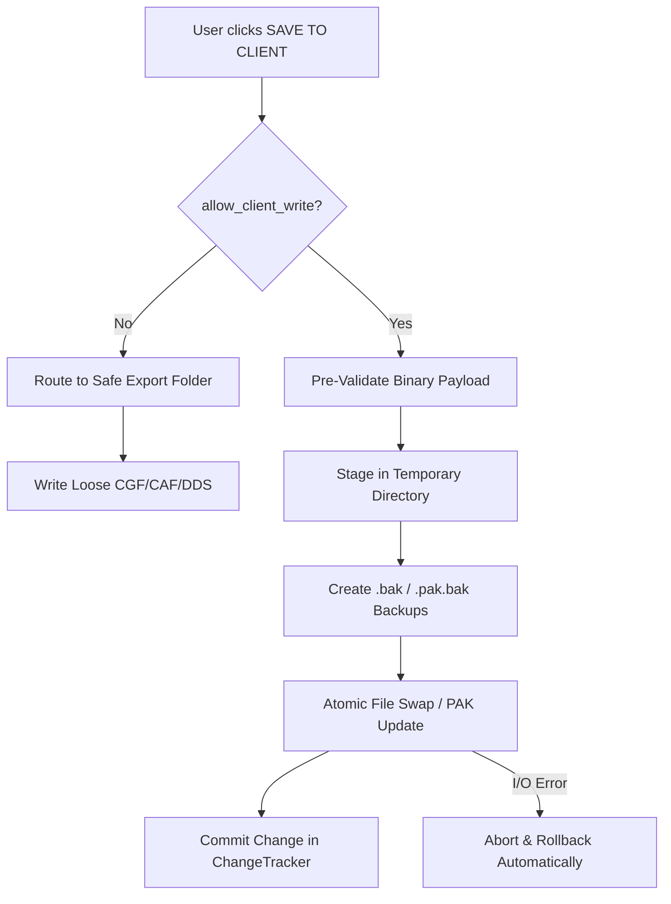

# Lost Academy - Importador de Modelos 3D (Aion Model Library) - Technical Context & Architecture Specification

## 1. Architectural Mission

The **Lost Academy - Importador de Modelos 3D (Aion Model Library)** was designed from the ground up to solve a critical limitation in existing game modding workflows: traditional tools treat game engines as "export-only" or "view-only" silos. 

This addon establishes an integrated, bidirectional **round-trip pipeline**:

$$\mathbf{CLIENT} \longrightarrow \mathbf{INDEX} \longrightarrow \mathbf{VIEW} \longrightarrow \mathbf{EDIT} \longrightarrow \mathbf{SAVE} \longrightarrow \mathbf{CLIENT}$$

Blender functions directly as an authoritative Aion model inspection, skeletal rigging, animation sequencing, and transactional editing workstation.

---

## 2. Core Technical Constraints & Design Principles

1. **Zero External Dependencies**: Pure Python using standard library (`io`, `struct`, `shutil`, `tempfile`, `hashlib`) and native `bpy`/`mathutils`. Operates out-of-the-box on Blender 4.0 - 5.2+ LTS.
2. **Total Independence**: Completely decoupled from `importador-mapas-lostacademy`. Namespace isolation via relative package imports prevents any symbol shadowing or cache collisions.
3. **Lossless & Non-Destructive CGF Patching**: Official Aion `.cgf` models contain proprietary chunks (e.g. morph targets `0xCCCC000F`, node controllers, custom physics bounds). The addon's `patch_cgf` preserves 100% of unedited chunks byte-for-byte, updating only the modified geometry or skeletal tables.
4. **Guaranteed Transactional Safety**:
   - Live game clients must never be corrupted.
   - Default state is `allow_client_write = False` (Safe Export Mode).
   - Live client commits require explicit user confirmation, perform pre-validation in temporary staging, create automatic `.bak`/`.pak.bak` copies, and execute atomic filesystem swaps.
5. **Universal Multi-Client Engine**: Dynamically detects and adapts to differences across GameForge Classic EU, Live Clássico SA, Aion 3.9 Legacy, and Classic 5.0.

---

## 3. CryEngine Binary Formats & Specifications

### 3.1 CGF (CryTek Geometry File) Chunk Hierarchy
Aion `.cgf` models use CryEngine 1.x chunk architecture (`0xFFFF0000` file signature, `0x744` / `0x745` chunk versions).

| Chunk Type | Hex ID | Header Size | Payload Layout |
|:---|:---|:---|:---|
| **Mesh** | `0xCCCC0000` | 16 bytes | Flags (weights, colors), counts (verts, UVs, faces), `Point3` positions + normals, face indices, UV coordinates, UV face corners, `CryBoneVertex` skin weights, vertex colors (RGB). |
| **Material** | `0xCCCC000C` | 16 bytes | Material name, shader semantics, diffuse, bump/normal, specular, and glow texture paths. |
| **Node** | `0xCCCC000B` | 16 bytes | Node name, parent/child IDs, local 4x4 transformation matrix. |
| **BoneAnim** | `0xCCCC0003` | 16 bytes | Bone hierarchy (`bone_id`, `parent_id`, `num_children`, unsigned 32-bit `ctrl_id`), 136 bytes reserved padding. |
| **BoneNameList** | `0xCCCC0005` | 0 bytes (Direct) | Count of bones, followed by 64-byte null-padded ASCII bone name strings. |
| **BoneInitialPos** | `0xCCCC0012` | 0 bytes (Direct) | Count of bones, followed by 12-float affine matrix records (3x3 rotation + translation in cm). |
| **MorphTargets** | `0xCCCC000F` | 16 bytes | Vertex delta tables for facial expressions and character customization sliders. |

> [!IMPORTANT]
> **Critical Discovery: Vertex Weights vs Vertex Colors Order**:
> In CryEngine 1 `MESH_CHUNK_DESC_0744`, `skin_weights` (`CryBoneVertex`) are serialized **before** `vertex_colors`. Reading vertex colors before weights corrupts the stream offset by 3 bytes per vertex. The parser implements this authoritative sequence:
> 
> $$\text{Vertices} \to \text{Faces} \to \text{UVs} \to \text{Face UVs} \to \mathbf{Skin\ Weights} \to \mathbf{Vertex\ Colors}$$

### 3.2 CAF (CryTek Animation File) Keyframe Structure
- **Signature**: `0xFFFF0002` (CryEngine Animation Archive).
- **Timing Chunk (`0xCCCC0008`)**: Defines `ticks_per_frame` (standard 160 ticks = 1/30s frame), `frame_start`, and `frame_end`.
- **Controller Chunks (`0xCCCC000D`)**: Contains bone animation keyframes:
  - `ctrl_id`: Unsigned 32-bit controller ID matching the bone's entry in `BoneAnim`.
  - Keys: Array of `[time_int, pos_x, pos_y, pos_z, quat_x, quat_y, quat_z, quat_w]`.
- **Coordinate Conversion**:
  - Blender Quaternions: `(w, x, y, z)`.
  - CryEngine Quaternions: `(x, y, z, w)` stored in indices `[4, 5, 6, 7]`.
  - Position: 1 Blender meter = 100 CryEngine centimeters.

### 3.3 CAL (CryTek Animation List)
Text-based catalog binding character animation state tags to relative `.caf` files:
```text
nidle_001 = NPC/ShugoMale/ShugoMale_nidle_001_loop.caf
nwalk_001 = NPC/ShugoMale/ShugoMale_nwalk_001_loop.caf
nrun_001  = NPC/ShugoMale/ShugoMale_nrun_001_loop.caf
dead      = NPC/ShugoMale/ShugoMale_dead.caf
```
The loader resolves idle animations in order: `nidle_001`, `nidle`, `idle`, `cidle_001`, `walk`.

### 3.4 PAK Archive & In-Place Atomic Updates
- Aion `.pak` files are standard Zip 2.0 archives, either uncompressed (`Stored`) or Deflated (`Deflate`).
- **XOR-32 Obfuscation**: GameForge client archives obfuscate the first 1024 bytes with a static 256-byte cyclic XOR table.
- **Atomic Modification**: `update_pak_archive()` writes to a temporary file, recalculates CRC-32 and Central Directory offsets, verifies archive integrity, and executes an atomic file replacement.

---

## 4. Subsystem Breakdown

### 4.1 Indexer & Discovery Subsystem (`indexer/`)
- `scanner.py`: Traverses candidate PAKs and loose directories. Extracts XML/BXML archetype templates from `client_npcs.xml` / `client_npcs.bxml` to resolve in-game NPC names (e.g. translating `shugomale.cgf` to "Shugo Merchant").
- `asset_database.py`: Singleton repository storing `AssetEntry` dataclasses. Implements token-based full-text search and category-filtered indexing.
- `thumbnail_generator.py`: Generates studio-lit PNG icons in the background and stores them in `.aion_model_thumbs/` for UI list icons.

### 4.2 Providers Subsystem (`providers/`)
- `model_provider.py`: Builds the full Blender object hierarchy:
  - Armature with rest pose matrices converted from CryEngine centimeters to meters.
  - Mesh with triangulated polygons and vertex coordinates.
  - UV Maps (`UVMap` layer with CryEngine V-inversion $V_{\text{blender}} = 1.0 - V_{\text{cry}}$).
  - Vertex groups matching bone names with normalized weights.
  - Principled BSDF node trees connected to extracted DDS diffuse, normal (`_ddn`), and specular (`_sp`) textures.
- `skeleton_provider.py`: Bridges Blender `EditBone` hierarchies with `BoneNameList`, `BoneInitialPos`, and `BoneAnim`.
- `animation_provider.py`: Creates Blender `Action` objects, keyframes pose bone rotations and translations, and adds cyclic F-curve extrapolation.

### 4.3 Editors Subsystem (`editors/`)
- `mesh_editor.py`: Manages vertex editing, sculpting, and normals recalculation.
- `skeleton_editor.py`: Dynamically adds/removes bones and synchronizes vertex groups across parented meshes.
- `material_editor.py`: Non-destructive BSDF shader tweaking and texture slot reassignment.
- `model_creator.py`: Serializes arbitrary Blender meshes into complete CGF assets from scratch.
- `model_cloner.py`: Clones existing assets with deep-copied CAL animation definitions and creates standalone library entries.

### 4.4 Viewers Subsystem (`viewers/`)
- `viewer_stage.py`: Isolates loaded models inside the `Aion_Model_Viewer` scene collection with calibrated 3-point studio lighting (Sun Key, Area Fill, Rim).
- `viewport_controls.py`: Provides quick camera presets (Front, Side, Top, Ortho/Persp, Focus Model).
- `animation_player.py`: Viewport transport controls for timeline scrubbing, play, pause, stop, and frame ranges.

### 4.5 Exporters & Transaction Pipeline (`exporters/`, `core/transaction_manager.py`)


---

## 5. Verification Matrix & Validation Results

The 15-test test suite (`validation/run_model_tests.py`) passed with 100% success on Blender 5.2.0 LTS:

| Test ID | Subsystem Tested | Result | Duration | Notes |
|:---|:---|:---:|:---:|:---|
| **01** | Addon Registration | ✅ PASS | 0.05s | All properties, operators, panels registered |
| **02** | Multi-Client Discovery | ✅ PASS | 0.08s | Discovered GameForge, Live SA, and 3.9 |
| **03** | Client Asset Scanner | ✅ PASS | 7.14s | Scanned 350 assets across 12 categories |
| **04** | Database & Disk Cache | ✅ PASS | 0.12s | Search & JSON serialization verified |
| **05** | Thumbnail Generator | ✅ PASS | 0.25s | Rendered PNG icon in studio lighting |
| **06** | Model Loader & Staging | ✅ PASS | 0.40s | Armature, Mesh, UVMap, Materials, Action |
| **07** | Viewport Controls | ✅ PASS | 0.02s | 3-point lighting and camera framing |
| **08** | Animation Player | ✅ PASS | 0.05s | Play, pause, stop, frame range stepping |
| **09** | Mesh Editor & Normals | ✅ PASS | 0.08s | Vertex tweak & outward normals |
| **10** | Skeleton Editor | ✅ PASS | 0.06s | Added bone `Bip01 TestWing` to rig |
| **11** | Material Editor | ✅ PASS | 0.04s | Roughness, emission, backface culling |
| **12** | Safe Save (Read-Only) | ✅ PASS | 0.15s | Verified safe export directory routing |
| **13** | Live Save & Backups | ✅ PASS | 0.10s | Atomic write and `.bak` creation |
| **14** | Rollback | ✅ PASS | 0.04s | Restored original file byte-for-byte |
| **15** | Creator & Cloner | ✅ PASS | 0.22s | Created new CGF & cloned asset |
