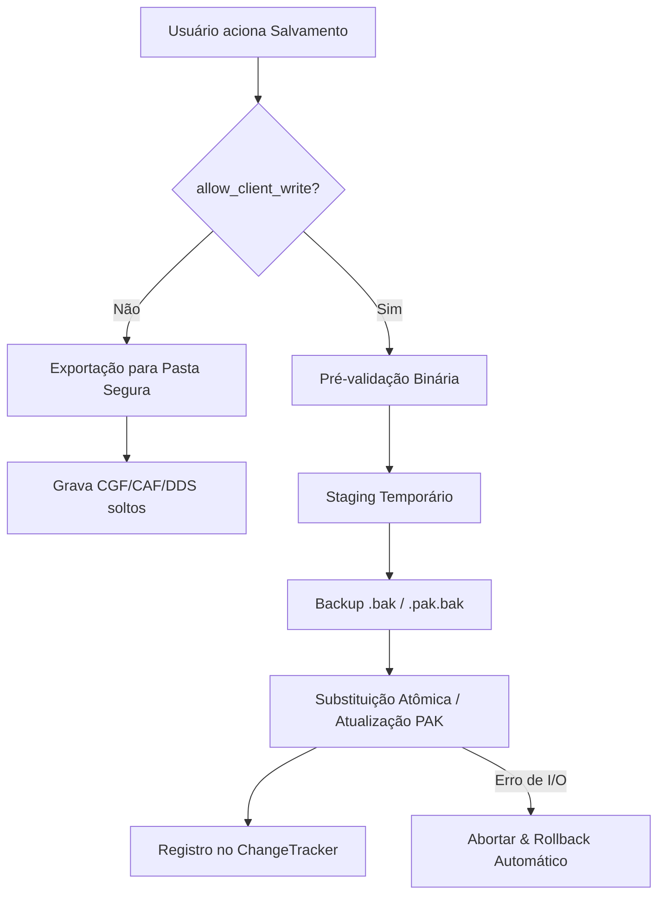

# Lost Academy — Importador de Modelos 3D (Aion Model Library): Especificação Técnica (`CONTEXT.md`)

**Repositório:** [https://github.com/kamidaki/aion-classic-5.0/](https://github.com/kamidaki/aion-classic-5.0/)  
**Ambiente Alvo:** Blender 4.0 - 5.2+ LTS (Python nativo do Blender, sem dependências externas)  
**Localização no Repositório:** `Ferramentas e Documentos/Blender - Plugins/importador-modelos3d-lostacademy`  
**Pacote Instalável (.ZIP):** `Ferramentas e Documentos/Blender - Plugins/importador-modelos3d-lostacademy.zip`

---

## 1. Missão Arquitetural

O **Importador de Modelos 3D (Aion Model Library)** implementa um pipeline bidirecional (*round-trip*) diretamente dentro do Blender para inspeção, rigging, animação e edição transacional de ativos 3D do Aion:

$$\mathbf{CLIENTE} \longrightarrow \mathbf{INDEXA\c{C}\tilde{A}O} \longrightarrow \mathbf{VISUALIZA\c{C}\tilde{A}O} \longrightarrow \mathbf{EDI\c{C}\tilde{A}O} \longrightarrow \mathbf{SALVAMENTO} \longrightarrow \mathbf{CLIENTE}$$

---

## 2. Princípios Técnicos e Restrições de Projeto

1. **Zero Dependências Externas:** 100% Python padrão (`io`, `struct`, `shutil`, `tempfile`, `hashlib`, `xml.etree.ElementTree`) + API nativa do Blender (`bpy`, `mathutils`).
2. **Desacoplamento Completo:** Isolado de `importador-mapas-lostacademy`, utilizando imports relativos dentro do pacote para evitar colisões de namespace ou cache.
3. **Preservação Sem Perdas (`patch_cgf`):** Modelos `.cgf` oficiais carregam chunks proprietários (como morph targets `0xCCCC000F`, controladores e bounds físicos). O patch preserva os chunks não alterados byte a byte, atualizando apenas as tabelas modificadas.
4. **Segurança Transacional:**
   - Estado padrão `allow_client_write = False` (gravação roteada para diretório de exportação segura).
   - Gravações diretas no cliente exigem confirmação explícita, validam payloads em diretório temporário, criam backups `.bak`/`.pak.bak` e executam substituição atômica.
5. **Suporte Multi-Client:** Detecta e adapta automaticamente estruturas de arquivos do **GameForge Classic (EU) / Classic 5.0**, **Retail 4.8** e **3.9 Legacy**.

---

## 3. Especificação dos Formatos Binários CryEngine

### 3.1. Hierarquia de Chunks CGF (CryTek Geometry File)
Modelos `.cgf` do Aion utilizam assinatura de arquivo `0xFFFF0000` (versões de chunk `0x744` / `0x745` / `0x750`).

| Tipo de Chunk | ID Hex | Cabeçalho | Estrutura do Payload |
| :--- | :--- | :--- | :--- |
| **Mesh** | `0xCCCC0000` | 16 bytes | Flags (pesos, cores), contagens (vértices, UVs, faces), posições + normais (`Point3`), índices de faces, coordenadas UV, índices UV por face, pesos de skin (`CryBoneVertex`) e cores de vértice (RGB). |
| **Material** | `0xCCCC000C` | 16 bytes | Nome do material, semântica do shader e caminhos das texturas difusa, normal/bump, especular e emissão. |
| **Node** | `0xCCCC000B` | 16 bytes | Nome do nó, IDs de pai/filho e matriz local 4×4 de transformação. |
| **BoneAnim** | `0xCCCC0003` | 16 bytes | Hierarquia de ossos (`bone_id`, `parent_id`, `num_children`, `ctrl_id` uint32) e bloco reservado. |
| **BoneNameList** | `0xCCCC0005` | Direto | Quantidade de ossos seguida de nomes ASCII em blocos terminados por nulo. |
| **BoneInitialPos** | `0xCCCC0012` | Direto | Quantidade de ossos seguida de matrizes afins de 12 floats (rotação 3×3 + translação em centímetros). |
| **MorphTargets** | `0xCCCC000F` | 16 bytes | Tabelas de deltas de vértices para expressões e customização. |

> [!IMPORTANT]
> **Ordem entre Skin Weights e Vertex Colors em `MESH_CHUNK_DESC_0744`:**
> Os pesos de skinning (`CryBoneVertex`) são serializados **antes** das cores de vértices (`vertex_colors`). Ler cores antes dos pesos desloca o stream em 3 bytes por vértice. A ordem canônica adotada no parser é:
>
> $$\text{Vértices} \to \text{Faces} \to \text{UVs} \to \text{Face UVs} \to \mathbf{Skin\ Weights} \to \mathbf{Vertex\ Colors}$$

### 3.2. Estrutura de Keyframes CAF (CryTek Animation File)
- **Assinatura:** `0xFFFF0002`
- **Chunk de Timing (`0xCCCC0008`):** `ticks_per_frame` (padrão 160 ticks = 1/30 s), `frame_start` e `frame_end`.
- **Chunks de Controladores (`0xCCCC000D`):** `ctrl_id` uint32 correspondente à entrada em `BoneAnim` + array `[time_int, pos_x, pos_y, pos_z, quat_x, quat_y, quat_z, quat_w]`.
- **Conversão de Coordenadas:**
  - Quaternions no Blender: `(w, x, y, z)`; na CryEngine: `(x, y, z, w)`.
  - Escala de posição: 1 metro no Blender = 100 centímetros na CryEngine.

### 3.3. Catálogo CAL (CryTek Animation List)
Arquivo texto que mapeia estados de animação para arquivos `.caf` relativos:
```text
nidle_001 = NPC/ShugoMale/ShugoMale_nidle_001_loop.caf
nwalk_001 = NPC/ShugoMale/ShugoMale_nwalk_001_loop.caf
nrun_001  = NPC/ShugoMale/ShugoMale_nrun_001_loop.caf
dead      = NPC/ShugoMale/ShugoMale_dead.caf
```

### 3.4. Arquivos `.pak` e Atualização Atômica
- Suporta pacotes Zip 2.0 padrão (`Stored` e `Deflate`) e pacotes ofuscados com **XOR-32** (tabela cíclica sobre os primeiros 1024 bytes).
- `update_pak_archive()` grava em arquivo temporário, recalcula CRC-32 e offsets do Diretório Central, valida a integridade e realiza substituição atômica após gerar `.pak.bak`.

---

## 4. Subsistemas do Add-on

- **`indexer/`:** `scanner.py` varre PAKs/pastas e lê templates em `client_npcs`; `asset_database.py` mantém índice em memória e cache JSON; `thumbnail_generator.py` gera ícones PNG em `.aion_model_thumbs/`.
- **`providers/`:** `model_provider.py`, `skeleton_provider.py`, `animation_provider.py`, `material_provider.py`, `texture_provider.py` (`V_blender = 1.0 - V_cry`), `npc_provider.py`, `mannequin_provider.py`, `sound_provider.py`, `effect_provider.py` e `export_provider.py`.
- **`editors/`:** `mesh_editor.py`, `uv_editor.py`, `skeleton_editor.py`, `animation_editor.py`, `material_editor.py`, `model_creator.py` e `model_cloner.py`.
- **`viewers/`:** `viewer_stage.py` (coleção `Aion_Model_Viewer` e iluminação 3 pontos), `stage_layout.py`, `viewport_controls.py`, `display_modes.py` e `animation_player.py`.
- **`exporters/` & `core/transaction_manager.py`:** `direct_saver.py`, `loose_exporter.py`, `client_exporter.py`, `npc_metadata.py` e `emulator_exporter.py` (com resolução via `AION_EMULATOR_ROOT` ou raiz relativa do repositório para `Código Fonte - Emulador/game-server-gameforge/data/static_data/npcs/npc_templates.xml`).



---

## 5. Diretrizes de Manutenção e Validação

- Mantenha módulos em `formats/` independentes de `bpy` para permitir testes isolados em Python puro.
- Nunca adicione caminhos absolutos locais no código ou na documentação — utilize `AION_CLIENT_ROOT`, `AION_EMULATOR_ROOT` ou resolução relativa a `Path(__file__)`.
- Execute os testes headless após alterações:

```powershell
$env:AION_CLIENT_ROOT = "<caminho-do-cliente-aion-classic>"
blender -b --python "validation/run_model_tests.py"
```
