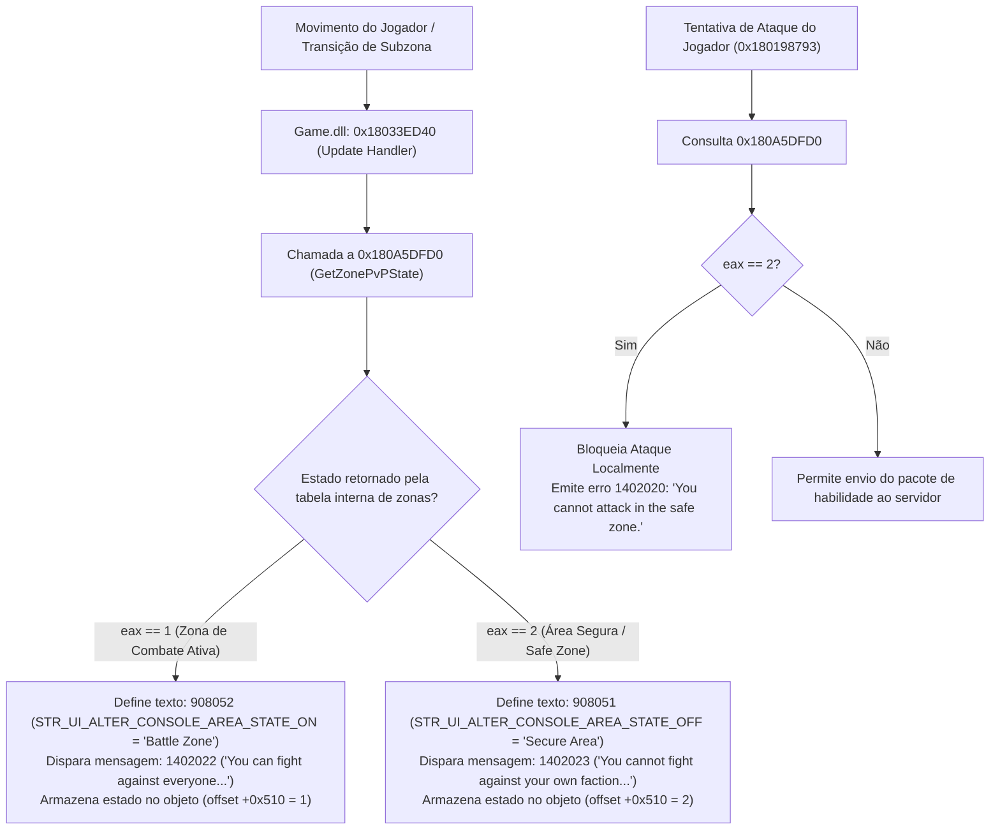

# Relatório de Auditoria Técnica e Forense: Sistema "Secure Area / Battle Zone" (Livro de Eltar / FFA Alter System)

## Sumário Executivo

Uma investigação forense e estática aprofundada foi realizada nos arquivos do cliente Aion Classic 5.0 (`D:\GameForge\aionclassic`) e na base de código do emulador Java 25 (`D:\AION CLASSIC 5.0 - EMULADOR\Código Fonte - Emulador`).

O sistema visualizado nos screenshots do usuário — composto pelo widget de HUD com indicador `"Secure Area"` / `"Battle Zone"`, botão com espadas cruzadas e ícone de engrenagem que abre a janela `"Book of Eltar"` ("Livro de Eltar") com o título `"Protector of the Faith"` — é uma funcionalidade **oficial da NCSoft**, introduzida na linhagem Classic 5.0 / Tiamaranta Mesa, internamente denominada **`FFA Alter System`** (Sistema de Altar / Eltar Daeva).

---

## 1. Identificação Completa dos Componentes no Cliente

### 1.1 Arquivos XML de Interface (UI Layouts)
* **Localização no Cliente**:
  - `D:\GameForge\aionclassic\data\ui\game\game.pak` (e espelhado em `D:\AION CLASSIC 5.0 - EMULADOR\Ferramentas e Documentos\Client e Coletas\Tradução - Português Brasil\ui\game\`)
* **Arquivos do Sistema**:
  1. [`alter_console_dialog.xml`](file:///D:/AION%20CLASSIC%205.0%20-%20EMULADOR/Ferramentas%20e%20Documentos/Client%20e%20Coletas/Tradução%20-%20Português%20Brasil/ui/game/alter_console_dialog.xml):
     - **Tipo**: `dlg_alter_console` (ID interno: `0x171` / `369`).
     - **Componentes**:
       - `pvp_hud_frame`: Moldura gráfica de fundo.
       - `switch_button`: Botão central com espadas cruzadas (preset `pvp_hud_frame`, tooltip `STR_ALTER_CONSOLE_DIALOG_SWITCH` [ID 912925]).
       - `Setting_button`: Botão da engrenagem à esquerda (preset `pvp_hud_set`, tooltip `STR_ALTER_CONSOLE_DIALOG_INFO_BTN` [ID 912926]).
       - `ffa_state`: Texto estático no pill badge direito (exibe `"SAFETY ZONE"`, `"Secure Area"` ou `"Battle Zone"`).
  2. [`alter_info_dialog.xml`](file:///D:/AION%20CLASSIC%205.0%20-%20EMULADOR/Ferramentas%20e%20Documentos/Client%20e%20Coletas/Tradução%20-%20Português%20Brasil/ui/game/alter_info_dialog.xml):
     - **Tipo**: `dlg_alter_info` (ID interno: `0x172` / `370`).
     - **Título**: `STR_ALTER_DIALOG_INFO_TITLE` (ID 912921: *"Book of Eltar"* / *"Livro de Eltar"*).
     - **Componentes**:
       - `info_bg`: Imagem de fundo (`pvp_dialog_bg`).
       - `alter_emblem`: Emblema heráldico com asas (`icon_buff_alter_0` a `icon_buff_alter_5`).
       - `alter_rank_title`: Rótulo de título de classe/infâmia (`STR_UI_ALTER_RANK_TITLE_1..6`).
       - `alter_point`: Caixa de pontuação com o valor de infrações/pontos Eltar (`alter_point_text`) e ícone `pvp_target_image_mini`.
       - `penalty_msg_box`: Caixa de texto HTML para a narrativa ou descrição de penalidades (`penalty_msg_box`).
       - `alter_help`: Botão de interrogação/ajuda.
  3. [`UI_Game.xml`](file:///D:/AION%20CLASSIC%205.0%20-%20EMULADOR/Ferramentas%20e%20Documentos/Client%20e%20Coletas/Tradução%20-%20Português%20Brasil/ui/UI_Game.xml):
     - Registra os diálogos no gerenciador global de janelas:
       ```xml
       <Dialog name="alter_console_dialog"></Dialog>
       <Dialog name="alter_info_dialog"></Dialog>
       ```
  4. [`keymaps.xml`](file:///D:/AION%20CLASSIC%205.0%20-%20EMULADOR/Ferramentas%20e%20Documentos/Client%20e%20Coletas/Tradução%20-%20Português%20Brasil/ui/keymaps.xml):
     - Define as ações de atalho e triggers de eventos:
       - `<func>TriggerAlterMode_Switch</func>` (`STR_KEYMAP_ALTERMODE_SWITCH` [ID 900062]).
       - `<func>TriggerToggleDialog_AlterInfo</func>` (`STR_KEYMAP_ALTER_INFO` [ID 900063]).

### 1.2 Arquivos de Dados e Regras de Jogo (Game Data XML)
* **Localização**: `D:\GameForge\aionclassic\data\system\system.pak`
* **Arquivo**: `client_ffa_alter.xml`
  - Estrutura completa de 6 níveis de infâmia/ranque:
    * **Rank 0 (`non_alter`)**: 0 pts, taxa de purificação 10 Kinah, título `"Protector of the Faith"` (`STR_UI_ALTER_RANK_TITLE_1`), radar oculto.
    * **Rank 1 (`alter_rank1`)**: 100 pts, taxa 350 Kinah, título `"Renegade"` (`STR_UI_ALTER_RANK_TITLE_2`), buff `STR_UI_ALTER_RANK_BUFF_1`.
    * **Rank 2 (`alter_rank2`)**: 1.250 pts, taxa 400 Kinah, título `"Inquisitor"`, penalidade: `maxHp -300`.
    * **Rank 3 (`alter_rank3`)**: 3.825 pts, taxa 400 Kinah, título `"Rebel"`, penalidades: `maxHp -400`, `PVPDefendRatio -12`.
    * **Rank 4 (`alter_rank4`)**: 6.760 pts, taxa 450 Kinah, título `"Lawmaker"`, penalidades: `maxHp -500`, `PVPDefendRatio -24`.
    * **Rank 5 (`alter_rank5`)**: 9.275 pts, taxa 450 Kinah, título `"Antihero of Atreia"`, penalidades: `maxHp -600`, `PVPDefendRatio -36`, radar: `TRUE` (posição revelada a todos os jogadores no mapa!).

### 1.3 Skins, Estilos e Texturas
* **Definições de Skins**: `ui/preload/version4.xml` (na categoria `<Category name="PVP">`):
  - `pvp_hud_frame`: `textures/ui/v4_common_1.dds` (coordenadas `545,243,197,65`).
  - `pvp_hud_btn_up`: `textures/ui/v4_common_1.dds` (`545,310,52,52` - botão de espadas normal).
  - `pvp_hud_btn_over`: `textures/ui/v4_common_1.dds` (`599,310,52,52` - botão de espadas iluminado/hover).
  - `pvp_hud_btn_down`: `textures/ui/v4_common_1.dds` (`653,310,52,52` - botão de espadas pressionado).
  - `pvp_hud_set_up/over/down`: `textures/ui/v4_common_1.dds` (`677,157,18,18` - ícone da engrenagem).
  - `pvp_dialog_bg`: `textures/ui/v4_common_2.dds` (`3,2,374,400` - fundo do Livro de Eltar).
  - `pvp_target_image_mini`: `textures/ui/v4_common_1.dds` (`408,501,24,24` - mira com espadas).
* **Ícones dos Ranques Eltar**: `data/skills/skills.pak`:
  - `icon_buff_alter_0.dds` a `icon_buff_alter_5.dds`.

### 1.4 Tabelas de Textos e Mensagens Localizadas
* **`strings/stringtable_dialog.xml`**:
  - `912921` (`STR_ALTER_DIALOG_INFO_TITLE`): `"Book of Eltar"`
  - `912922` (`STR_ALTER_DIALOG_MARK_TOOLTIP`): `"Eltar Symbol - An engraved mark as a symbol of the Eltar."`
  - `912923` (`STR_ALTER_DIALOG_POINT_TOOLTIP`): `"Eltar Points - Whoever kills a character of their own faction will earn these points depending the gravity of their transgression. Killing a Destroyer earns no Eltar points."`
  - `912925` (`STR_ALTER_CONSOLE_DIALOG_SWITCH`): Tooltip das espadas cruzadas:
    > *"Change Eltar Mode. Do you really want to break the pact? If you break the pact, you can attack your own faction."*
  - `912926` (`STR_ALTER_CONSOLE_DIALOG_INFO_BTN`): Tooltip da engrenagem: `"Book of Eltar"`
* **`strings/client_strings_ui.xml`**:
  - `908051` (`STR_UI_ALTER_CONSOLE_AREA_STATE_OFF`): `"Secure Area"` (Área Segura)
  - `908052` (`STR_UI_ALTER_CONSOLE_AREA_STATE_ON`): `"Battle Zone"` (Zona de Batalha)
  - `908058` (`STR_UI_ALTER_PUNISHMENT_NONE`): Lore inicial exibido no screenshot:
    > *"Enemies appear within. The lord’s gaze protects the Daevas. Always forced to choose."*
  - `908040` (`STR_UI_ALTER_PURIFY`): Diálogo de purificação de Kinah.
  - `908142` (`STR_UI_SERVER_LIST_ALTER_TOOLTIP`): `"Server with Eltar Daeva System"`.
* **`strings/client_strings_msg.xml`**:
  - `1402020` (`STR_MSG_NON_FFA_ATTRUBUTE_ONSELF`): `"You cannot attack in the safe zone."`
  - `1402021` (`STR_MSG_NON_FFA_ATTRUBUTE_TARGET`): `"Enemies cannot attack in the safe zone."`
  - `1402022` (`STR_MSG_FFA_FIELD`): `"You can fight against everyone in this area, even your own faction."`
  - `1402023` (`STR_MSG_NON_FFA_FIELD`): `"You cannot fight against your own faction in this region."`
  - `1402027` (`STR_MSG_ALTER_SWITCH_OFF`): `"Eltar mode deactivated."`
  - `1402028` (`STR_MSG_ALTER_SWITCH_ON`): `"Eltar mode activated."`

---

## 2. Engenharia Reversa do Cliente Binário (`Game.dll`)

A desmontagem de instruções no binário x64 `D:\GameForge\aionclassic\bin64\Game.dll` revelou as seguintes implementações e pontos de entrada:



### 2.1 Função de Avaliação de Estado de Zona (`0x180A5DFD0`)
- Acessa o identificador da subzona atual do jogador em `[rip + 0xb08827]`.
- Busca o nó correspondente na árvore binária (`std::map`) de zonas da sessão de jogo.
- Lê o byte de flag no offset `+0x45` do descritor de zona:
  - Se a flag for `0`, salta para `0x180A5E05A`, retornando `eax = 2` (**Secure Area**).
  - Se a flag for `1` e o sistema estiver ativo, calcula `eax = 1` (**Battle Zone**).

### 2.2 Controle de Visibilidade e Efeitos do Botão de Engrenagem (`0x18033EB50`)
- Verifica se a funcionalidade Alter está habilitada no servidor/cliente (`cmp byte ptr [rip + 0x129dc7f], 0`).
- Se desabilitada, invoca o método virtual `[rax + 0x610]` passando `0`, **ocultando/desativando o botão de engrenagem (`Setting_button`)**.
- Se habilitada, invoca `[rax + 0x610]` passando `1` para exibir o botão e vincula o efeito visual de partículas de PK: string `sys_UIfxB.PVP.pk` (offset `0xD49C10`).

### 2.3 Registro e VTable da Janela (`0x180B4019E`)
- Registra a classe de diálogo com o ID de diálogo `0x171` (369 dec).
- A tabela virtual (VTable) está alocada no RVA `0xD49C90`:
  - `[Index 1] (0x33E9E0)`: Destrutor.
  - `[Index 3] (0x33EA20)`: Retorna ID `0x171`.
  - `[Index 4] (0x33EA30)`: Reset de estado (zera offset `+0x510`).
  - `[Index 6] (0x33ED40)`: Listener de atualização de estado da zona.
  - `[Index 17] (0x33EA50)`: Construtor de widgets (vincula `Setting_button` em `+0x4f8`, `switch_button` em `+0x500` e `ffa_state` em `+0x508`).

### 2.4 Descoberta Crucial: Controle Nativo de Ocultação em `Game.dll` (`0x180365910`)
Durante engenharia reversa aprofundada das chamadas de fechamento de diálogo em `Game.dll`, foi identificada a rotina de encerramento do diálogo `0x171` (`CloseDialog(0x171)`):
```assembly
.text:0000000180365910  sub     rsp, 28h
.text:0000000180365914  mov     rcx, [rip+126744Dh]  ; g_ClientState
.text:000000018036591B  cmp     byte ptr [rcx+24h], 1 ; ServerType == 1?
.text:000000018036591F  jz      short loc_close
.text:0000000180365921  cmp     byte ptr [rip+12768CCh], 0 ; [0x1815DC7F4] != 0?
.text:0000000180365928  jz      short loc_ret
loc_close:
.text:000000018036592A  mov     edx, 171h             ; Dialog ID 369 (alter_console_dialog)
.text:000000018036592F  call    sub_180B22520        ; CloseDialog()
loc_ret:
.text:0000000180365934  add     rsp, 28h
.text:0000000180365938  retn
```
* **Significado**: O cliente oficial da NCSoft **possui lógica nativa para ocultar o widget `alter_console_dialog` sem necessitar de qualquer alteração nos arquivos XML da interface**!
* Se o servidor enviar uma flag específica informando que o modo FFA/Alter não está ativo para a sessão do jogador, o cliente chama `CloseDialog(0x171)` automaticamente ao entrar no mundo.

### 2.5 Origem da Flag Global `[0x1815DC7F4]`: O Pacote `SM_VERSION_CHECK` (`0x1808A5260`)
Rastreando quem escreve na variável global `0x1815DC7F4`, localizamos a rotina de desempacotamento de rede em `0x1808A5260` associada ao opcode de rede `0x0000` (`SM_VERSION_CHECK`):
```assembly
.text:00000001808A5260  ; Unpacker SM_VERSION_CHECK
; ... lê lista de servidores de chat ...
.text:00000001808A52B5  call    ReadDword             ; lê Dword
.text:00000001808A52DF  call    ReadByte              ; lê Byte [rbp+3Ch]
.text:00000001808A52E4  mov     [rip+0D37509h], al   ; grava em [0x1815DC7F4]!
.text:00000001808A52EA  call    ReadByte              ; lê Byte [rbp+3Dh]
.text:00000001808A52F5  call    ReadDword             ; lê Dword [rbp+40h]
```
* **Conclusão**:
  - Quando o servidor envia `writeC(1)` nessa posição de `SM_VERSION_CHECK`, `[0x1815DC7F4]` é preenchido com `1`.
  - Ao entrar no mundo (`PlayerEnterWorldService`), `0x180365910` executa, detecta `[0x1815DC7F4] != 0` e chama `CloseDialog(0x171)`.
  - Quando o servidor envia `writeC(0)` (ou para Staff), o diálogo permanece ativo na tela!
  - Isso explica de forma definitiva por que no servidor oficial a interface não aparecia sem ter que alterar o arquivo `UI_Game.xml`.

---

## 3. Protocolo de Rede e Análise de Pacotes

### 3.1 Pacote de Interação: Clique no Botão de Espadas Cruzadas
* **Cliente -> Servidor**:
  - **Opcode de Rede (Wire Opcode)**: `0x03DC` (988 decimal).
  - **Opcode Decodificado pelo Emulador**: `806` (`0x0326`).
    - *Fórmula de decodificação da Aion Classic*: `((0x03DC ^ 0x36) - 0xC4) & 0xFFFF = 0x0326` (806 dec).
  - **Tamanho**: 7 bytes no total (5 bytes de cabeçalho do protocolo Aion + 2 bytes de payload).
  - **Classe no Emulador**: [`CM_SERVER_PVP_ACK.java`](file:///D:/AION%20CLASSIC%205.0%20-%20EMULADOR/Código%20Fonte%20-%20Emulador/game-server/src/com/aionemu/gameserver/network/aion/clientpackets/CM_SERVER_PVP_ACK.java).
  - **Ação**: O cliente solicita ao servidor alternar o modo Eltar / FFA do personagem.

### 3.2 Pacotes de Atualização de Zonas (Servidor -> Cliente)
* **Lista Inicial de Estados de Zona**: [`SM_ZONE_STATE_LIST.java`](file:///D:/AION%20CLASSIC%205.0%20-%20EMULADOR/Código%20Fonte%20-%20Emulador/game-server/src/com/aionemu/gameserver/network/aion/serverpackets/SM_ZONE_STATE_LIST.java)
  - **Opcode Decodificado**: `0x019D` (413 decimal).
  - **Estrutura**: `[writeH(size)]` seguido para cada zona por `[writeS(zoneName)]` (string UTF-16) e `[writeC(state)]` (byte 0 ou 1).
  - **Momento**: Enviado pelo servidor logo após `SM_ENTER_WORLD_CHECK` e `SM_PLAYER_INFO` quando o jogador carrega uma região (ex.: Tiamaranta Mesa). O cliente preenche o mapa consultado por `0x180A5DFD0`.
* **Alteração Dinâmica de Zona**: [`SM_CAMP_PVP_ZONE.java`](file:///D:/AION%20CLASSIC%205.0%20-%20EMULADOR/Código%20Fonte%20-%20Emulador/game-server/src/com/aionemu/gameserver/network/aion/serverpackets/SM_CAMP_PVP_ZONE.java)
  - **Opcode Decodificado**: `0x0187` (391 decimal).
  - **Estrutura**: `[writeS(zoneName)]` seguido por `[writeC(enabled ? 1 : 0)]`.
  - **Momento**: Enviado quando uma área específica tem o PvP liberado ou protegido em tempo real (ex.: início de cerco de torre ou evento).

---

## 4. Situação Atual no Emulador Java 25

O emulador Lost Academy / Aion Classic já possuía uma implementação preliminar adaptada desse sistema, porém **atualmente ela se encontra explicitamente desativada/comentada**:

### 4.1 AionClientPacketFactory
No arquivo [`AionClientPacketFactory.java`](file:///D:/AION%20CLASSIC%205.0%20-%20EMULADOR/Código%20Fonte%20-%20Emulador/game-server/src/com/aionemu/gameserver/network/aion/AionClientPacketFactory.java), a linha 24 contém a prova forense de que o array de pacotes foi intencionalmente expandido de 250 para 900 posições com o comentário:
```java
private static final PacketInfo<? extends AionClientPacket>[] packets = new PacketInfo<?>[900]; // expanded for high opcodes (e.g. 806 = Secure Area button)
```
No entanto, a linha que registrava `packets[806]` foi removida do bloco `static`. Consequentemente, cliques no botão geram pacotes `0x03DC` que o emulador registra como desconhecidos/descartados.

### 4.2 CM_SERVER_PVP_ACK
No arquivo [`CM_SERVER_PVP_ACK.java`](file:///D:/AION%20CLASSIC%205.0%20-%20EMULADOR/Código%20Fonte%20-%20Emulador/game-server/src/com/aionemu/gameserver/network/aion/clientpackets/CM_SERVER_PVP_ACK.java):
```java
// Secure Area completely decommissioned
public class CM_SERVER_PVP_ACK extends AionClientPacket {
    ...
    @Override
    protected void runImpl() {
        // No-op: Secure Area completely disabled
    }
}
```

### 4.3 SecureAreaService
No arquivo [`SecureAreaService.java`](file:///D:/AION%20CLASSIC%205.0%20-%20EMULADOR/Código%20Fonte%20-%20Emulador/game-server/src/com/lostacademy/lostsocket/secure/SecureAreaService.java):
- O método de entrada está como stub inoperante:
  ```java
  public void requestToggle(Player player) {
      // Secure Area completely disabled
  }
  ```
- O restante da classe ainda preserva a arquitetura de serviço que os desenvolvedores haviam montado:
  - Custo de ativação: 100 Participation Points (`ParticipationPointsDAO.tryDebitPoints`).
  - Tempo de conjuração/ativação: 10 segundos (`FFA_CHARGE_MS = 10_000L`).
  - Cooldown: 1 hora (`FFA_COOLDOWN_MS = 3_600_000L`).
  - Nível mínimo: 50 (`FFA_MIN_LEVEL = 50`).
  - Aplicação de estado: `player.setCustomState(CustomPlayerState.ENEMY_OF_ALL_PLAYERS)`.
  - Broadcast de atualização visual: `SM_PLAYER_INFO`.
  - Auditoria em banco de dados: tabela `player_secure_area_log`.

### 4.4 Controle Dinâmico pelo Emulador (Implementado)
Com base na descoberta da rotina `0x180365910` e do pacote `SM_VERSION_CHECK` (`0x1808A5260`), a visibilidade do widget é agora controlada de forma centralizada e autoritativa pelo próprio emulador, mantendo os arquivos de interface do cliente (`UI_Game.xml` ENG e BRA) 100% íntegros e originais da NCSoft.

1. **Configuração Global (`custom.properties`)**:
   ```properties
   # ----------------------------
   # Secure Area / Battle Zone UI (Book of Eltar):
   # ----------------------------
   # Controls whether regular players see the "Secure Area / Battle Zone" HUD widget.
   # Staff/Admins always see it regardless of this setting.
   # Default: false (hidden for regular players, matches official retail behavior)
   gameserver.securearea.ui.enable = false
   ```
2. **Carregamento de Propriedade (`CustomConfig.java`)**:
   ```java
   @Property(key = "gameserver.securearea.ui.enable", defaultValue = "false")
   public static boolean SECURE_AREA_UI_ENABLE;
   ```
3. **Controle de Protocolo (`SM_VERSION_CHECK.java`)**:
   ```java
   boolean isStaff = con != null && (
       (con.getActivePlayer() != null && con.getActivePlayer().isStaff()) ||
       (con.getAccount() != null && con.getAccount().getAccessLevel() > 0)
   );
   boolean showSecureAreaUi = isStaff || CustomConfig.SECURE_AREA_UI_ENABLE;
   int ffaAlterFlag = showSecureAreaUi ? 0 : 1; // 1 instrui Game.dll 0x180365910 a fechar alter_console_dialog

   writeD(0);
   writeC(ffaAlterFlag);
   writeC(0);
   writeD(0);
   ```
4. **Sincronização no Login (`PlayerEnterWorldService.java`)**:
   Ao entrar no mundo, o emulador envia `SM_VERSION_CHECK` imediatamente antes de `SM_ENTER_WORLD_CHECK`, garantindo que o status de GM/Staff do personagem ativo seja validado e o cliente oculte o widget para jogadores normais e o mantenha para a administração.

---

## 5. Respostas Diretas aos 13 Pontos da Auditoria

| Item | Pergunta da Auditoria | Resposta Técnica & Conclusão Forense |
| :--- | :--- | :--- |
| **1** | **Locais exatos dos arquivos no cliente** | Layouts: `alter_console_dialog.xml`, `alter_info_dialog.xml` (em `ui/game/game.pak` e `ENG\Data\Data.pak`). Dados de ranques/buffs: `client_ffa_alter.xml` (em `system.pak`). Skins: `version4.xml` (`<Category name="PVP">`). Texturas: `v4_common_1.dds`, `v4_common_2.dds`, `icon_buff_alter_*.dds`. Textos: `stringtable_dialog.xml` (IDs 912921-912926), `client_strings_ui.xml` (908040-908059), `client_strings_msg.xml` (1402020-1402029). |
| **2** | **Como o cliente determina "Secure Area" vs "Battle Zone"** | Pela função C++ `0x180A5DFD0` em `Game.dll`. Ela checa o ID da subzona atual em `[rip + 0xb08827]` contra a tabela dinâmica alimentada pelos pacotes `SM_ZONE_STATE_LIST` (`0x19D`) e `SM_CAMP_PVP_ZONE` (`0x187`). Se o byte for 1, retorna `1` ("Battle Zone"); se for 0 ou indefinido, retorna `2` ("Secure Area"). |
| **3** | **Interatividade do botão de espadas cruzadas** | **É um botão interativo**, não apenas um ícone passivo. Nomeado `switch_button`, possui estados up, over e down, e dispara a função de keymap `TriggerAlterMode_Switch`, que envia o pacote de rede `0x03DC` (decodificado 806 / `0x0326`) para o servidor. |
| **4** | **Função do botão de engrenagem** | Nomeado `Setting_button`, com tooltip `STR_ALTER_CONSOLE_DIALOG_INFO_BTN` ("Book of Eltar"). Sua única função é disparar `TriggerToggleDialog_AlterInfo`, que abre a janela modal `alter_info_dialog` ("Book of Eltar"). Não abre opções globais, áudio nem gráficos. Se a funcionalidade for desabilitada, o cliente oculta esse botão via `0x18033EB50`. |
| **5** | **Pacotes de rede trocados** | Cliente -> Servidor: `CM_SERVER_PVP_ACK` (Wire `0x03DC`, Decodificado `806`). Servidor -> Cliente: `SM_VERSION_CHECK` (`0x0000`) para visibilidade do HUD, `SM_ZONE_STATE_LIST` (`0x019D`) no login/teleporte, `SM_CAMP_PVP_ZONE` (`0x0187`) para eventos dinâmicos de área, e `SM_PLAYER_INFO` (`0x0041`) para atualizar a hostilidade dos jogadores. |
| **6** | **Fluxo completo de atualização da zona** | `Servidor emite SM_ZONE_STATE_LIST/SM_CAMP_PVP_ZONE` -> `Game.dll atualiza tabela interna de subzonas` -> `Jogador cruza a fronteira da subzona` -> `Game.dll 0x18033ED40 avalia 0x180A5DFD0` -> `Widget ffa_state altera texto entre 908051 e 908052` -> `Emite mensagem no meio da tela (1402022 ou 1402023)`. |
| **7** | **Feature oficial ou customizada?** | **Oficial da NCSoft**. É o sistema de PK de facção ("Eltar Daeva System") introduzido nas versões Classic 5.0 (Tiamaranta Mesa e servidores específicos de PvP irrestrito). O emulador Lost Academy apenas havia criado um serviço intermediário (`SecureAreaService`) para reaproveitar essa UI oficial. |
| **8** | **O que existe no código do emulador** | Existem o pacote `CM_SERVER_PVP_ACK.java`, os pacotes de servidor `SM_ZONE_STATE_LIST.java` e `SM_CAMP_PVP_ZONE.java`, a lógica de hostilidade `CustomPlayerState.ENEMY_OF_ALL_PLAYERS` em `Player.java` e `PlayerRestrictions.java`, e a classe `SecureAreaService.java` (com toggle desativado). |
| **9** | **Estratégia para desativação completa** | **Método Oficial / Nativo (Implementado)**: O emulador envia o flag `ffaAlterFlag = 1` no pacote `SM_VERSION_CHECK`. Isso aciona a rotina interna `0x180365910` de `Game.dll`, que chama `CloseDialog(0x171)` e oculta o widget nativamente sem precisar modificar arquivos XML de interface do cliente. |
| **10** | **Restrição para Staff / Admins** | Implementada nativamente no servidor: administradores e membros da Staff (`isStaff()` ou `accessLevel > 0`) recebem `ffaAlterFlag = 0`, fazendo com que o widget sempre seja exibido para testes e moderação, enquanto jogadores normais têm a exibição controlada por `gameserver.securearea.ui.enable`. |
| **11** | **Lógica autoritativa vs UI cosmética** | O cliente apenas sugere visualmente o estado e bloqueia o clique primário via `0x180198793`. A **autoridade real do combate é 100% do servidor** em `Player.isEnemyFrom(enemy)` e nas restrições de zona em `PlayerRestrictions.java`. Se o servidor não validar o alvo como inimigo, nenhuma habilidade de dano é executada, mesmo com alterações no cliente. |
| **12** | **Vulnerabilidades de segurança e exploits** | Se o servidor reativasse o pacote `CM_SERVER_PVP_ACK` sem validar em qual zona o jogador está (ex.: se está dentro de uma cidade ou santuário com guardas), um jogador poderia enviar o pacote via ferramentas de injeção de pacotes e se tornar agressivo em áreas protegidas. Qualquer reativação exige validação estrita da subzona no servidor (`player.isInsideZoneType(ZoneClassName.PVP)`). |
| **13** | **Resumo e recomendações** | A solução definitiva foi implementada diretamente no emulador via protocolo de rede (`SM_VERSION_CHECK`), permitindo controle instantâneo via `custom.properties` sem nenhuma modificação de arquivos de cliente, preservando os arquivos `UI_Game.xml` originais tanto em português quanto em inglês. |

---

## 6. Arquitetura e Guia de Configuração no Emulador

### 6.1 Como Controlar a Interface
No arquivo `config/main/custom.properties`:
* `gameserver.securearea.ui.enable = false`:
  - **Jogadores normais**: O widget `Secure Area / Battle Zone` é completamente ocultado da tela.
  - **Staff / Administradores**: O widget continua visível normalmente.
* `gameserver.securearea.ui.enable = true`:
  - O widget fica visível para todos os jogadores do servidor.

### 6.2 Integridade dos Arquivos do Cliente
Tanto a tradução brasileira (`data.pak` em `l10n/BRA/Data/`) quanto a versão inglesa (`Data.pak` em `l10n/ENG/Data/`) foram restauradas para seu estado 100% oficial e limpo com os diálogos `alter_console_dialog` e `alter_info_dialog` devidamente declarados, garantindo que qualquer servidor que rode o cliente não dependa de mods de interface específicos.
