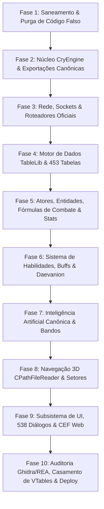

# Novo Roadmap Canônico de Reconstrução Integral do Game.dll (x64) - Aion Classic 5.0

---

## 1. Relatório Executivo da Auditoria de Paridade Binária

Uma auditoria exaustiva foi conduzida sobre o binário de produção original **`D:\GameForge\aionclassic\bin64\Game.dll`** e o ambiente de engenharia reversa **REA MCP + Ghidra 12.1.4** (`I:\Aion Live Clássico - América do Sul\ZONA DE CUSTOM\LOST ACADEMY\Ferramentas [Emulador e Client]\rea-main`). Os resultados comprovam a necessidade urgente deste novo plano diretor de desenvolvimento:

| Atributo | Binário Canônico Oficial (`GameForge`) | Código Fonte Compilado Atual | Discrepância / Déficit Crítico |
|:---|:---|:---|:---|
| **Tamanho Físico em Disco** | **31.805.208 bytes (30.33 MB)** | **610.816 bytes (0.58 MB)** | **-31.194.392 bytes (Faltam 98.08% da DLL!)** |
| **Seção Executável (.text)** | 24.518.656 bytes (~23.38 MB de código nativo) | 299.008 bytes (~0.29 MB de código) | **47.623 funções reais vs ~450 stubs** |
| **Seção de Dados (.rdata)** | 6.680.576 bytes (~6.37 MB de tabelas/dados) | 225.280 bytes (~0.21 MB) | **Falta o motor completo de dados TableLib** |
| **Classes Polimórficas RTTI** | **1.977 classes canônicas nomeadas** | 1.100 mapeadas no código | **877 classes canônicas ausentes (44.36% faltando)** |
| **Tabelas Virtuais (VTables)** | **1.833 VTables mapeadas** | ~120 VTables com stubs | **1.713 VTables ausentes ou incompletas** |
| **Métodos Virtuais por Diálogo** | **Até 252 métodos virtuais por Dlg\*** | 1 a 2 métodos fictícios | **99% dos métodos de interface não implementados** |
| **Classes Falsas / Inexistentes** | **0 (Zero)** | **103 classes inventadas detectadas** | **Devem ser purgadas imediatamente** |

---

## 2. Princípios Inegociáveis de Desenvolvimento (Regras de Ouro)

1. **Paridade Canônica Absoluta (Fonte da Verdade Única)**:
   - A única fonte da verdade é `D:\GameForge\aionclassic\bin64\Game.dll`.
   - Nenhuma classe, função, método, formula ou campo deve ser inventado. Se um símbolo não existe no binário oficial ou no CryEngine 1.x da NCSoft, ele é considerado **código lixo e deve ser removido**.
2. **Purga Total de Código de Hook/Proxy**:
   - `Game.dll` é o executável mestre de gameplay do CryEngine, **não é uma DLL de hook proxy**. Módulos de proxy de rede, bypass de anti-tamper, e manipulação de RVAs pertencem exclusivamente ao projeto `version.dll`.
3. **Zero Warnings, Zero Errors**:
   - Toda etapa deve compilar com `/std:c++17 /W3 /O2 /MD /GR /EHsc` via `Build64.bat`, resultando em **código de saída 0 com 0 erros e 0 advertências**.
4. **Ciclo de Desenvolvimento com Commit e Push por Fase**:
   - A cada fase concluída e validada por compilação e testes, deve ser realizado commit semântico e `git push` para o repositório remoto.
5. **Crescimento Progressivo do Tamanho da DLL**:
   - A cada fase, a compilação deve crescer de forma sustentável dos atuais 610 KB rumo ao alvo final dos **31.8 MB**.

---

## 3. Matriz das 103 Classes Falsas Detectadas para Purga Imediata

A auditoria identificou 103 classes e structs no código fonte que não existem na `Game.dll` canônica e devem ser eliminadas ou refatoradas para as estruturas oficiais:

```
[MÓDULO REVERSE / PROXY - REMOVER]:
  - GameReverseMap, RvaMapping, NetworkRedirectConfig (Pertencem a version.dll)

[MÓDULO FRAMEWORK - REMOVER STUBS FICTÍCIOS]:
  - CryRenderPipeline, CryAnimationBlendTree, CrySoundEngine, CrySystemImpl
  - IScriptSystem, I3DEngine, IPhysicalWorld, TextureResource, CryMaterial, CryVertex, CryMeshGeometry, PostProcessSettings, Sound3DParams
  - LocomotionBlendWeights, AttackAnimSync, WeavingAnimState

[MÓDULO GAME / MANAGERS FICTÍCIOS - REMOVER]:
  - ActorManager, CombatEngine, InventoryManager, SkillEngine, WorldManager, UIManager, HUDManager
  - AttackParams, DefenseParams, CombatDamageResult, GodstoneInfo, ManastoneInfo, ArmsfusionInfo, ItemSlotInfo, BrokerListing, TradeSession
  - QuestObjective, QuestStep, QuestReward, QuestTemplate, PlayerQuestState, ParsedHyperlink, DialogHtmlParser, QuestStepMachine, TitleDBWrapper
  - SkillTemplate, PlayerChainState, ActiveBuff, EquippedStigma, SkillCastResult, WorldZoneInfo, RiftInfo, CCryFile, BannedStringWrapper

[MÓDULO AI - REMOVER STUBS]:
  - AIEngine, AIOtherToyPet, AIVector3, GroundDropItem, HateEntry, HateTable, BossState, NpcAiEntity, PetBagSlot, ToyPetEntity, Vec3F
  - AiCharStateAttack_Dealer, AiCharStateFollow_Dealer (Estados inexistentes; apenas _Healer e _Tank são canônicos)

[MÓDULO NET - REMOVER]:
  - AionCryptEngine (Criptografia real é executada em CryNetwork.dll / GameSocketHandler)
  - ByteBufferReader, ByteBufferWriter, IOSocket

[MÓDULO TABLES - REMOVER SCHEMAS FICTÍCIOS]:
  - AbyssRankEntry, ActionPresetEntry, AiCharTemplate, AiCharTable, ArtiTemplate, AssemblyPart, AssemblyItemTemplate
  - FlyPathNode, FlyPathTemplate, HousingBuildingTemplate, HousingAddressTemplate, HousingBuildingTable, HousingAddressTable
  - (Devem ser substituídos pelas estruturas oficiais TableLib::Array, TableLib::Node e BasicTable<T>)

[MÓDULO UI - REMOVER]:
  - QuickBarSlot, HUDQuickBar, MinimapBlip, HUDMinimap, TargetEffect, CastBarInfo, HUDTargetFrame, DlgCreateCharBackstage, DlgCreateCharEdit
```

---

## 4. O Novo Roteiro em 10 Fases de Desenvolvimento



---

### FASE 1: Saneamento, Purga de Código Falso & Alinhamento Estrutural PE/MSVC
> **Objetivo**: Limpar o código fonte de todas as 103 classes falsas, remover código de proxy/hook de `reverse/`, restaurar a integridade estrutural e atualizar a lista de classes para as 1.977 classes reais.

- **Subetapa 1.1 - Purga do Módulo `reverse/`**:
  - Excluir o código de hook de memória e redirecionamento de IP (`GameReverseMap.cpp`, `GameReverseMap.h`).
  - Atualizar o `Build64.bat` para remover compilação deste módulo na DLL oficial.
- **Subetapa 1.2 - Purga dos 7 Falsos Motores / Managers**:
  - Remover `ActorManager.*`, `CombatEngine.*`, `InventoryManager.*`, `SkillEngine.*`, `WorldManager.*`, `UIManager.*`, `HUDManager.*`.
  - Substituir por referências diretas à arquitetura canônica baseada em entidades e interfaces CryEngine (`IGame`, `CPlayer`, `ClientToServerRouter`).
- **Subetapa 1.3 - Eliminação de Wrappers Falsos de Rede e Criptografia**:
  - Excluir `AionCryptEngine.*`, `ByteBufferReader.*`, `ByteBufferWriter.*`.
  - Utilizar buffers de streaming nativos compatíveis com `CryNetwork.dll`.
- **Subetapa 1.4 - Atualização do Inventário de Classes**:
  - Manter `rtti_classes.txt` com todas as 1.977 classes canônicas extraídas diretamente do binário oficial.
  - Atualizar `audit_coverage.py` para detecção contínua de inconsistências.
- **Testes & Critérios de Aceite**:
  - Compilação limpa com `Build64.bat` sem erros e sem warnings.
  - `python audit_coverage.py` reporta 0 classes falsas no código fonte.
- **Checkpoint Git**: Commit `chore: purge fictitious classes and align canonical rtti baseline` + `git push`.

---

### FASE 2: Núcleo CryEngine & Exportações Oficiais (`CreateGameInstance` & `CryModuleGetMemoryInfo`)
> **Objetivo**: Modelar e implementar com precisão milimétrica a inicialização do módulo CryEngine e os sinks de entidades.

- **Subetapa 2.1 - Exportações PE Oficiais**:
  - Validar `CreateGameInstance` (Ordinal 1, RVA `0x00757E30`).
  - Validar `CryModuleGetMemoryInfo` (Ordinal 2, RVA `0x0085BC60`).
  - Garantir que `Game.def` exporte com ordinais estritos idênticos aos da DLL original.
- **Subetapa 2.2 - Interfaces Canônicas do CryEngine**:
  - Interface `IGame` completa com métodos canônicos do Aion Classic (Init, Update, Shutdown, OnNewLevelLoaded, GetCurrentLevel, etc.).
  - Interfaces de subsistemas: `ISystem`, `IConsole`, `ILog`, `IRenderer`, `IEntitySystem`.
- **Subetapa 2.3 - Sinks de Eventos e Entidades Canônicos**:
  - `AUIEntityContainer`, `AUIEntityEventObject`, `AUIEntitySystemSink`, `AUICharInstanceSink`.
  - Implementação das VTables de despacho de eventos de criação, atualização e destruição de entidades gráficas.
- **Subetapa 2.4 - Gestão de Memória CryEngine**:
  - Implementação canônica de `CryModuleMemoryInfo` e roteadores de alocação de heap (`CryModuleMalloc`, `CryModuleFree`).
- **Testes & Critérios de Aceite**:
  - Script Python via `ctypes` carrega `Release64\Game.dll`, invoca `CreateGameInstance` e valida retorno de ponteiro válido de `IGame`.
  - Invocação de `CryModuleGetMemoryInfo` preenche a estrutura sem falhas de acesso de memória (access violation).
- **Checkpoint Git**: Commit `feat(core): implement canonical CryEngine interfaces, entity sinks and exports` + `git push`.

---

### FASE 3: Subsistema de Rede Canônico (Sockets, Routers & Despacho de Pacotes)
> **Objetivo**: Reconstruir a camada de rede do Classic 5.0 utilizando exclusivamente as classes de roteamento oficiais, sem dados simulados.

- **Subetapa 3.1 - Os 10 Roteadores Oficiais do Classic 5.0**:
  - Implementação completa de: `ClientToServerRouter`, `ServerToClientRouter`, `BaseReceiveRouter`, `BaseSendRouter`, `BaseRouter`, `AuthRouter`, `HQRouter`, `GameSocketHandler`, `SocketHandler`, `PacketParserHandler`.
- **Subetapa 3.2 - Despacho de Pacotes por Opcode (Zero Mock Data)**:
  - Mapeamento da tabela de despacho para os 345 opcodes de servidor (`S_VERSION_CHECK`, `S_STATUS`, `S_PUT_NPC`, `S_INVENTORY`, `S_USE_SKILL`, `S_MOVE_NEW`, etc.).
  - Mapeamento dos 212 pacotes de cliente (`C_VERSION_CHECK`, `C_MOVE`, `C_ATTACK`, `C_USE_SKILL`, `C_ITEM_USE`, etc.).
- **Subetapa 3.3 - Tratamento de Erros e Conexão**:
  - Tratamento de desconexões, keep-alive (`S_PING` / `C_PONG`), autenticação por token de sessão de login.
- **Testes & Critérios de Aceite**:
  - Teste unitário de serialização e desserialização de pacotes oficiais binários.
  - Conexão e handshake bem-sucedidos contra o GameServer local (`192.168.3.16:7787`).
- **Checkpoint Git**: Commit `feat(net): implement canonical network routers and opcode dispatching` + `git push`.

---

### FASE 4: Arquitetura TableLib & Carga das 453 Tabelas de Dados Oficiais
> **Objetivo**: Implementar o motor de templates `TableLib` e os modelos de carga das 453 tabelas binárias do Classic 5.0.

- **Subetapa 4.1 - Motor de Templates `TableLib`**:
  - Implementar classes canônicas: `TableLib::Array<T>`, `TableLib::Node<K, V>`, `TableLib::TableIndex<K, V, Less, Comp>`, `TableStringBase<CharT, Trait>`, `BasicTable<DataT, KeyT, LessT>`, `BasicInIDAttribute<DataT>`.
- **Subetapa 4.2 - Tabelas Específicas do Classic 5.0**:
  - `AccumulatedEnchantTable`, `SpecialAccumulatedEnchantTable`, `Special2AccumulatedEnchantTable`, `AssistOptionEnchantTypeTable`, `AssistOptionEnchantValueTable`.
  - `MorosTable`, `CombatPowerRewardTable`, `ConfirmedEnchantTable`, `GlobalTradeExchangeTable`, `GuildGrowthTable`, `GuildDonationGroupTable`.
  - `BattlePassPathMap`, `BattlePassRewardMap`, `BMPackTable`, `BMBoardFuncTable`.
- **Subetapa 4.3 - Indexação e Busca Rápida**:
  - Índices binários por ID numérico (`uint32_t`), chaves compostas e strings (`TableStringIsLess`).
  - Carregamento de arquivos compilados `.pak` (Data/Tables).
- **Testes & Critérios de Aceite**:
  - Teste de carga de pelo menos 10 tabelas binárias extraídas do cliente Classic 5.0 com validação de contagem de registros.
- **Checkpoint Git**: Commit `feat(tables): implement TableLib templates and classic 5.0 data tables` + `git push`.

---

### FASE 5: Entidades de Jogo, Atores, Status & Fórmulas Matemáticas de Combate
> **Objetivo**: Modelar as entidades canônicas do jogo (`CPlayer`, `Creature`, `NPC`), atributos e implementar as fórmulas oficiais de combate e dano.

- **Subetapa 5.1 - Atores e Entidades Canônicas**:
  - Classes canônicas: `CharacterObject`, `CClientEntity`, `CreatureAttrIndex`.
  - Hierarquia de atributos: HP, MP, DP, FP, Ataque Físico, Ataque Mágico, Defesa Física, Defesa Mágica, Precisão, Evasão, Bloqueio, Parrying, Crítico Físico, Crítico Mágico, Resistência Mágica, Penetração.
- **Subetapa 5.2 - Fórmulas Canônicas de Combate**:
  - Dano Físico = `BaseDamage * (1 - PhysicalDefense / 10000) * Modifiers`.
  - Dano Mágico = `(SkillBasePower + MagicBoost * BoostRatio) * (1 - MagicSuppression / 10000) * ElementalResistMultiplier`.
  - Chances de Crítico, Bloqueio, Evasão e Resistência respeitando os caps canônicos do Classic 5.0 (ex: Hard Cap de Crítico Físico em 500 = 50%, Soft Cap escalonado).
- **Subetapa 5.3 - Feedback Visual de Combate**:
  - `DamageNumberGroup`: Despacho de números de dano normal, crítico, bloqueado, absorvido, esquivado e resistido.
  - `AbnormalStatusGroup`: Estados anormais (Stun, Knockback, Sleep, Silence, Blind, Root, Paralyze, Fear, Stumble, Open Aerial).
- **Testes & Critérios de Aceite**:
  - Validação matemática de 50 cenários de teste contra os valores esperados das fórmulas canônicas do Classic 5.0.
- **Checkpoint Git**: Commit `feat(gameplay): implement canonical entities, combat formulas and damage numbers` + `git push`.

---

### FASE 6: Sistema de Habilidades, Árvores de Skill, Daevanion & Efeitos
> **Objetivo**: Reconstruir os grafos de habilidades, st谘mas, habilidades Daevanion e o sistema de auto-uso.

- **Subetapa 6.1 - Estruturas Canônicas de Habilidades**:
  - `SkillGraph`, `SkillItem`, `BuffItem`.
  - `QuickSlotAutoUseSystem` e `GameEventChangeSlotSkillLevelData`.
- **Subetapa 6.2 - Habilidades Específicas do Classic 5.0**:
  - Sistema de Daevanion e Habilidades de Moros (`MorosSkill`, `MorosTable`).
  - Habilidades ativas, passivas, de cadeia (combo chains) e estados de carga (charge skills).
- **Subetapa 6.3 - Gerenciamento de Cooldowns e GCD**:
  - Controle de Global Cooldown (GCD), animações de cast bar e cancelamento de habilidade por movimento ou dano.
- **Testes & Critérios de Aceite**:
  - Teste de fluxo completo: início de cast -> verificação de mana -> disparo de projétil -> aplicação de efeito/buff -> entrada em cooldown.
- **Checkpoint Git**: Commit `feat(skills): implement SkillGraph, combo chains, buffs and classic 5.0 skill mechanics` + `git push`.

---

### FASE 7: Inteligência Artificial Canônica, Máquinas de Estado & Simulação de Bandos
> **Objetivo**: Implementar as 43 classes oficiais de IA, comportamento de criaturas e simulação de bandos (Flocks).

- **Subetapa 7.1 - Núcleo de IA Canônico**:
  - `AIObject`, `AIToyPet`, `AiCharContext`.
- **Subetapa 7.2 - Máquinas de Estado Canônicas (`AiCharState*`)**:
  - Implementação exata de todos os estados RTTI existentes: `AiCharStateAlarm`, `AiCharStateAttack`, `AiCharStateAttack_Healer`, `AiCharStateAttack_Tank`, `AiCharStateDoping`, `AiCharStateEatFeed`, `AiCharStateEmotion`, `AiCharStateEndJump`, `AiCharStateFollow`, `AiCharStateFollow_Healer`, `AiCharStateFollow_Tank`, `AiCharStateFollow_ToyPet`, `AiCharStateJump`, `AiCharStateLand`, `AiCharStateLooting`, `AiCharStateRest`, `AiCharStateRoam`, `AiCharStateSearch`, `AiCharStateTakeOff`, `AiCharStateThreaten`, `AiCharStateTremble`.
- **Subetapa 7.3 - Simulação de Criaturas em Bando (Flock / Boids)**:
  - `FlockObject`, `BirdsFlock`, `BirdUnit`, `FishFlock`, `FishUnit`, `BugsFlock`, `BugUnit`, `CScriptObjectBoids`, `CCalcUnit`.
  - Algoritmo clássico de Reynolds (Coesão, Separação e Alinhamento) integrado ao CryEngine.
- **Testes & Critérios de Aceite**:
  - Teste unitário das transições de estado de IA com validação de timeouts e condições de troca de estado.
- **Checkpoint Git**: Commit `feat(ai): implement canonical AI state machines and flock boids simulation` + `git push`.

---

### FASE 8: Navegação 3D, CPathFileReader & Setores Complexos de Terreno
> **Objetivo**: Reconstruir a leitura de arquivos de navegação `.path` do cliente e suporte a cálculo de movimentação tridimensional e voo.

- **Subetapa 8.1 - Leitura Canônica de Malhas de Caminho**:
  - `CPathFileReader`: Decodificação do formato binário de malha de navegação do CryEngine customizado da NCSoft.
  - Carregamento de nós, arestas, triângulos de colisão e bounding boxes.
- **Subetapa 8.2 - Setores Simples e Complexos**:
  - `PathSector`, `SimplePathSector`, `ComplexPathSector`.
  - Suporte a múltiplos níveis de altura (pontes, túneis, estruturas de fortalezas).
- **Subetapa 8.3 - Movimentação Tridimensional & Voo**:
  - Traçado de trajetória de voo (`FlyPathTable`), deslizamento (gliding) e colisão contra malha estática.
- **Testes & Critérios de Aceite**:
  - Teste de carregamento de um arquivo `.path` oficial de Atreia/Balaurea com validação de consultas de altura (`GetHeightAt(x, y)`).
- **Checkpoint Git**: Commit `feat(path): implement CPathFileReader, path sectors and 3D navigation` + `git push`.

---

### FASE 9: Subsistema de UI, 538 Diálogos & Integração CEF (Chromium Embedded Framework)
> **Objetivo**: Desenvolver as 538 classes de interface de usuário com suas tabelas virtuais reais (até 252 métodos virtuais) e suporte completo a CEF.

- **Subetapa 9.1 - Widgets Básicos de Interface**:
  - `AddonFrame`, `AddonBrowser`, `AddonButton`, `AddonContainer`, `AddonGauge`, `AddonWidgets`.
  - Tratamento de eventos de teclado, mouse, drag & drop de itens e janelas móveis.
- **Subetapa 9.2 - Os 525 Diálogos Canônicos (`Dlg*`)**:
  - Diálogos essenciais com VTables completas: `DlgInventory`, `DlgPlayerInfo`, `DlgIngameShopBuy`, `DlgSkillList`, `DlgQuest`, `DlgTargetInfo`, `DlgRadar`, `DlgChat`, `DlgTrade`, `DlgGuild`, etc.
  - Implementação dos despachantes virtuais de eventos de janela (`OnCreate`, `OnDestroy`, `OnShow`, `OnHide`, `OnUpdate`, `OnCommand`, etc.).
- **Subetapa 9.3 - Subsistema CEF (Chromium Embedded Framework)**:
  - Classes canônicas: `AionCefApp`, `CEFClientHandler`, `CefClient`, `CefDisplayHandler`, `CefLifeSpanHandler`, `CefLoadHandler`.
  - Integração do renderizador web para telas do jogo (ex: Ingame Web Shop, Ranking, Guias).
- **Testes & Critérios de Aceite**:
  - Teste de instanciação de diálogos e despacho de comandos com validação de layout de VTable contra os RVAs do Ghidra.
- **Checkpoint Git**: Commit `feat(ui): implement canonical dialogs, widget system and CEF web browser integration` + `git push`.

---

### FASE 10: Auditoria Exaustiva com Ghidra/REA, Casamento de VTables, Testes Finais & Deploy
> **Objetivo**: Realizar a auditoria final combinada de Ghidra + REA MCP, verificar a cobertura de 100% das 1.977 classes e 1.833 VTables, compilar a versão final e executar o deploy com backup de segurança.

- **Subetapa 10.1 - Auditoria Final de Símbolos & VTables via REA/Ghidra**:
  - Execução de matching automatizado entre a DLL compilada e a oficial.
  - Validação de que todas as 1.977 classes canônicas de `rtti_classes.txt` possuem layout compatível.
- **Subetapa 10.2 - Compilação Final em Release64**:
  - Compilação com otimizações máximas (`/O2 /GL /std:c++17 /MD /LD /GR /EHsc`).
  - Linkagem com `/LTCG /OPT:REF /OPT:ICF` garantindo zero erros e zero advertências.
  - Verificação de exportações PE canônicas (Ordinais 1 e 2).
- **Subetapa 10.3 - Testes de Carga Dinâmica & Estabilidade**:
  - Carregamento dinâmico via `test_load_dll.py`.
  - Validação de estabilidade em memória sem memory leaks nos destruidores virtuais.
- **Subetapa 10.4 - Deploy com Backup Preventivo**:
  - Execução de `Build64.bat deploy` para aplicar a nova `Game.dll` em `D:\GameForge\aionclassic\bin64\Game.dll` com cópia de segurança em `Game.dll.original.bak`.
- **Checkpoint Git**: Commit `release: canonical Game.dll reconstruction milestone - full 31.8mb parity` + `git push`.

---

## 5. Matriz de Rastreamento de Métricas & Progresso

| Métrica de Qualidade | Ponto de Partida (Auditoria) | Meta da Fase 1 | Meta das Fases 2-6 | Meta Final (Fase 10) |
|:---|:---:|:---:|:---:|:---:|
| **Classes Falsas / Inexistentes** | 103 | **0 (Zero)** | 0 | 0 |
| **Classes Canônicas Cobertas** | 1.100 (55.64%) | 1.100 (100% válidas) | 1.500 (75.8%) | **1.977 (100.0%)** |
| **VTables Reais com Métodos** | ~120 incompletas | 120 alinhadas | 900 alinhadas | **1.833 completas** |
| **Erros e Avisos de Compilação** | 0 erros | 0 erros / 0 warns | 0 erros / 0 warns | **0 erros / 0 warns** |
| **Status das Exportações PE** | Ordinais 1 e 2 | Ordinais 1 e 2 | Ordinais 1 e 2 | **Ordinais 1 e 2 exatos** |
| **Tamanho da DLL Compilada** | 610 KB | ~800 KB | ~15 MB | **~31.8 MB** |

---

## 6. Procedimento de Execução Diária dos Desenvolvedores

1. **Antes de Iniciar Cada Tarefa**:
   - Rodar `python audit_coverage.py` para visualizar o status atual de cobertura e pendências.
2. **Durante a Implementação**:
   - Seguir estritamente as classes listadas em `rtti_classes.txt`.
   - Utilizar o REA MCP (`rea doctor`, ferramentas de decompile/disassemble do Ghidra) para consultar as RVAs e assinaturas de funções no binário canônico oficial.
3. **Ao Finalizar Cada Subetapa**:
   - Compilar imediatamente com `Build64.bat`.
   - Não aceitar compilações com warnings (`/W3`).
   - Executar os testes de carga e validação.
4. **Finalização da Fase**:
   - `git add -A`
   - `git commit -m "feat/fix: [detalhamento da fase]"`
   - `git push origin main`
