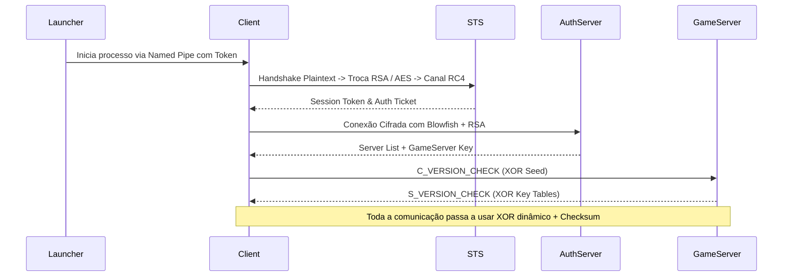

# ETAPA 01: INFRAESTRUTURA DE REDE, SEGURANÇA E PROTOCOLOS DE PACOTES

> **Status da Etapa**: Concluída  
> **Prioridade**: Crítica (Fundação da Comunicação)  
> **Dependências**: [00_VISAO_GERAL_E_METODOLOGIA.md](file:///d:/AION%20RUST/AionEMU/AionEMU/PLANO-DESENVOLVIMENTO/00_VISAO_GERAL_E_METODOLOGIA.md)  
> **Referência Principal em Java**: `com.aionemu.gameserver.network` e `com.aionemu.commons.network`

---

## 1. Arquitetura da Camada de Transporte (Network Engine)

O Aion utiliza conexões TCP persistentes com controle de enquadramento (Framing) baseado em cabeçalho de 2 bytes indicando o tamanho do pacote (Little Endian).

### 1.1 Estrutura do Pacote Aion (Wire Format)
```
+-------------------+---------------------+-------------------------+
| Tamanho (2 bytes) | Opcode (1 ou 2 B)   | Payload Cifrado/Aberto |
+-------------------+---------------------+-------------------------+
```

### 1.2 Implementação em Rust (`tokio` + `bytes`)
- **Evitar alocações desnecessárias**: Usar `BytesMut` e buffers circulares.
- **Correção mandatória de I/O**: Todas as operações de envio de pacotes devem usar `tokio::io::AsyncWriteExt::write_all` (ou garantir loop de envio completo), impedindo pacotes truncados que quebrem a máquina de estados do cliente.

---

## 2. Camada Criptográfica (`krypt` Crate)

A comunicação com o cliente Aion 4.5 Classic passa por múltiplos estágios de cifra:



### 2.1 Cifras Utilizadas:
1. **RSA (1024/2048 bits)**: Troca de chaves no Login e STS.
2. **Blowfish**: Utilizado no `auth-server` para decodificar credenciais e tickets de login.
3. **RC4 Stream Cipher**: Usado para encapsular a sessão de tokens no `sts-server`.
4. **XOR Dinâmico com Tabela de Opcodes e Checksum**: Usado no `game-server`. Cada conexão gera um par de sementes XOR (`gen_xor_seed`, `gen_xor_key`).

---

## 3. Framework Unificado de Pacotes (CM $\leftrightarrow$ SM)

Inspirado no modelo `AionClientPacket` e `AionServerPacket` do Java 4.8 Retail, o Rust deve utilizar traits bem definidas:

### 3.1 Trait para Pacotes Recebidos do Cliente (Client Messages - CM)
```rust
pub trait AionClientPacket: Send + Sync {
    /// Deserializa o payload a partir do buffer decifrado
    fn read(buf: &[u8]) -> Result<Self, PacketError> where Self: Sized;
    
    /// Executa a regra de negócio sobre a sessão do jogador
    fn handle(&self, session: &mut PlayerSession, world: &WorldHandle) -> Result<(), ServerError>;
}
```

### 3.2 Trait para Pacotes Enviados pelo Servidor (Server Messages - SM)
```rust
pub trait AionServerPacket: Send + Sync {
    /// Identificador do Opcode para o cliente Classic 4.5
    fn opcode(&self) -> u16;
    
    /// Serializa o payload no buffer de saída
    fn write(&self, buf: &mut BytesMut) -> Result<(), PacketError>;
}
```

---

## 4. Tabela de Mapeamento de Opcodes e Prevenção de Crash

### 4.1 Opcodes Vitais de Conexão e Sincronismo

| Opcode Classic 4.5 | Nome no Java 4.8 | Função / Comportamento |
| :---: | :--- | :--- |
| `0x00` | `CM_VERSION_CHECK` / `SM_VERSION_CHECK` | Handshake inicial de versão e entrega da chave XOR. |
| `0x12` (18) | `CM_TIME_CHECK` / `SM_TIME_CHECK` | Sincronismo de relógio do cliente/servidor (`S_SYNC_TIME`). |
| `0x2C` (44) | `CM_PING` / `SM_PONG` | Heartbeat keep-alive para evitar timeout de conexão. |
| `0x8B` | `S_SA_ACCOUNT_ITEM_NOTI` | **Crítico**: Opcode de 4 bytes sem o qual a tela de seleção de personagem trava. |
| `0x0D` (13) | `SM_ENTER_WORLD_CHECK` | Confirmação de permissão para carregar o mapa. |
| `0x09` (9) | `CM_LEVEL_READY` | Cliente avisa que o mapa terminou de carregar no disco. |

### 4.2 Mecanismo Anti-Crash para Opcodes Desconhecidos
- Caso o cliente envie um CM desconhecido:
  1. Registrar `WARN: Opcode 0xXX desconhecido recebido (tamanho: N bytes)`.
  2. Gravar dump hexadecimal para análise rápida no `pcap-parser` / Wireshark.
  3. Manter a conexão aberta, sem pânico (`panic!`), evitando derrubar o cliente ou a thread do servidor.

---

## 5. Validação Autônoma da Etapa 01

### Testes a Realizar:
1. **Teste Unitário de Criptografia**: Validar cifragem e decifragem XOR com vetores de teste gravados em PCAPs conhecidos (`cargo test --package krypt`).
2. **Teste de Fuzzing de Pacotes**: Enviar fluxos de bytes aleatórios para o `game-server` e verificar se a conexão fecha suavemente sem panics.
3. **Validação de Handshake Real**: Lançar o cliente oficial e conferir se o `S_VERSION_CHECK` e `S_SYNC_TIME` completam com sucesso.
