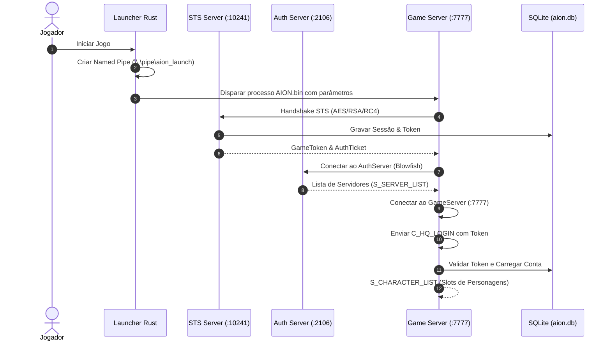

# ETAPA 02: AUTENTICAÇÃO STS, LOGIN E GESTÃO DE PERSONAGENS (LOBBY)

> **Status da Etapa**: Concluída  
> **Prioridade**: Crítica (Acesso ao Jogo)  
> **Dependências**: [01_INFRAESTRUTURA_REDE_SEGURANCA_PROTOCOLOS.md](file:///d:/AION%20RUST/AionEMU/AionEMU/PLANO-DESENVOLVIMENTO/01_INFRAESTRUTURA_REDE_SEGURANCA_PROTOCOLOS.md)  
> **Referência Principal em Java**: `com.aionemu.gameserver.network.aion.clientpackets.CM_CHARACTER_LIST`, `CM_CREATE_CHARACTER`, `CM_ENTER_WORLD`, `com.aionemu.gameserver.services.player.PlayerService`

---

## 1. Fluxo de Autenticação e Transição de Conexões

O cliente Aion Classic 4.5 segue uma sequência estrita de handshake entre múltiplos serviços:



---

## 2. Detalhes de Implementação dos Protocolos de Lobby

### 2.1 Handshake no GameServer (`C_HQ_LOGIN`)
- O cliente envia o `AUTHN_TOKEN` recebido do launcher dentro de uma string terminada em nulo (`\0`).
- **Atenção Crítica**: O servidor Rust DEVE aparar o byte nulo (`trim_end_matches('\0')`) antes de buscar no banco. A falha na remoção do `\0` causava contas sintéticas duplicadas a cada login.

### 2.2 Lista de Personagens (`S_CHARACTER_LIST`)
- Cada personagem na lista possui um registro padronizado de **758 bytes**:
  - Dados básicos: ID da entidade, Nome (52 bytes UTF-16LE / bytes truncados), Raça, Gênero, Classe, Nível, Mapa, Coordenadas X/Y/Z, Rotação.
  - Bloco de Aparência (Rosto, Cabelo, Cores de Pele/Olho/Cabelo, Altura, Proporções corporais).
  - Slots de Equipamentos visíveis (Armas, Peitoral, Calças, Luvas, Botas, Ombreiras, Elmo, Asas).

### 2.3 Engenharia Reversa da Criação de Personagens (`C_CREATE_CHARACTER`)
- O pacote `C_CREATE_CHARACTER` enviado pelo cliente contém exatamente a estrutura necessária para o registro:
  - Os bytes **22..162** do pedido de criação correspondem, byte a byte, ao trecho **4..144** do registro da lista de personagens (deslocamento fixo de 18 bytes):
    $$\text{nome (52 bytes)} \mid \text{genero} \mid \text{raca} \mid \text{classe} \mid \text{voz} \mid \text{4 cores} \mid \text{rosto (52 bytes)} \mid \text{altura}$$
  - **Fórmula de Redundância de Mesh**:
    $$\text{MeshID} = 100000 + (\text{raca} \times 2) + \text{genero}$$
    *Nota: Essa fórmula seleciona o esqueleto base 3D do personagem. Não deve ser trocada entre Elyos/Asmodian para evitar o bug do personagem sem cabeça.*

### 2.4 Resposta de Criação (`S_CREATE_CHARACTER`)
- Formato: 4 bytes de resultado (`0 = Sucesso`, `1 = Nome em uso`, etc.) + primeiros 744 bytes do registro de 758 bytes.

### 2.5 Opcode Desbloqueante da Tela de Personagens (`0x8B`)
- Sem a resposta `S_SA_ACCOUNT_ITEM_NOTI` (Opcode `0x8B` com 4 bytes zero), o cliente Classic 4.5 fica congelado no lobby sem permitir clique nos botões "Entrar no Mundo" ou "Criar Personagem".

---

## 3. Esquema de Banco de Dados Relacional (SQLite / `aion.db`)

```sql
-- Contas
CREATE TABLE IF NOT EXISTS accounts (
    id INTEGER PRIMARY KEY AUTOINCREMENT,
    name TEXT NOT NULL UNIQUE,
    token TEXT NOT NULL,
    access_level INTEGER DEFAULT 0,
    membership INTEGER DEFAULT 0,
    last_ip TEXT,
    last_online TIMESTAMP
);

-- Personagens
CREATE TABLE IF NOT EXISTS characters (
    id INTEGER PRIMARY KEY,
    account_id INTEGER NOT NULL,
    name TEXT NOT NULL UNIQUE,
    race INTEGER NOT NULL,
    gender INTEGER NOT NULL,
    class_id INTEGER NOT NULL,
    level INTEGER DEFAULT 1,
    exp INTEGER DEFAULT 0,
    hp INTEGER DEFAULT 100,
    mp INTEGER DEFAULT 100,
    world_id INTEGER NOT NULL,
    x REAL NOT NULL,
    y REAL NOT NULL,
    z REAL NOT NULL,
    heading INTEGER NOT NULL,
    creation_data BLOB NOT NULL, -- Bloco de 758 bytes da aparência
    deletion_time TIMESTAMP,
    FOREIGN KEY(account_id) REFERENCES accounts(id)
);
```

---

## 4. Entrada no Mundo (`CM_ENTER_WORLD` & `CM_LEVEL_READY`)

1. Jogador seleciona personagem $\rightarrow$ Envia `CM_ENTER_WORLD` com `character_id`.
2. Servidor valida e responde com:
   - `SM_ENTER_WORLD_CHECK` (Opcode 13 - autoriza tela de loading).
   - `SM_PLAYER_SPAWN` / `SM_PLAYER_INFO` (carrega dados próprios).
   - `SM_INVENTORY_INFO` (envia itens do inventário/equipamentos).
   - `SM_STATS_INFO` (envia status de HP/MP/Atributos).
   - `SM_SKILL_LIST` (envia skills aprendidas).
3. Cliente conclui loading do mapa e envia `CM_LEVEL_READY`.
4. Servidor coloca o jogador no Grid Espacial do Mundo e inicia o streaming de entidades vizinhas.

---

## 5. Validação Autônoma da Etapa 02

### Roteiro de Testes:
1. **Lançamento Automático**: O agente dispara o launcher e cliente Classic 4.5.
2. **Criação de Personagens**: Criar 1 Elyos e 1 Asmodian com diferentes classes (Guerreiro, Mago, Escoteiro, Sacerdote, Artista, Engenheiro).
3. **Persistência**: Fechar o cliente, reiniciar o emulador Rust e reabrir o cliente; validar se os personagens continuam na lista com aparência intacta.
4. **Entrada no Mundo**: Entrar com o personagem e verificar se a tela de loading avança para o mundo 3D sem travar no `0x8B` ou por timeout de tokens.
