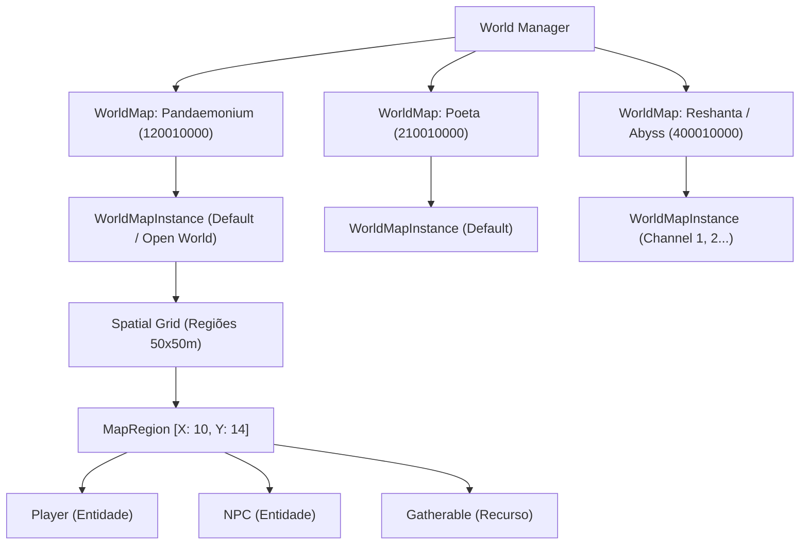

# ETAPA 03: MOTOR DE MUNDO, GRID ESPACIAL E GERENCIAMENTO DE ENTIDADES

> **Status da Etapa**: Concluída  
> **Prioridade**: Alta (Coração da Simulação)  
> **Dependências**: [02_AUTENTICACAO_STS_LOGIN_PERSONAGEM.md](file:///d:/AION%20RUST/AionEMU/AionEMU/PLANO-DESENVOLVIMENTO/02_AUTENTICACAO_STS_LOGIN_PERSONAGEM.md)  
> **Referência Principal em Java**: `com.aionemu.gameserver.world`, `com.aionemu.gameserver.world.knownlist`, `com.aionemu.gameserver.model.gameobjects`

---

## 1. Arquitetura do World Engine em Rust

O motor de mundo gerencia a presença física de todos os jogadores, NPCs, monstros e objetos no espaço tridimensional.



---

## 2. Particionamento Espacial e Sistema de Visibilidade (KnownList)

### 2.1 O Problema do Envio Massivo de Entidades
No Aion, enviar todos os NPCs de uma cidade de uma vez (como os 1.054 NPCs de Pandaemonium) estoura o buffer TCP/Socket e causa dessincronia. O servidor oficial utiliza **streaming por proximidade**.

### 2.2 Divisão em Regiões Espaciais (`MapRegion`)
- O mapa é subdividido em células de grade 2D/3D (ex: $50\text{m} \times 50\text{m}$).
- Cada entidade pertence a uma `MapRegion` baseada em suas coordenadas $(X, Y, Z)$.
- As entidades vizinhas são consultadas nas 9 regiões adjacentes (a célula atual + 8 ao redor).

### 2.3 Raios de Visibilidade Típicos:
- **Jogadores**: $60\text{ metros}$.
- **NPCs e Monstros**: $40\text{ metros}$.
- **Objetos Estáticos / Kisk / Portas**: $100\text{ metros}$.

### 2.4 Algoritmo de Streaming e Delta de Movimento:
A cada movimento do jogador de aproximadamente $15\text{ a }20\text{ metros}$:
1. Calcular lista de entidades no raio de visão atual ($K_{\text{novo}}$).
2. Comparar com a lista conhecida anteriormente pelo cliente ($K_{\text{anterior}}$).
3. **Novas Entidades que Entraram** ($K_{\text{novo}} \setminus K_{\text{anterior}}$): Enviar `SM_NPC_INFO` (`S_PUT_NPC`) ou `SM_PLAYER_INFO` (`S_PUT_USER`).
4. **Entidades que Saíram da Visão** ($K_{\text{anterior}} \setminus K_{\text{novo}}$): Enviar `SM_DELETE` (`S_REMOVE_OBJECT`).
5. Atualizar $K_{\text{anterior}} \leftarrow K_{\text{novo}}$.

---

## 3. Hierarquia de Entidades e Tipos no Rust

Em Rust, ao invés de herança profunda de classes Java (`VisibleObject -> Creature -> Player`), utilizamos uma composição elegante de structs e Enums:

```rust
pub enum EntityKind {
    Player(Box<PlayerData>),
    Npc(Box<NpcData>),
    Monster(Box<MonsterData>),
    Gatherable(Box<GatherableData>),
    Pet(Box<PetData>),
    Summon(Box<SummonData>),
    Kisk(Box<KiskData>),
    StaticDoor(Box<DoorData>),
}

pub struct Entity {
    pub id: u32,
    pub world_id: u32,
    pub instance_id: u32,
    pub position: Vector3<f32>,
    pub heading: u8,
    pub region_id: (u32, u32),
    pub kind: EntityKind,
}
```

---

## 4. Estrutura dos Pacotes de Spawns de Entidades

### 4.1 Pacote `SM_NPC_INFO` (`S_PUT_NPC` - Opcode 14)
Estrutura do payload:
- `0..12`: $X, Y, Z$ (`f32` Little Endian).
- `12..16`: ID único da entidade em tempo de execução (bit alto ligado `0x80000000`).
- `16..20`: `npc_id` do template do cliente.
- `20..24`: `npc_id` repetido.
- `24`: Tipo de NPC (Monstro, Guarda, Comerciante, etc.).
- `25`: Estado (ex: `0x41 = Vivo/Ativo`).
- `28..32`: ID da string do nome no catálogo do cliente.
- `32..N`: Velocidade, heading, altitude, buffs visíveis e postura.

### 4.2 Pacote `SM_DELETE` (`S_REMOVE_OBJECT` - Opcode 22)
Estrutura do payload:
- `0..4`: ID da entidade a ser removida da tela do cliente.
- `4`: Tipo de exclusão (`0 = Despawn/Fora de alcance`, `1 = Morte/Desintegração`).

---

## 5. Validação Autônoma da Etapa 03

### Testes a Executar pelo Agente:
1. **Teste de Streaming Contínuo**:
   - Conectar um personagem em Pandaemonium ou Sanctum.
   - Caminhar 500 metros em linha reta.
   - Conferir nos logs se `SM_NPC_INFO` é enviado progressivamente e se `SM_DELETE` é disparado para os NPCs deixados para trás.
   - Validar que o uso de memória não vaza e que o buffer TCP permanece estável sem quedas.
2. **Teste de Concorrência**:
   - Inserir 10.000 entidades mock no Grid e rodar queries de proximidade com múltiplos threads assíncronos (`tokio::spawn`), validando latência inferior a $2\text{ms}$ por query.
