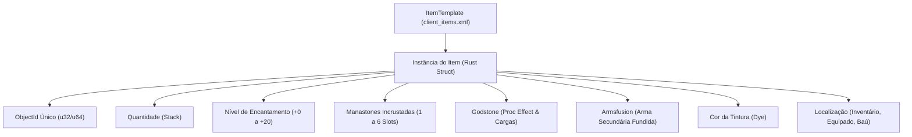
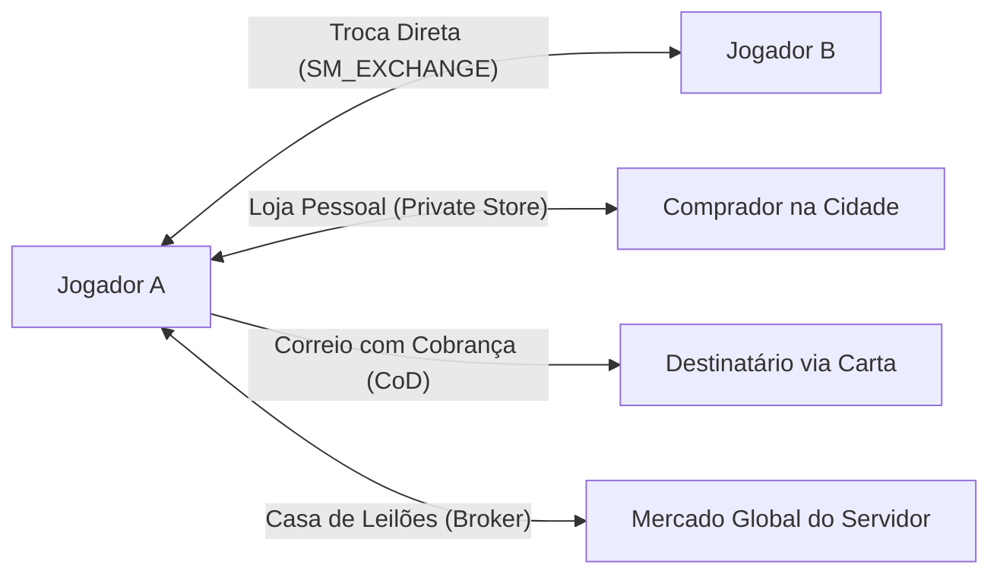

# ETAPA 06: ITENS, INVENTÁRIO, EQUIPAMENTOS E ECONOMIA

> **Status da Etapa**: Concluída  
> **Prioridade**: Alta (Sustentação do RPG)  
> **Dependências**: [05_STATUS_ATRIBUTOS_SISTEMA_VIDA.md](file:///d:/AION%20RUST/AionEMU/AionEMU/PLANO-DESENVOLVIMENTO/05_STATUS_ATRIBUTOS_SISTEMA_VIDA.md)  
> **Referência Principal em Java**: `com.aionemu.gameserver.model.items`, `com.aionemu.gameserver.services.item`, `com.aionemu.gameserver.services.ExchangeService`, `com.aionemu.gameserver.services.BrokerService`

---

## 1. Estrutura de Dados e Ciclo de Vida dos Itens

Todos os itens do jogo são baseados em templates estáticos lidos do cliente (`client_items.xml`) e instanciados dinamicamente com atributos únicos.

---

## 2. Tipos de Armazenamento e Gerenciamento de Espaço

1. **Cubo Principal (Inventário)**:
   - Inicia com 27 slots base (3 linhas de 9).
   - Expansível até 108+ slots via missões e NPCs de expansão de cubo (`CubeExpandService`).
2. **Cubo Especial**:
   - Espaço dedicado exclusivo para itens de missão, moedas de evento e medalhas, sem ocupar o inventário comum.
3. **Armazém Pessoal (Warehouse)**:
   - Baú individual do personagem + Baú compartilhado da conta (Account Warehouse).
4. **Armazém de Legião (Guild Warehouse)**:
   - Compartilhado com permissões de saque/depósito por cargo militar.

---

## 3. Sistema de Equipamento e Visual (`S_WIELD`)

### 3.1 Slots de Equipamento:
- **Armas**: Mão Principal (*Mainhand*), Mão Secundária (*Offhand*), Conjunto Alternativo de Troca Rápida (*Weapon Switch* via `Alt+Z`).
- **Armaduras**: Peitoral, Calças, Ombreiras, Luvas, Botas, Elmo.
- **Acessórios**: Colar, 2 Brincos, 2 Anéis, Cinto.
- **Especiais**: Asas (*Wings*), Penas (*Plumes*), Braceletes, Slots de Stigma (Normal e Maior).

### 3.2 Sincronização Visual com Jogadores Vizinhos:
- Quando o jogador equipa ou desembainha armas/armaduras, o servidor envia `SM_UPDATE_PLAYER_APPEARANCE` (`S_WIELD` - Opcode 36) e atualiza o pacote `SM_PLAYER_INFO` (`S_PUT_USER`) para todos no `KnownList`.

---

## 4. Mecânicas Avançadas de Modificação de Itens

1. **Encantamento de Itens**:
   - Uso de Pedras de Encantamento (*Enchantment Stones*) e Suplementos.
   - Cálculo probabilístico de sucesso (+1 a +15/20) ou falha (perda de níveis de encantamento).
2. **Incrustação de Manastones**:
   - Inserção de pedras de atributos (Crítico, Ataque, HP, Poder Mágico, etc.).
   - Regra clássica de falha: se falhar o socket atual, as pedras anteriores no item são destruídas (a menos que protegidas por itens especiais).
3. **Godstones**:
   - Adiciona efeito de ativação por porcentagem (ex: 5% chance de causar dano de fogo, 2% chance de paralisia).
4. **Fusão de Armas (*ArmsfusionService*)**:
   - Permite fundir duas armas de duas mãos (ex: Greatsword ou Spear), herdando $10\%$ do ataque da arma secundária, além de seus atributos extras e slots de manastone.

---

## 5. Economia, Transações e Comércio

### 5.1 Moedas do Jogo:
- **Kinah**: Moeda padrão de circulação.
- **Abyss Points (AP)**: Moeda de honra ganha em PvP e monstros do Abyss, usada para compra de equipamentos militares.

### 5.2 Canais de Comércio:

### 5.3 Mapeamento de Pacotes de Comércio e Inventário:

| Opcode Classic 4.5 | Pacote | Finalidade |
| :---: | :--- | :--- |
| `0x1A` (26) | `SM_INVENTORY_INFO` (`S_LOAD_INVENTORY`) | Envia todo o conteúdo do inventário no login. |
| `0x1B` (27) | `SM_INVENTORY_ADD_ITEM` (`S_ADD_INVENTORY`) | Adiciona item recém-adquirido. |
| `0x1C` (28) | `SM_DELETE_ITEM` (`S_REMOVE_INVENTORY`) | Remove item destruído, vendido ou consumido. |
| `0x1D` (29) | `SM_INVENTORY_UPDATE_ITEM` (`S_CHANGE_ITEM_DESC`) | Atualiza quantidade de stack ou atributos. |
| `0x25` (37) | `CM_USE_ITEM` | Uso de poções, comidas, pergaminhos ou caixas. |
| `0x26` (38) | `CM_EQUIP_ITEM` | Equipar ou desequipar item de um slot. |
| `0x33` (51) | `CM_BUY_ITEM` | Compra de itens de NPCs de mercadorias. |
| `0x3E` (62) | `SM_SELL_ITEM` (`S_STORE_PURCHASE_INFO`) | Abre janela de venda de mercadorias do NPC. |
| `0x3F..0x45` | `CM/SM_EXCHANGE_*` | Handshake completo de troca segura entre dois jogadores (Travar, Aceitar, Cancelar). |

---

## 6. Validação Autônoma da Etapa 06

### Roteiro de Testes:
1. **Teste de Manipulação de Inventário**:
   - Abrir inventário (`I`); mover itens entre slots; dividir stacks (`Shift + Clique`); equipar e desequipar armaduras e armas.
2. **Teste de Compra e Venda em NPC**:
   - Interagir com NPC mercador de poções; comprar poção de HP usando Kinah; consumir a poção e validar aumento de HP e decremento de stack.
3. **Teste de Troca Segura (Trade)**:
   - Conectar duas sessões de teste; iniciar troca; adicionar Kinah e itens; travar e confirmar; validar inventários de ambas as partes.
