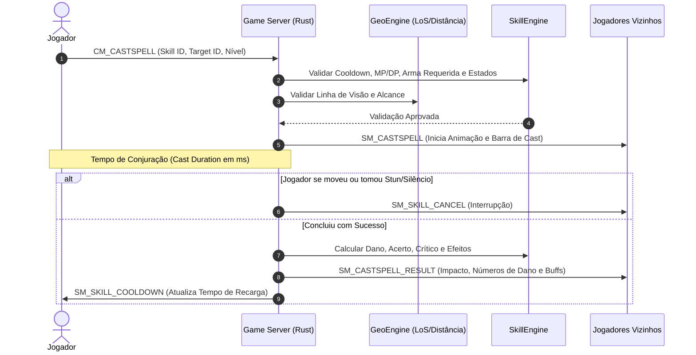

# ETAPA 07: SISTEMA DE COMBATE, HABILIDADES E MOTOR DE EFEITOS (SKILLENGINE)

> **Status da Etapa**: Concluída  
> **Prioridade**: Crítica (Núcleo da Jogabilidade de Combate)  
> **Dependências**: [04_SISTEMA_MOVIMENTACAO_FISICA_GEOENGINE.md](file:///d:/AION%20RUST/AionEMU/AionEMU/PLANO-DESENVOLVIMENTO/04_SISTEMA_MOVIMENTACAO_FISICA_GEOENGINE.md), [05_STATUS_ATRIBUTOS_SISTEMA_VIDA.md](file:///d:/AION%20RUST/AionEMU/AionEMU/PLANO-DESENVOLVIMENTO/05_STATUS_ATRIBUTOS_SISTEMA_VIDA.md), [06_ITENS_INVENTARIO_EQUIPAMENTOS_ECONOMIA.md](file:///d:/AION%20RUST/AionEMU/AionEMU/PLANO-DESENVOLVIMENTO/06_ITENS_INVENTARIO_EQUIPAMENTOS_ECONOMIA.md)  
> **Referência Principal em Java**: `com.aionemu.gameserver.skillengine`, `com.aionemu.gameserver.controllers.attack`, `com.aionemu.gameserver.network.aion.serverpackets.SM_CASTSPELL`, `SM_CASTSPELL_RESULT`

---

## 1. Pipeline de Execução de Habilidades e Feitiços

O ciclo de conjuração de habilidades no Aion envolve múltiplos estágios assíncronos e validações físicas:

---

## 2. Fórmulas Matemáticas de Combate do Aion

### 2.1 Ataques Físicos e Habilidades Marciais
- **Chance de Acerto vs Evasão / Bloqueio / Parry**:
  - Se $\text{Accuracy} > \text{Evasion} + 300$, chance de acerto é máxima ($100\%$).
  - Se houver Bloqueio com Escudo: Redução de dano calculada pelo valor de mitigação do escudo (normalmente $50\%$ a $70\%$).
  - Se houver Parry (Aparo): Redução de $40\%$ do dano físico.
- **Crítico Físico**:
  - $\text{ChanceCrit} = \frac{\text{CritStrike} - \text{StrikeResist}}{10}\%$ (com hard cap de $50\%$).
  - Multiplicadores de Crítico por tipo de arma:
    - Adaga (*Dagger*): $2.3\times$
    - Espada (*Sword*): $2.2\times$
    - Espada de Duas Mãos (*Greatsword*): $1.8\times$
    - Lança (*Polearm*): $1.8\times$
    - Arco (*Bow*): $1.4\times$
- **Fórmula de Dano Físico**:
  $$\text{DanoFisico} = \left( \text{AtaqueFisico} \times \text{PoderDaSkill} - \frac{\text{DefesaFisicaAlvo}}{10} \right) \times \text{ModificadorDeCrit} \times \text{ModificadorPvP}$$

### 2.2 Feitiços e Habilidades Mágicas
- **Acerto Mágico vs Resistência Mágica**:
  - Se $\text{MagicalResist} > \text{MagicalAccuracy}$, a cada 10 pontos de diferença o alvo ganha $1\%$ de chance de resistir integralmente ao feitiço (cap em $80\%$).
- **Fórmula de Dano Mágico**:
  $$\text{DanoMagico} = \text{DanoBaseSkill} \times \left( 1 + \frac{\text{MagicBoost} - \text{MagicSuppression}}{1000} \right) \times \left( 1 - \frac{\text{ResistenciaElemental}}{1200} \right)$$

---

## 3. Motor de Efeitos de Estado (`EffectEngine`)

O Aion possui dezenas de efeitos anormais e controle de grupo (*Crowd Control* - CC):

| Categoria | Efeitos | Comportamento e Interrupção |
| :--- | :--- | :--- |
| **Hard CC** | Stun, Stumble, Knockback, Paralysis, Sleep, Fear | Impede ações e movimento; cancela casts ativos. *Sleep* é quebrado ao receber dano. |
| **Soft CC** | Root, Snare, Slow, Blind, Silence | *Silence* impede skills mágicas; *Blind* faz ataques físicos errarem; *Root* prende no chão mas permite cast. |
| **Suporte & Dano** | Shields (Absorção de HP), Reflect, HoT, DoT | *Shields* absorvem quantidade fixa de dano; *DoTs* causam dano a cada segundo/tique. |
| **Especiais** | Polymorph, Invisible / Hide, Stealth Detection | Transforma o alvo ou o torna invisível no grid espacial (`SM_PLAYER_STATE`). |

---

## 4. Sistema de Cadeias de Habilidades (Chains / Combos)

1. **Skill Chains**: Habilidades que só são ativadas após o acerto prévio de um estágio anterior (ex: *Ferocious Strike* $\rightarrow$ *Robust Blow* $\rightarrow$ *Wrathful Blow*).
2. **Chances de Gatilho (Trigger Rates)**: Determinadas habilidades possuem chance percentual de abrir a continuação do combo (ex: $100\%$ no estágio 1, $30\%$ de chance no estágio 2).
3. **Timer de Expiração do Combo**: O jogador tem uma janela de tempo (geralmente 5 a 7 segundos) para disparar a próxima habilidade da cadeia.

---

## 5. Mapeamento de Pacotes de Habilidades

| Opcode Classic 4.5 | Pacote | Função |
| :---: | :--- | :--- |
| `0x21` (33) | `CM_CASTSPELL` / `SM_CASTSPELL` | Solicitação do cliente e broadcast de início de canalização de habilidade. |
| `0x2A` (42) | `SM_SKILL_CANCEL` | Notifica cancelamento de cast aos jogadores vizinhos. |
| `0x2B` (43) | `SM_CASTSPELL_RESULT` | Entrega do resultado do feitiço (dano, tipo de acerto, efeitos aplicados). |
| `0x2C` (44) | `SM_SKILL_LIST` (`S_ADD_SKILL`) | Lista de skills conhecidas enviada no login ou ao subir de nível. |
| `0x2D` (45) | `SM_SKILL_REMOVE` | Remove habilidade ao resetar ou trocar stigmas. |
| `0x2E` (46) | `SM_SKILL_ACTIVATION` | Liga/Desliga habilidades de aura contínua (Toggle Skills). |
| `0x31` (49) | `SM_ABNORMAL_STATE` | Aplica ícone de buff/debuff com duração na interface do jogador. |
| `0x32` (50) | `SM_ABNORMAL_EFFECT` | Renderiza efeitos visuais de buff/debuff sobre a entidade para outros jogadores. |
| `0x33` (51) | `SM_SKILL_COOLDOWN` | Atualiza temporizadores de recarga de habilidades. |

---

## 6. Validação Autônoma da Etapa 07

### Roteiro de Testes:
1. **Teste de Conjuração e Animação**:
   - Aprender habilidades no login; arrastar para a barra de atalhos.
   - Selecionar um monstro ou boneco de treino; disparar uma skill com tempo de cast; verificar se a barra de cast enche, a animação é tocada e o dano é subtraído da vida do alvo.
2. **Teste de Interrupção por Movimento**:
   - Iniciar cast de uma magia longa (ex: *Flame Bolt*); dar um passo para o lado; validar se a magia é cancelada e o MP não é consumido.
3. **Teste de Combo (Chain)**:
   - Executar o primeiro golpe de uma cadeia; conferir se o ícone do próximo golpe pisca na tela e pode ser executado com sucesso dentro da janela de tempo.
