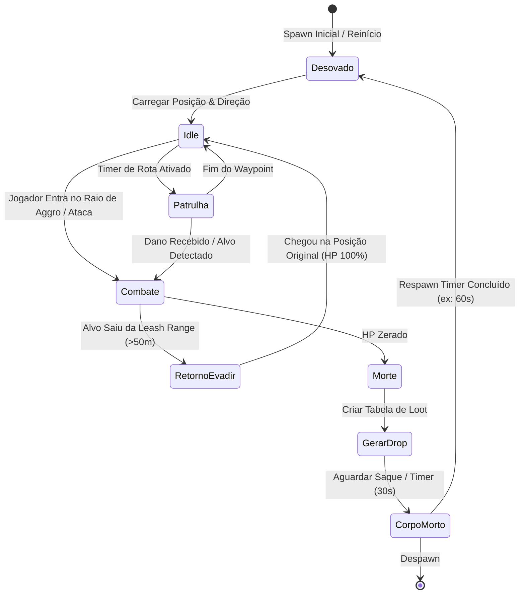

# ETAPA 08: IA DE NPCS, COMPORTAMENTO DE MONSTROS E SPAWNENGINE

> **Status da Etapa**: Concluída  
> **Prioridade**: Alta (Povoamento do Mundo e Desafio PvE)  
> **Dependências**: [03_MOTOR_MUNDO_SPATIAL_ENTIDADES.md](file:///d:/AION%20RUST/AionEMU/AionEMU/PLANO-DESENVOLVIMENTO/03_MOTOR_MUNDO_SPATIAL_ENTIDADES.md), [04_SISTEMA_MOVIMENTACAO_FISICA_GEOENGINE.md](file:///d:/AION%20RUST/AionEMU/AionEMU/PLANO-DESENVOLVIMENTO/04_SISTEMA_MOVIMENTACAO_FISICA_GEOENGINE.md), [07_SISTEMA_DE_COMBATE_E_HABILIDADES_SKILLENGINE.md](file:///d:/AION%20RUST/AionEMU/AionEMU/PLANO-DESENVOLVIMENTO/07_SISTEMA_DE_COMBATE_E_HABILIDADES_SKILLENGINE.md)  
> **Referência Principal em Java**: `com.aionemu.gameserver.ai2`, `com.aionemu.gameserver.spawnengine`, `com.aionemu.gameserver.services.drop.DropService`

---

## 1. Arquitetura do SpawnEngine e Povoamento Mundial

O `SpawnEngine` é responsável por instanciar e manter o ciclo de vida de milhares de monstros, guardas, comerciantes e criaturas pacíficas nos mapas do Aion Classic 4.5.

---

## 2. Máquina de Estados da Inteligência Artificial (AI2)

A IA de monstros e NPCs em Rust deve ser implementada como uma Máquina de Estados Finitos com controle determinístico:

### 2.1 Estados da IA:
1. **`IDLE` (Em Espera)**:
   - NPC parado em sua coordenada de origem.
   - Executa animações ocasionais e frases de ambiente (`NpcShoutsService`).
2. **`PATROL` (Patrulha)**:
   - Caminha suavemente entre nós de uma rota pré-estabelecida (`WalkerTemplate`).
3. **`THINK / AGGRO` (Detecção de Ameaça)**:
   - Verifica periodicamente entidades no raio de detecção ($10\text{ a }25\text{ metros}$).
   - Consulta a matriz de relações de tribos (`TribeRelationService`):
     - Hostil $\rightarrow$ Entra em combate.
     - Amigável / Neutro $\rightarrow$ Ignora.
4. **`COMBAT` (Combate Ativo)**:
   - **Tabela de Ódio (*Hate List / Aggro Table*)**: Mantém pontuação de ameaça por dano causado, curas em aliados ou habilidades de *Taunt*.
   - **Perseguição**: Move-se em direção ao alvo prioritário usando o `NavMesh` para contornar obstáculos.
   - **Uso de Skills de Monstro**: Rotação periódica de magias especiais (ex: ataques em área, stuns, buffs de fúria).
5. **`RETURN / EVADE` (Leash & Evasão)**:
   - Se o alvo se afastar mais de $50\text{ metros}$ do ponto de spawn ou ficar inalcançável (abuso de terreno sem LoS), o monstro cancela o combate, torna-se imune a dano, restaura $100\%$ do HP e corre de volta ao local de origem.
6. **`DEATH` (Morte)**:
   - Interrompe o ticking de IA, executa animação de morte e invoca o `DropService`.

---

## 3. Sistema de Drops e Distribuição de Recompensas (`DropService`)

Quando um monstro é derrotado:
1. **Cálculo de XP e DP**:
   - Distribuído proporcionalmente ao dano causado pelos jogadores participantes (ou dividido igualmente entre os membros do grupo).
2. **Geração de Loot (Tabela de Drops)**:
   - Carrega a tabela de chances do monstro (Itens Comuns, Verdes, Azuis, Heroicos/Dourados e Míticos).
   - Sorteia quantidades e cria a entidade de saque no chão (`DropNpc`).
3. **Saque do Corpo (`CM_LOOT_ITEM` / `SM_LOOT_ITEM_LIST`)**:
   - O jogador com direito ao saque clica no monstro.
   - O servidor abre a janela de drop.
   - Se estiver em grupo, ativa as regras de grupo (Livre, Aleatório, Líder ou Rolagem de Dados / *Dice Roll* com `SM_GROUP_LOOT`).

---

## 4. Extração e População de Mapas do Classic 4.5

### Fontes de Dados:
1. **Capturas de Tráfego (PCAP)**:
   - Como comprovado na sessão de Pandaemonium (1.054 NPCs reais extraídos), as capturas fornecem as posições e IDs exatos de NPCs do Classic 4.5.
2. **Arquivos de Nível do Cliente (`.pak`)**:
   - Extração de posições de monstros e pontos de coleta através do módulo `pak` e `bxml`.
3. **Servidor Retail 4.8 como Referência de Comportamento**:
   - Os templates de skills de monstros e tabelas de drop de `JAVA EMU - 4.8 RETAIL/game-server/data/static_data` fornecem as regras de combate dos chefes clássicos (ex: Tahabata, Stormwing, Kromede).

---

## 5. Validação Autônoma da Etapa 08

### Roteiro de Testes:
1. **Teste de Spawns em Zona Inicial**:
   - Logar em Poeta ou Ishalgen; validar se monstros locais (ex: Spriggs, Lobos, Calydons) estão nos locais corretos.
2. **Teste de Aggro e Perseguição**:
   - Aproximar-se de um monstro agressivo; verificar se ele nota o jogador, corre em sua direção e inicia ataques físicos/skills.
3. **Teste de Leash / Reset**:
   - Correr para longe do monstro ($>50\text{m}$); verificar se ele para, ganha estado de evasão e retorna à posição de spawn regenerando a vida.
4. **Teste de Abate e Drop**:
   - Derrotar o monstro; conferir ganho de XP/DP, animação de queda, abertura da janela de loot ao clicar com botão direito e inserção do item no inventário.
