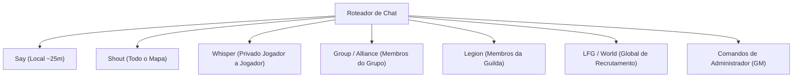
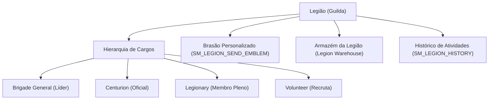

# ETAPA 10: SISTEMAS SOCIAIS, GRUPOS, LEGIÕES, ABYSS E PVP

> **Status da Etapa**: Concluída  
> **Prioridade**: Média-Alta (Comunidade e Competitividade)  
> **Dependências**: [05_STATUS_ATRIBUTOS_SISTEMA_VIDA.md](file:///d:/AION%20RUST/AionEMU/AionEMU/PLANO-DESENVOLVIMENTO/05_STATUS_ATRIBUTOS_SISTEMA_VIDA.md), [07_SISTEMA_DE_COMBATE_E_HABILIDADES_SKILLENGINE.md](file:///d:/AION%20RUST/AionEMU/AionEMU/PLANO-DESENVOLVIMENTO/07_SISTEMA_DE_COMBATE_E_HABILIDADES_SKILLENGINE.md)  
> **Referência Principal em Java**: `com.aionemu.gameserver.services.LegionService`, `com.aionemu.gameserver.services.player.PlayerGroupService`, `com.aionemu.gameserver.services.abyss.AbyssPointsService`, `com.aionemu.gameserver.services.DuelService`

---

## 1. Servidor de Chat e Comunicação em Tempo Real

A comunicação entre jogadores é dividida em múltiplos canais lógicos com filtros de escopo e rate limiting:

### 1.1 Comandos de Administrador (GM):
- `.spawn <npc_id>`: Instancia um NPC/Monstro na posição atual.
- `.teleport <map_id> <x> <y> <z>`: Teletransporta instantaneamente.
- `.additem <item_id> <count>`: Adiciona item no inventário.
- `.setlevel <nivel>`: Altera nível e recalcula atributos.
- `.god`: Modo invulnerável e dano infinito para testes.

---

## 2. Sistema de Grupos (Party) e Alianças (Alliance)

### 2.1 Grupos Comuns (Até 6 Jogadores):
- **Convite & Gestão**: Convite (`CM_GROUP_INVITE`), Aceite, Expulsão, Passagem de Líder.
- **Sincronização de HUD**: Transmissão em tempo real da barra de vida, mana, classe, nível e coordenadas no minimapa de todos os membros (`SM_PARTY_MEMBER_INFO`).
- **Regras de XP & Loot**:
  - Divisão de XP com base na proximidade física ($<50\text{m}$) e diferencial de níveis.
  - Modos de saque: Livre, Rotativo, Líder ou Rolagem de Dados (*Dice Roll*).

### 2.2 Alianças Militares (Até 24 Jogadores / 4 Grupos):
- Estrutura necessária para incursões de grande porte (*Raids*), Fortalezas do Abyss e Dreadgion.
- Comandos de Capitão de Aliança, marcação de alvos prioritários na tela e canais de comando.

---

## 3. Legiões (Guildas)

### 3.1 Personalização de Brasão:
- Upload de arquivo de imagem (`PNG/DDS 256x256`) pelo líder da guilda.
- Envio fragmentado aos jogadores próximos via pacotes `CM_LEGION_SEND_EMBLEM` / `SM_LEGION_SEND_EMBLEM`.

---

## 4. Sistema de Abyss, Ranking e Combate PvP

### 4.1 Fórmulas e Economia de Abyss Points (AP):
- Ganho de AP ao abater jogadores da facção inimiga (Elyos vs Asmodian):
  $$\text{AP\_Ganho} = \text{AP\_Base\_Do\_Alvo} \times \text{MultiplicadorDeRank} \times \text{ModificadorDeNivel}$$
- Perda de AP ao morrer em PvP ($10\%$ a $30\%$ do valor do rank do jogador).

### 4.2 Patentes do Abyss (Abyss Ranks):
1. **Soldados**: Soldado Rank 9 (Inicial) até Soldado Rank 1.
2. **Oficiais de Estrela**: Oficial 1 Estrela até 5 Estrelas.
3. **Generais Supremos**: General, Great General, Commander e **Army Governor** (Top 1 do ranking da facção).

### 4.3 Sistema de Duelos Individuais (`DuelService`):
- Desafio entre jogadores da mesma facção com contagem regressiva de 3 segundos.
- Criação de círculo virtual de duelo ($30\text{m}$). Se um dos duelistas sair da área por mais de 10 segundos, o duelo é cancelado por desistência.
- Ao atingir 1 de HP, o duelo termina com declaração de vitória sem penalidades de morte ou perda de XP.

---

## 5. Validação Autônoma da Etapa 10

### Roteiro de Testes:
1. **Teste de Canais de Chat**:
   - Digitar mensagens no chat Normal (`/s`), Grudar (`/y`) e Sussurro (`/w <nick>`); validar se as cores e alcances funcionam.
2. **Teste de Formação de Grupo**:
   - Conectar dois clientes; convidar para grupo; aceitar; validar se a barra de vida do membro aparece no canto superior esquerdo.
3. **Teste de Duelo**:
   - Solicitar duelo entre dois personagens; lutar até que um chegue a 1 de HP; validar se o vencedor é anunciado e se nenhum dos personagens morre de verdade.
