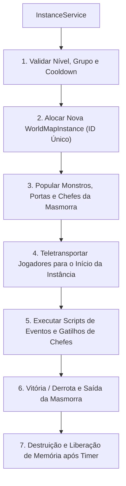
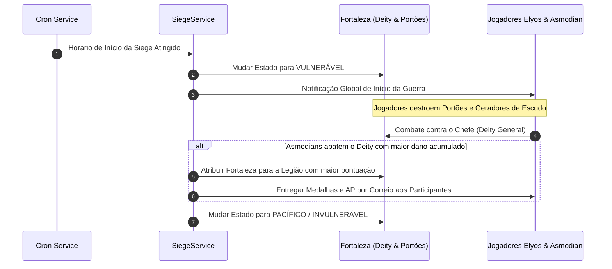

# ETAPA 11: INSTÂNCIAS DINÂMICAS, SIEGES, RIFTS E RECURSOS DO CLASSIC 4.5

> **Status da Etapa**: Pendente  
> **Prioridade**: Média-Alta (Endgame e Conteúdo em Grupo)  
> **Dependências**: [03_MOTOR_MUNDO_SPATIAL_ENTIDADES.md](file:///d:/AION%20RUST/AionEMU/AionEMU/PLANO-DESENVOLVIMENTO/03_MOTOR_MUNDO_SPATIAL_ENTIDADES.md), [07_SISTEMA_DE_COMBATE_E_HABILIDADES_SKILLENGINE.md](file:///d:/AION%20RUST/AionEMU/AionEMU/PLANO-DESENVOLVIMENTO/07_SISTEMA_DE_COMBATE_E_HABILIDADES_SKILLENGINE.md), [10_SISTEMAS_SOCIAIS_GUILDAS_ABYSS_PVP.md](file:///d:/AION%20RUST/AionEMU/AionEMU/PLANO-DESENVOLVIMENTO/10_SISTEMAS_SOCIAIS_GUILDAS_ABYSS_PVP.md)  
> **Referência Principal em Java**: `com.aionemu.gameserver.instance`, `com.aionemu.gameserver.services.instance.InstanceService`, `com.aionemu.gameserver.services.SiegeService`, `com.aionemu.gameserver.services.RiftService`

---

## 1. Motor de Instâncias Dinâmicas (`InstanceEngine`)

As masmorras (*Dungeons*) do Aion funcionam em instâncias isoladas com ciclo de vida temporário e independente para cada grupo de jogadores.

### 1.1 Principais Masmorras Clássicas Suportadas:
- **Nível Baixo / Médio**: Nochsana Training Camp, Fire Temple (Kromede), Steel Rake, Aetherogenesis.
- **Nível Alto / Endgame**: Dark Poeta (Sistema de Pontuação e Ranks S/A/B/C/D), Beshmundir Temple (Stormwing), Tiarkh/Dredgion (PvPvE), Sauro Supply Base, Runadium, Danuar Sanctuary.

### 1.2 Controle de Cooldowns e Entradas:
- Cada masmorra possui regras de reentrada (ex: recarga diária às 09:00 AM ou temporizador de 2 horas).
- Sincronização via pacote `SM_INSTANCE_INFO` exibindo contadores de tempo na interface de masmorras (`Shift + V`).

---

## 2. Sistema de Guerra de Fortalezas (Sieges do Abyss)

---

## 3. Fendas Dimensionais (Rifts)

- Abertura aleatória ou programada de portais azuis conectando Elysea (ex: Eltnen, Heiron) a Asmodae (Morheim, Beluslan).
- **Parâmetros de Controle**:
  - Nível máximo permitido para atravessar o Rift (ex: Nível 20 a 32, 40 a 50).
  - Limite de passagens (ex: fecha automaticamente após 24 a 48 jogadores passarem).

---

## 4. Recursos Exclusivos do Aion Classic 4.5

Diferente do servidor Retail 4.8, a versão Classic 4.5 possui sistemas modernos incorporados:

### 4.1 Passe de Batalha (Daeva Pass):
- Sistema sazonal de missões diárias, semanais e de temporada.
- Acúmulo de pontos de passe que destravam recompensas cosméticas, consumíveis e moedas especiais.
- Pacote de sincronização `SM_DAEVA_PASS_INFO`.

### 4.2 Sistema de Roupeiro (Wardrobe):
- Interface dedicada que permite registrar a aparência de armaduras e armas sem destruir o item original e aplicar skins livremente aos equipamentos atuais.

---

## 5. Validação Autônoma da Etapa 11

### Roteiro de Testes:
1. **Teste de Criação e Entrada em Instância**:
   - Formar grupo; aproximar-se do portal de entrada de Fire Temple; entrar na masmorra.
   - Conferir se o mapa gerado possui ID de instância único e se os monstros da masmorra desovam corretamente.
2. **Teste de Script de Chefe**:
   - Atacar o chefe da masmorra; reduzir o HP para $50\%$; validar se o script dispara o spawn de monstros servos (*Adds*) e magias em área.
3. **Teste de Destruição Limpa**:
   - Sair da masmorra; desmanchar o grupo; verificar se a instância é desalocada da memória do servidor sem vazamentos (*memory leaks*).
