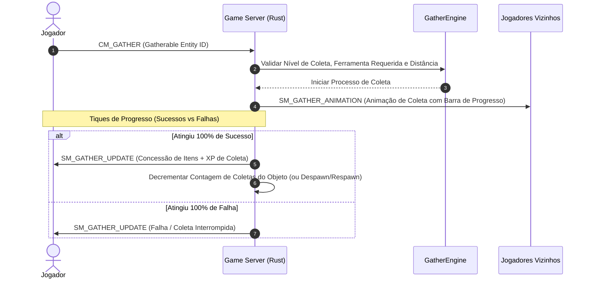

# ETAPA 12: COLETA, EXTRAÇÃO DE ÉTER E ARTESANATO (CRAFTING ENGINE)

> **Status da Etapa**: Pendente  
> **Prioridade**: Média-Alta (Economia e Fabricação)  
> **Dependências**: [06_ITENS_INVENTARIO_EQUIPAMENTOS_ECONOMIA.md](file:///d:/AION%20RUST/AionEMU/AionEMU/PLANO-DESENVOLVIMENTO/06_ITENS_INVENTARIO_EQUIPAMENTOS_ECONOMIA.md)  
> **Referência Principal em Java**: `com.aionemu.gameserver.services.craft`, `com.aionemu.gameserver.services.RecipeService`, `com.aionemu.gameserver.model.gameobjects.Gatherable`, `com.aionemu.gameserver.network.aion.clientpackets.CM_GATHER`, `SM_GATHER_UPDATE`, `SM_GATHER_ANIMATION`

---

## 1. Sistema de Coleta no Solo e Extração de Éter

O Aion divide a extração de recursos naturais em duas habilidades essenciais:
1. **Extração de Vitalidade (*Essencetapping*)**: Coleta de plantas, ervas, minérios, madeiras e peixes no solo.
2. **Extração de Éter (*Aethertapping*)**: Coleta aérea em vórtices de éter que flutuam no céu (requer modo de voo).

---

## 2. As 7 Profissões de Artesanato (Crafting Disciplines)

| Profissão | Descrição e Produções |
| :--- | :--- |
| **Armorsmithing** | Forja de Armaduras de Malha (*Chain*) e Placas (*Plate*), Escudos e Elmos Metálicos. |
| **Weaponsmithing** | Forja de Armas Metálicas (Espadas, Adagas, Lanças, Espadas de Duas Mãos, Maças). |
| **Handicrafting** | Fabricação de Acessórios (Colares, Brincos, Anéis, Cintos), Arcos, Cajados e Caixas. |
| **Tailoring** | Confecção de Roupas de Tecido (*Cloth*), Couro (*Leather*) e Cintos de Tecido. |
| **Alchemy** | Produção de Poções (HP/MP/FP), Pergaminhos (*Scrolls*), Orbes, Livros Mágicos e Pedras de Manastone. |
| **Cooking** | Culinária de pratos que concedem buffs avançados de atributos e regeneração. |
| **Construction** | Fabricação de mobílias, papéis de parede e decorações para o sistema de habitação (*Housing*). |

---

## 3. Mecânica de Receitas, Combos e Críticos (Craft Procs)

1. **Aprendizado de Receitas (`RecipeService`)**:
   - Aprendizado automático ao subir nível de profissão ou através de receitas compradas em NPCs / drops de monstros (`client_recipes.xml`).
2. **Sistema de Crafting Procs (Críticos de Fabricação)**:
   - Ao fabricar um item, há uma chance probabilística (ex: $15\%$ a $30\%$) de ocorrer um **Proc Crítico**:
     $$\text{Item Comum (Branco)} \longrightarrow \text{Item Superior (Verde/Azul/Fabled/Heroic)}$$
   - Algumas armas e armaduras de ponta exigem cadeias de múltiplos procs consecutivos (*Multi-step Proc Chain*).
3. **Ordens de Serviço de Artesanato (*Work Orders*)**:
   - Missões de treinamento fornecidas pelos Mestres de Ofício que entregam materiais gratuitos para o jogador upar a perícia ($0 \rightarrow 99 \rightarrow 199 \rightarrow 299 \rightarrow 399 \rightarrow 499 \rightarrow 549$).

---

## 4. Mapeamento de Pacotes de Coleta e Artesanato

| Opcode Classic 4.5 | Pacote | Função |
| :---: | :--- | :--- |
| `0x13` (19) | `CM_GATHER` | Jogador clica no nó de recurso para iniciar extração. |
| `0x22` (34) | `SM_GATHER_ANIMATION` (`S_GATHER_OTHER`) | Broadcast da animação de colheita para quem está ao redor. |
| `0x23` (35) | `SM_GATHER_UPDATE` (`S_GATHER`) | Envia a barra de sucesso/falha e o resultado final da extração. |
| `0x60` | `CM_CRAFT` / `SM_CRAFT_UPDATE` | Solicitação de fabricação de item e feedback de progresso da receita. |
| `0x61` | `SM_RECIPE_LIST` | Lista de receitas conhecidas pelo jogador no login. |

---

## 5. Validação Autônoma da Etapa 12

### Roteiro de Testes:
1. **Teste de Coleta de Planta/Minério**:
   - Ir até um nó de coleta em Poeta/Ishalgen; clicar com botão direito; validar abertura da barra de progresso e recepção do item no inventário.
2. **Teste de Extração de Éter**:
   - Levantar voo próximo a um cristal de éter; iniciar extração aérea; validar consumo de FP durante a coleta e sucesso.
3. **Teste de Produção de Poção (Alchemy)**:
   - Interagir com a mesa de Alquimia; selecionar receita de *Lesser Healing Potion*; fabricar lote de 5 unidades; validar consumo de materiais e incremento no inventário.
