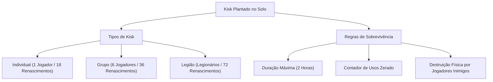

# ETAPA 15: OBJETOS INTERATIVOS, KISKS, VENTO E SISTEMA CLIMÁTICO

> **Status da Etapa**: Concluída  
> **Prioridade**: Média (Imersão e Mecânicas Ambientais)  
> **Dependências**: [03_MOTOR_MUNDO_SPATIAL_ENTIDADES.md](file:///d:/AION%20RUST/AionEMU/AionEMU/PLANO-DESENVOLVIMENTO/03_MOTOR_MUNDO_SPATIAL_ENTIDADES.md), [04_SISTEMA_MOVIMENTACAO_FISICA_GEOENGINE.md](file:///d:/AION%20RUST/AionEMU/AionEMU/PLANO-DESENVOLVIMENTO/04_SISTEMA_MOVIMENTACAO_FISICA_GEOENGINE.md)  
> **Referência Principal em Java**: `com.aionemu.gameserver.services.KiskService`, `com.aionemu.gameserver.services.StaticDoorService`, `com.aionemu.gameserver.services.FlyRingService`, `com.aionemu.gameserver.services.WeatherService`

---

## 1. Pedras de Renascimento Portáteis (Kisks)

Os Kisks são marcos táticos implantados por jogadores em território inimigo para permitir renascimento imediato sem retornar ao obelisco da cidade.

### 1.1 Fluxo de Vinculação e Morte:
1. Jogador interage com o Kisk colocado por ele ou aliado.
2. O servidor vincula o `kisk_id` ao estado do jogador.
3. Ao morrer em combate, a janela de renascimento (`CM_REVIVE`) oferece a opção "Renascer no Kisk".

---

## 2. Portas Estáticas, Portões e Alavancas (`StaticDoorService`)

- Portões de fortalezas, portas de masmorras e grades de celas (`StaticDoor`).
- **Interação (`CM_OPEN_STATICDOOR` - Opcode 23)**:
  - Verifica se o jogador possui a chave requerida, status de GM ou se a porta é de acionamento livre.
  - Altera o estado para aberto/fechado e atualiza a malha de colisão do `GeoEngine`.

---

## 3. Correntes de Vento (Windstreams), Geysers e Anéis de Voo

1. **Windstreams (`CM_WINDSTREAM` - Opcode 70)**:
   - Túneis aéreos de vento em alta velocidade presentes em Inggison, Gelkmaros e Silentera Canyon.
   - O jogador pula na corrente com asas abertas e é impulsionado ao longo de uma spline 3D pré-calculada, com opção de ejeção a qualquer momento.
2. **Geysers & Updrafts**:
   - Jatos termais no solo que lançam o personagem centenas de metros para cima para alcançar platôs elevados.
3. **Anéis de Voo (*FlyRings*)**:
   - Anéis no céu do Abyss que concedem bônus temporário de $+50\%$ de velocidade de voo ou recarga imediata de Flight Points (FP).

---

## 4. Sistema de Clima Global (`WeatherService`)

- O Aion possui um motor de clima sincronizado que altera visualmente e sonoramente os mapas:
  - **Condições**: Céu Limpo, Chuva Leve, Tempestade de Raios, Neve, Cinzas Vulcânicas, Névoa do Vazio.
  - **Sincronização via `SM_WEATHER` (Opcode 67)**: Transmite o ID do clima para os jogadores ao entrarem em uma nova zona ou durante mudanças climáticas programadas.

---

## 5. Validação Autônoma da Etapa 15

### Roteiro de Testes:
1. **Teste de Implantação de Kisk**:
   - Plantar um Kisk em uma zona de campo; vincular o personagem; morrer para um monstro; selecionar renascer no Kisk e confirmar o surgimento no local correto.
2. **Teste de Abertura de Portão de Masmorra**:
   - Interagir com a alavanca de uma porta estática; verificar abertura visual e passagem do personagem através da abertura sem bloqueio de colisão.
3. **Teste de Windstream**:
   - Entrar em um ponto de fluxo de vento; validar a locomoção automática pela rota e saída ao pressionar a barra de espaço.
