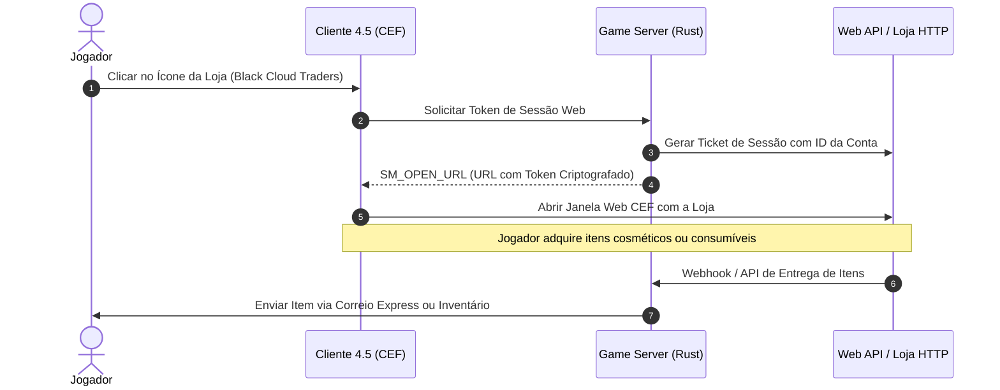

# ETAPA 16: SERVIÇOS WEB, LOJA IN-GAME, DAEVA PASS E ROUPEIRO

> **Status da Etapa**: Pendente  
> **Prioridade**: Média-Alta (Monetização e Recursos do Classic 4.5)  
> **Dependências**: [06_ITENS_INVENTARIO_EQUIPAMENTOS_ECONOMIA.md](file:///d:/AION%20RUST/AionEMU/AionEMU/PLANO-DESENVOLVIMENTO/06_ITENS_INVENTARIO_EQUIPAMENTOS_ECONOMIA.md)  
> **Referência Principal em Java**: `com.aionemu.gameserver.services.AtreianPassportService`, `com.aionemu.gameserver.services.SurveyService`, `com.aionemu.gameserver.services.HTMLService`, `com.aionemu.gameserver.services.reward.WebRewardService`

---

## 1. Navegador Web Embutido e Loja In-Game (Black Cloud Market)

O cliente Aion Classic 4.5 possui um navegador web interno baseado em CEF (*Chromium Embedded Framework*) para carregar a loja do jogo, páginas de suporte e eventos.

---

## 2. Passe de Batalha (Daeva Pass - Classic 4.5)

O Daeva Pass é o coração da progressão sazonal do Aion Classic:
1. **Missões do Passe**:
   - **Diárias**: Abater monstros, concluir 1 masmorra, coletar recursos.
   - **Semanais**: Participar de Sieges, abater chefes de raid, ganhar pontos em arenas.
   - **Sazonais**: Metas acumuladas ao longo dos 30 a 60 dias da temporada.
2. **Níveis e Recompensas**:
   - Barra de nível do passe ($1 \text{ a } 45$).
   - Trilha Gratuita (*Free Track*) e Trilha Desbloqueada (*Premium Pass*).
   - Resgate de recompensas via pacote `CM_DAEVA_PASS_CLAIM` $\rightarrow$ `SM_DAEVA_PASS_INFO`.

---

## 3. Sistema de Roupeiro (Wardrobe)

- Diferente do sistema antigo onde aplicar uma aparência consumia a arma/armadura de sacrifício, o Roupeiro do Classic 4.5 armazena skins de forma permanente:
  - Registro de peças cosméticas no catálogo visual do personagem.
  - Pré-visualização de tinturas (*Dyes*) em tempo real.
  - Aplicação e remoção livre de skins nos equipamentos em uso sem custo de destruição de itens.

---

## 4. Passaporte de Atreia (Presença Diária) e Enquetes (Surveys)

### 4.1 Passaporte de Atreia (`AtreianPassportService`):
- Calendário de login diário com 28 dias por ciclo mensal.
- Entrega de caixas de recompensa com carimbo de presença ao logar pela primeira vez no dia (`SM_ATREIAN_PASSPORT`).

### 4.2 Sistema de Enquetes In-Game (`SurveyService`):
- Janelas de pesquisa ou presentes entregues pelo servidor para níveis específicos (ex: presente de incentivo ao atingir nível 20, 30, 40 e 50).

---

## 5. Mapeamento de Pacotes de Serviços Web e Passe

| Opcode Classic 4.5 | Pacote | Função |
| :---: | :--- | :--- |
| `0x01` (1) | `CM_QUERY_PASSPORT` / `SM_ATREIAN_PASSPORT` | Sincroniza o calendário de presença diária. |
| `0x82` | `SM_OPEN_URL` | Comanda o cliente a abrir uma URL externa ou interna no navegador CEF. |
| `0x8A` | `SM_DAEVA_PASS_INFO` | Transmite os pontos, níveis e status de resgate do Daeva Pass. |
| `0x8C` | `SM_SURVEY_INFO` | Abre janela de pesquisa/recompensa para o jogador. |

---

## 6. Validação Autônoma da Etapa 16

### Roteiro de Testes:
1. **Teste do Passaporte de Atreia**:
   - Entrar no jogo com personagem novo; verificar se o pop-up do calendário de presença abre e permite carimbar o dia 1 recebendo a recompensa.
2. **Teste de Progresso do Daeva Pass**:
   - Abrir o menu do Daeva Pass; completar uma missão diária; verificar se a barra de experiência do passe avança e permite o resgate do nível correspondente.
3. **Teste de Envio de Item por Webhook**:
   - Simular chamada HTTP na API do servidor Rust; validar a chegada imediata do pacote de presente no correio do personagem logado.
