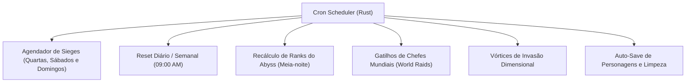
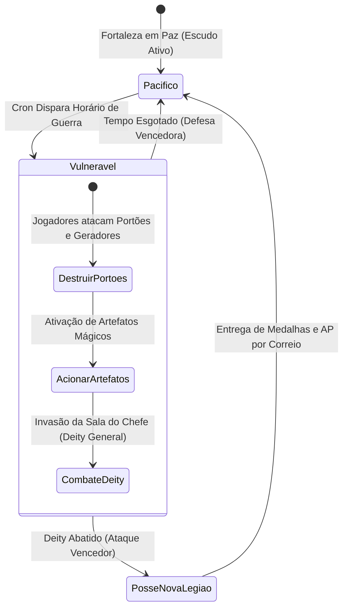

# ETAPA 17: AGENDAMENTOS (CRON), SIEGES DE GUERRA, BASES E CHEFES MUNDIAIS

> **Status da Etapa**: Concluída  
> **Prioridade**: Média-Alta (Guerra em Massa e Eventos Programados)  
> **Dependências**: [03_MOTOR_MUNDO_SPATIAL_ENTIDADES.md](file:///d:/AION%20RUST/AionEMU/AionEMU/PLANO-DESENVOLVIMENTO/03_MOTOR_MUNDO_SPATIAL_ENTIDADES.md), [07_SISTEMA_DE_COMBATE_E_HABILIDADES_SKILLENGINE.md](file:///d:/AION%20RUST/AionEMU/AionEMU/PLANO-DESENVOLVIMENTO/07_SISTEMA_DE_COMBATE_E_HABILIDADES_SKILLENGINE.md), [10_SISTEMAS_SOCIAIS_GUILDAS_ABYSS_PVP.md](file:///d:/AION%20RUST/AionEMU/AionEMU/PLANO-DESENVOLVIMENTO/10_SISTEMAS_SOCIAIS_GUILDAS_ABYSS_PVP.md)  
> **Referência Principal em Java**: `com.aionemu.gameserver.services.CronJobService`, `com.aionemu.gameserver.services.SiegeService`, `com.aionemu.gameserver.services.BaseService`, `com.aionemu.gameserver.services.VortexService`, `com.aionemu.gameserver.services.WorldRaidService`

---

## 1. Motor de Agendamento Assíncrono (Cron Scheduler em Rust)

O servidor depende de um temporizador de alta precisão para disparar eventos cíclicos sem impactar a latência do Game Loop:

---

## 2. Sistema Completo de Guerra de Fortalezas (Sieges)

### 2.1 Fortalezas Ativas:
- **Reshanta (Abyss)**: Inferior (Siel, Sulfuro), Superior (Kysis, Miren, Krotan) e Núcleo (*Divine Fortress*).
- **Inggison & Gelkmaros**: Fortalezas de solo com proteção de campo de força e artefatos.

### 2.2 Ciclo de Vida da Siege:

### 2.3 Assalto Balaur (*BalaurAssaultService*):
- Caso nenhuma facção de jogadores domine ou ataque a fortaleza, o Dreadgion dos Balaurs surge no céu e tropas de elite invadem o castelo para reconquistá-lo para os monstros.

---

## 3. Conquista de Bases e Postos Avançados (`BaseService`)

- Pequenas fortalezas distribuídas pelos mapas com bandeira central de captura.
- Ao abater o Comandante da Base, a bandeira muda para a facção vencedora (Elyos ou Asmodian), gerando guardas aliados, teletransportadores e comerciantes de equipamentos de batalha.

---

## 4. Vórtices Dimensionais e Invasões Mundiais

- **Vórtices de Invasão (`VortexService`)**:
  - Abertura de portais massivos para invasão direta no território inimigo com objetivos de destruição de geradores e chefes locais.
- **Chefes de Raide Mundial (`WorldRaidService`)**:
  - *Sunayaka*, *Ragnarok*, *Omega*, *Enraged Mastarius / Veille*.
  - Chefes com dezenas de milhões de HP exigindo alianças inteiras para abate.

---

## 5. Validação Autônoma da Etapa 17

### Roteiro de Testes:
1. **Teste de Disparo de Cron**:
   - Forçar o cron de siege via comando administrativo; verificar transição do estado da fortaleza para vulnerável e notificação sonora/visual na tela do cliente.
2. **Teste de Destruição de Portão de Fortaleza**:
   - Atacar o portão da fortaleza com arma de cerco ou ataques normais; validar decremento de HP do portão até sua abertura.
3. **Teste de Conquista de Base**:
   - Derrotar o capitão de uma base neutra; verificar substituição imediata dos NPCs defensores pelos guardas da raça do jogador.
