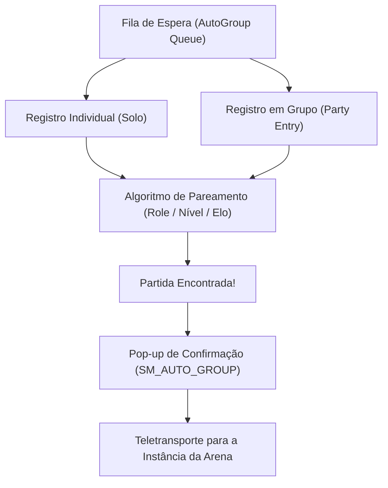

# ETAPA 18: ARENAS COMPETITIVAS, CAMPOS DE BATALHA E AUTOGROUP

> **Status da Etapa**: Concluída  
> **Prioridade**: Média-Alta (PvP Competitivo e Matchmaking)  
> **Dependências**: [07_SISTEMA_DE_COMBATE_E_HABILIDADES_SKILLENGINE.md](file:///d:/AION%20RUST/AionEMU/AionEMU/PLANO-DESENVOLVIMENTO/07_SISTEMA_DE_COMBATE_E_HABILIDADES_SKILLENGINE.md), [11_INSTANCIAS_MASMORRAS_E_EVENTOS.md](file:///d:/AION%20RUST/AionEMU/AionEMU/PLANO-DESENVOLVIMENTO/11_INSTANCIAS_MASMORRAS_E_EVENTOS.md)  
> **Referência Principal em Java**: `com.aionemu.gameserver.services.autogroup.AutoGroupService`, `com.aionemu.gameserver.model.autogroup`

---

## 1. Motor de Matchmaking e Fila Automática (AutoGroup Engine)

O sistema `AutoGroup` gerencia a busca automática de jogadores para masmorras PvE e arenas PvP competitivas.

---

## 2. Modalidades de Arenas e Campos de Batalha

| Modalidade | Formato | Regras e Pontuação |
| :--- | :--- | :--- |
| **Arena of Discipline** | $1 \text{ vs } 1$ | 3 rounds cronometrados. O jogador com mais abates e pontos de dano vence. |
| **Arena of Chaos** | 6 Jogadores FFA | Todos contra todos. Pontos por abates, coleta de orbes e monstros no mapa. |
| **Arena of Glory** | 4 Finalistas | Competição exclusiva para os melhores colocados da semana, com prêmios em medalhas de platina/cerâmio. |
| **Dreadgion (Baranath / Chantra)** | $6 \text{ vs } 6$ PvPvE | Invasão da nave de guerra Balaur; corrida de destruição de núcleos de Surkana e combate direto entre times. |
| **Tiarkh Training Ground** | $6 \text{ vs } 6$ | Campo de treino acelerado de combate em equipe. |

---

## 3. Sistema de Pontuação e Recompensas

1. **Pontuação Dinâmica em Tempo Real**:
   - Abate de jogador inimigo: $+1.000\text{ pts}$.
   - Morte para jogador: $-300\text{ pts}$.
   - Destruição de objetos estratégicos (*Surkana*): $+800\text{ pts}$.
2. **Moedas de Recompensa**:
   - *Courage Insignia* & *Crucible Insignia*, utilizadas para troca de armaduras de PvP, armas de arena e consumíveis exclusivos.

---

## 4. Mapeamento de Pacotes de Arenas

| Opcode Classic 4.5 | Pacote | Função |
| :---: | :--- | :--- |
| `0x75` | `CM_REGISTER_AUTOGROUP` | Jogador entra na fila da arena ou masmorra. |
| `0x76` | `SM_AUTO_GROUP` | Notificação de partida pronta e botões de entrar/recusar. |
| `0x77` | `SM_ARENA_SCORE` | Placar ao vivo com tempo restante e ranking de pontos do round. |

---

## 5. Validação Autônoma da Etapa 18

### Roteiro de Testes:
1. **Teste de Fila de Arena 1v1**:
   - Conectar dois clientes; ambos entram na fila da Arena of Discipline; validar surgimento do pop-up de entrada e teletransporte sincronizado.
2. **Teste de Rounds e Placar**:
   - Iniciar o round 1; abater o oponente; validar se a pontuação sobe no placar e se o round seguinte inicia após o timer de respawn.
3. **Teste de Entrega de Medalhas de Arena**:
   - Finalizar a partida; validar entrega de *Crucible Insignias* e saída limpa da instância para a capital.
