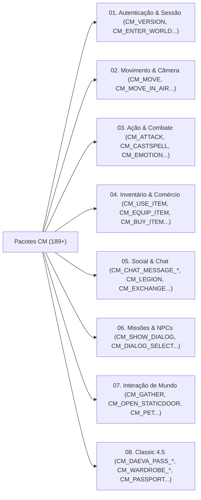

# ETAPA 20: MAPEAMENTO COMPLETO DE PACOTES CLIENTE (CM) E SERVIDOR (SM) - CLASSIC 4.5

> **Status da Etapa**: Pendente  
> **Prioridade**: Crítica (Dicionário de Comunicação e Prevenção de Crash)  
> **Dependências**: [01_INFRAESTRUTURA_REDE_SEGURANCA_PROTOCOLOS.md](file:///d:/AION%20RUST/AionEMU/AionEMU/PLANO-DESENVOLVIMENTO/01_INFRAESTRUTURA_REDE_SEGURANCA_PROTOCOLOS.md)  
> **Referência Principal em Java**: `com.aionemu.gameserver.network.aion.AionClientPacketFactory` (189 pacotes CM) e `ServerPacketsOpcodes` (239 pacotes SM)

---

## 1. O Papel do Mapeamento Exaustivo de Pacotes

No cliente Aion Classic 4.5, o envio de um pacote com **formato incompatível**, **tamanho truncado** ou a **falta de resposta para opcodes bloqueantes** resulta no congelamento ou fechamento súbito (*crash*) do jogo.

O desenvolvimento do emulador Rust deve garantir que:
1. **Todos os 189+ pacotes CM** sejam reconhecidos e desserializados com segurança.
2. **Todos os 239+ pacotes SM** sejam registrados na tabela de opcodes e serializados com cabeçalhos exatos.
3. Pacotes ainda sem lógica de negócio completa recebam um **tratamento padrão seguro (No-Op / Acknowledge)** para manter o cliente em execução.

---

## 2. Catálogo Estruturado de Pacotes do Cliente (Client Messages - CM)



### 2.1 Principais Opcodes CM e seus Manipuladores em Rust:

| Opcode CM | Classe Java 4.8 | Estrutura Rust (`client.rs`) | Comportamento e Estado Requerido |
| :---: | :--- | :--- | :--- |
| `0` | `CM_VERSION_CHECK` | `c::VersionCheck` | Handshake inicial de criptografia. |
| `2` | `CM_DISCONNECT` | `c::Disconnect` | Desconexão limpa solicitada pelo usuário. |
| `3` | `CM_QUIT` | `c::Quit` | Retorno para a tela de seleção de personagens. |
| `5` | `CM_REVIVE` | `c::Revive` | Solicitação de renascimento após morte. |
| `8` | `CM_ENTER_WORLD` | `c::EnterWorld` | Pedido de entrada no mapa com o personagem selecionado. |
| `9` | `CM_LEVEL_READY` | `c::LevelReady` | Notificação de que o cliente carregou o mapa 3D. |
| `14` | `CM_CAPTCHA` | `c::Captcha` | Resposta de segurança contra bots de coleta. |
| `18` | `CM_TIME_CHECK` | `c::TimeCheck` | Sincronismo contínuo de relógio entre cliente e servidor. |
| `19` | `CM_GATHER` | `c::Gather` | Início de extração de recurso de coleta no solo/ar. |
| `27` | `CM_CHAT_MESSAGE_PUBLIC` | `c::Say` | Mensagem de chat local enviada pelo jogador. |
| `28` | `CM_CHAT_MESSAGE_WHISPER`| `c::Whisper` | Mensagem privada de jogador para jogador. |
| `31` | `CM_TARGET_SELECT` | `c::ChangeTarget` | Seleção de alvo com o mouse ou tecla Tab. |
| `32` | `CM_ATTACK` | `c::Attack` | Disparo de ataque básico físico contínuo. |
| `33` | `CM_CASTSPELL` | `c::UseSkill` | Início de conjuração de magia ou habilidade marcial. |
| `37` | `CM_USE_ITEM` | `c::UseItem` | Uso de poção, pergaminho, comida ou caixa do inventário. |
| `38` | `CM_EQUIP_ITEM` | `c::EquipItem` | Equipar ou desequipar arma, armadura ou acessório. |
| `43` | `CM_EMOTION` | `c::Action` | Execução de emote, abrir asas, sentar ou pular. |
| `44` | `CM_PING` | `c::Ping` | Heartbeat keep-alive para manter o socket ativo. |
| `48` | `CM_MOVE` | `c::Move` | Pacote contínuo de coordenadas de locomoção. |
| `52` | `CM_SHOW_DIALOG` | `c::StartDialog` | Clique de interação com NPC para abrir diálogo. |
| `54` | `CM_DIALOG_SELECT` | `c::DialogSelect` | Escolha de opção em diálogo HTML de NPC. |
| `63..69` | `CM_EXCHANGE_*` | `c::Exchange*` | Pipeline de troca direta de itens entre jogadores. |
| `70` | `CM_WINDSTREAM` | `c::WindPath` | Entrada e navegação em correntes de vento. |

---

## 3. Catálogo Estruturado de Pacotes do Servidor (Server Messages - SM)

### 3.1 Principais Opcodes SM e seus Construtores em Rust:

| Opcode SM | Classe Java 4.8 | Estrutura Rust (`server.rs`) | Payload e Função |
| :---: | :--- | :--- | :--- |
| `0` | `SM_VERSION_CHECK` | `s::VersionCheck` | Envia chaves XOR para o cliente. |
| `1` | `SM_STATS_INFO` | `s::Status` | Envia todos os atributos e defesas do personagem. |
| `3` | `SM_STATUPDATE_HP` | `s::HitPoint` | Atualiza o valor de HP do jogador local. |
| `4` | `SM_STATUPDATE_MP` | `s::ManaPoint` | Atualiza o valor de MP do jogador local. |
| `5` | `SM_ATTACK_STATUS` | `s::HitPointOther` | Notifica variação de vida de entidades para quem está ao redor. |
| `6` | `SM_STATUPDATE_DP` | `s::Dp` | Atualiza a quantidade de pontos divinos (DP). |
| `8` | `SM_STATUPDATE_EXP` | `s::Exp` | Atualiza a barra de experiência do jogador. |
| `13` | `SM_ENTER_WORLD_CHECK`| `s::EnterWorldCheck`| Autoriza o cliente a iniciar a tela de loading. |
| `14` | `SM_NPC_INFO` | `s::PutNpc` | Spawna NPC ou Monstro na tela do cliente. |
| `15` | `SM_PLAYER_SPAWN` | `s::World` | Inicializa o personagem local no mapa. |
| `17` | `SM_GATHERABLE_INFO` | `s::PutObject` | Spawna cristal de éter ou planta de coleta no mapa. |
| `21` | `SM_POSITION_SELF` | `s::Blink` | Corrige a posição do jogador (Rollback / Anti-Speedhack). |
| `22` | `SM_DELETE` | `s::RemoveObject` | Remove entidade que morreu ou saiu do raio de visão. |
| `24` | `SM_MESSAGE` | `s::Message` | Entrega mensagem de chat em canal público ou privado. |
| `25` | `SM_SYSTEM_MESSAGE` | `s::MessageCode` | Exibe mensagem de sistema pré-traduzida do cliente. |
| `26` | `SM_INVENTORY_INFO` | `s::LoadInventory` | Carrega todos os itens do inventário no login. |
| `32` | `SM_PLAYER_INFO` | `s::PutUser` | Spawna outro jogador com sua aparência e armaduras. |
| `33` | `SM_CASTSPELL` | `s::UseSkill` | Inicia barra de cast de habilidade visível para todos. |
| `36` | `SM_UPDATE_PLAYER_APPEARANCE` | `s::Wield` | Atualiza armas desembainhadas ou roupas trocadas. |
| `37` | `SM_EMOTION` | `s::Action` | Renderiza salto, planar com asas ou emote no mundo. |
| `43` | `SM_CASTSPELL_RESULT` | `s::SkillSucceded` | Entrega dano, acerto crítico e buffs aplicados. |
| `44` | `SM_SKILL_LIST` | `s::AddSkill` | Lista de habilidades aprendidas. |
| `49` | `SM_ABNORMAL_STATE` | `s::AbnormalStatus` | Adiciona ícone de buff/debuff com duração. |
| `51` | `SM_SKILL_COOLDOWN` | `s::LoadSkillCooltime`| Atualiza recarga de habilidades na barra de atalhos. |
| `55` | `SM_MOVE` | `s::MoveNew` | Sincroniza deslocamento de jogadores e monstros. |
| `60` | `SM_DIALOG_WINDOW` | `s::NpcHtmlMessage` | Exibe página HTML de diálogo de NPC. |
| `67` | `SM_WEATHER` | `s::Weather` | Altera o clima e iluminação da região. |
| `71` | `SM_QUEST_LIST` | `s::LoadWorkingQuest`| Sincroniza missões em andamento e concluídas. |
| `0x8B` | `S_SA_ACCOUNT_ITEM_NOTI`| `s::SaAccountItemNoti`| **Crítico**: 4 bytes zero que destravam o lobby de personagens. |

---

## 4. Matriz de Tratamento Seguro e Prevenção de Desconexões

Para manter a estabilidade contínua sem depender da implementação imediata de cada detalhe:
1. **Fallback de CM Desconhecido**:
   ```rust
   match opcode {
       0x00 => handle_version_check(session, buf),
       // ... opcodes mapeados ...
       unknown => {
           log::warn!("Opcode CM desconhecido 0x{:02X} (tamanho: {} bytes)", unknown, buf.len());
           // Mantém a conexão aberta sem panic
           Ok(())
       }
   }
   ```
2. **Prevenção de Escrita Parcial de Socket**:
   - Todo envio de pacotes através da trait `AionServerPacket` DEVE utilizar `write_all` ou garantir o loop de esvaziamento completo do buffer TCP.

---

## 5. Validação Autônoma da Etapa 20

### Roteiro de Testes:
1. **Verificação de Cobertura de Opcodes**:
   - Rodar suite de testes unitários que itera sobre todos os opcodes cadastrados na tabela do Rust e valida se nenhum causa pânico (`panic!`).
2. **Inspeção de Log de Opcodes Desconhecidos**:
   - Jogar uma sessão de 30 minutos; inspecionar o log e verificar se restou algum opcode classificado como `WARN` não identificado.
