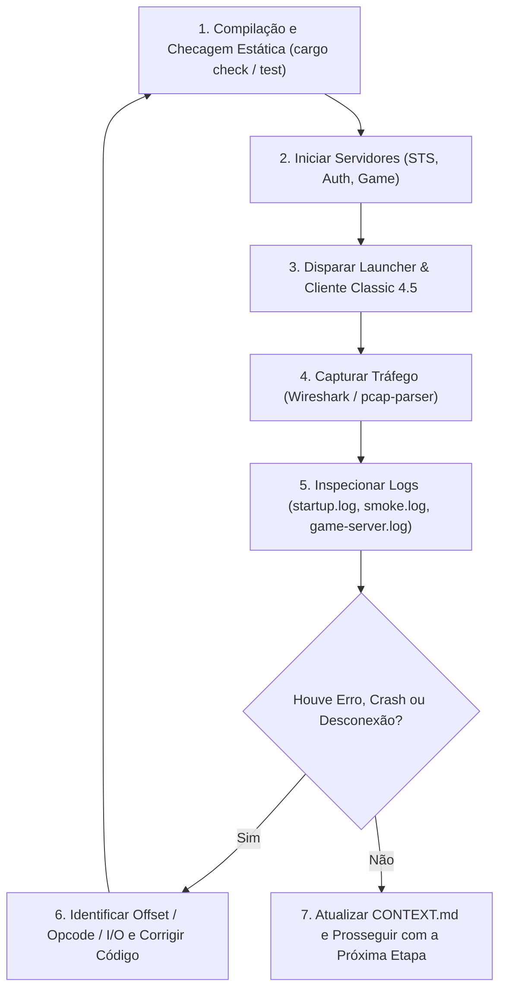

# ETAPA 21: PROTOCOLO AUTÔNOMO DE TESTES, DEPURAÇÃO DE PACOTES E DEPLOY

> **Status da Etapa**: Pendente  
> **Prioridade**: Contínua / Mandatória  
> **Dependências**: Todas as etapas anteriores (00 a 20)  
> **Ferramentas Utilizadas**: Wireshark (`E:\Programas instalados - Leves\Wireshark`), Cliente Classic (`D:\AION RUST\AionEMU\AionEMU\Cliente\GFAion\aionclassic`), `pcap-parser` e Logs

---

## 1. O Papel e Responsabilidade Autônoma do Agente de IA

> [!IMPORTANT]
> O Agente de IA não deve apenas produzir código em Rust; ele deve **executar, testar, capturar pacotes de rede, depurar logs e iterar correções de forma totalmente autônoma até o funcionamento perfeito do emulador**.
> Nenhuma funcionalidade é dada como concluída sem a validação prática no cliente oficial do jogo ou em simulações automatizadas de alta fidelidade.

---

## 2. O Ciclo de Teste e Depuração Passo a Passo



---

## 3. Comandos e Procedimentos Práticos de Execução

### 3.1 Compilação e Validação do Código Rust
```powershell
# Executar a partir de D:\AION RUST\AionEMU\AionEMU\EmuRustDurak
# Dica: Em ambiente Windows, carregar as variáveis MSVC caso necessário
cmd.exe /c "`"C:\Program Files\Microsoft Visual Studio\2022\Community\VC\Auxiliary\Build\vcvars64.bat`" && cargo check --workspace"
cargo test --workspace
```

### 3.2 Inicialização dos Servidores
```powershell
# 1. Iniciar o STS Server (Porta 10241)
cargo run --bin sts-server

# 2. Iniciar o Auth Server (Porta 2106)
cargo run --bin auth-server

# 3. Iniciar o Game Server (Porta 7777)
cargo run --bin game-server
```

### 3.3 Execução do Cliente Oficial para Testes Reais
```powershell
# Disparar o Launcher Rust (que cria o Named Pipe \\.\pipe\aion_launch e abre o AION.bin em Cliente\GFAion\aionclassic)
cargo run --bin launcher
```

### 3.4 Captura e Análise de Tráfego de Rede
- **Wireshark**: Localizado em `E:\Programas instalados - Leves\Wireshark\Wireshark.exe` (ou usar o `tshark.exe` via terminal):
  ```powershell
  & "E:\Programas instalados - Leves\Wireshark\tshark.exe" -i "Loopback" -f "tcp port 7777 or tcp port 2106 or tcp port 10241" -w "D:\AION RUST\AionEMU\AionEMU\EmuRustDurak\test_session.pcap"
  ```
- **Análise com o `pcap-parser` do Projeto**:
  ```powershell
  cargo run --package pcap-parser -- "D:\AION RUST\AionEMU\AionEMU\EmuRustDurak\test_session.pcap"
  ```

---

## 4. Diagnóstico de Problemas Comuns e Soluções

| Sintoma Observado | Causa Raiz Mais Provável | Ação de Correção Mandatória |
| :--- | :--- | :--- |
| **Tela de seleção de personagem congelada** | Falta de envio do Opcode `0x8B` (`S_SA_ACCOUNT_ITEM_NOTI`). | Registrar resposta com 4 bytes zero no handler de `0x8B`. |
| **"Packet Checksum Failed" logo após entrar** | Dessincronia de cifras causada por escrita parcial (`write`). | Substituir qualquer `write` por `write_all` / flush completo de buffers. |
| **Personagem entra no mundo sem cabeça** | Fórmula de Mesh (`100000 + raca*2 + genero`) incorreta para a raça. | Verificar se o corpo corresponde ao esqueleto da raça (Elyos vs Asmodian). |
| **Crash do cliente ao abrir inventário ou skills** | Tamanho ou ordem dos campos do pacote SM incompatível com 4.5. | Comparar payload com a captura PCAP oficial e corrigir tipos (`u16` vs `u32`). |
| **Conta nova criada a cada login** | String do token com caractere nulo (`\0`) no final falhando a busca. | Fazer `trim_end_matches('\0')` na chave de autenticação recebida. |

---

## 5. Critérios de Aceite para Conclusão do Emulador

Para que o emulador seja considerado **100% Concluído e Estável**, os seguintes marcos devem ser satisfeitos:
1. **Estabilidade de Conexão**: Sessão contínua de mais de 4 horas sem quedas, sem corrupção de checksum e sem travamento de sockets.
2. **Ciclo Completo de Gameplay**: Criação de personagem $\rightarrow$ Entrada no Mundo $\rightarrow$ Movimentação/Voo $\rightarrow$ Combate $\rightarrow$ Coleta/Crafting $\rightarrow$ Masmorras $\rightarrow$ Missões $\rightarrow$ Comércio/Leilão $\rightarrow$ Sieges/Arenas $\rightarrow$ Logout e Persistência perfeita no SQLite.
3. **Desempenho**: Suporte a mais de 1.000 entidades simultâneas em Pandaemonium/Sanctum com latência de resposta inferior a $5\text{ms}$ por pacote.
4. **Deploy Otimizado**: Build em modo `--release` com compilação LTO (Link-Time Optimization) e SQLite configurado com `WAL mode` e `synchronous=NORMAL`.
