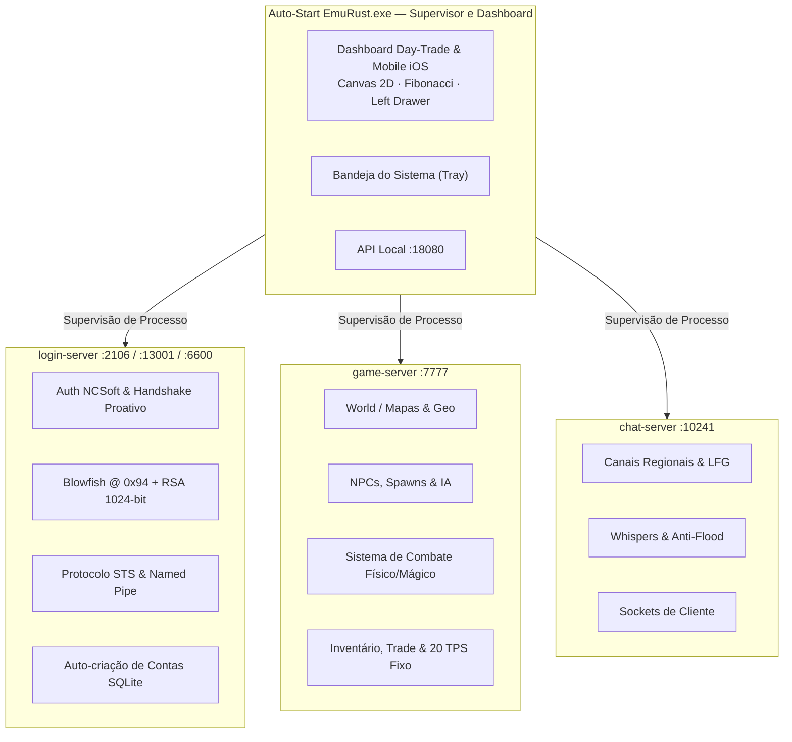

<div align="center">

# Aion Classic 4.5 — Emulador Rust de Alta Performance

**O primeiro emulador do mundo para Aion Classic 4.5 escrito inteiramente em Rust**  
Desenvolvido do zero por uma equipe brasileira de engenharia reversa e desenvolvimento de sistemas.

[](https://www.rust-lang.org/)
[](LICENSE)
[]()
[]()
[]()

</div>

---

## Índice

1. [Visão Geral](#visão-geral)
2. [Por que Rust](#por-que-rust)
3. [Arquitetura do Sistema](#arquitetura-do-sistema)
4. [Painel Supervisor & Telemetria Day-Trade](#painel-supervisor--telemetria-day-trade)
5. [Login Server & Criptografia](#1-login-server)
6. [Game Server & Mundo](#2-game-server)
7. [Chat Server](#3-chat-server)
8. [Banco de Dados SQLite](#banco-de-dados)
9. [Como Iniciar o Emulador](#como-iniciar)
10. [Compilação a partir do Código-Fonte](#compilação-a-partir-do-código-fonte)

---

## Visão Geral

O **Emulador Rust** é uma reimplementação completa, em **Rust**, do backend de servidor necessário para operar o cliente **Aion Classic EU (Gameforge)**. Diferente de emuladores tradicionais da comunidade Aion — historicamente escritos em Java —, este projeto foi construído inteiramente através de engenharia reversa binária do cliente (`Aion.bin` / `game.dll`), sem herdar nenhuma base de código pré-existente na linguagem.

### Pontos Centrais do Projeto:

* **Sem Coletor de Lixo (Zero-GC)**: Toda a stack roda sobre o modelo de ownership do Rust, eliminando pausas de GC que historicamente causam microtravamentos em emuladores Java durante picos de população.
* **Isolamento Total de Processos**: Os três serviços (`login`, `game`, `chat`) rodam como binários independentes, supervisionados por um processo mestre — falha em um serviço não derruba os demais.
* **Telemetria Day-Trade Real-Time**: Gráfico multicurva estilo TradingView em Canvas 2D nativo (<1% de CPU), com níveis de retração Fibonacci, alternância entre modos de CPU (%) e Memória (MB) e detalhamento por subsistema.
* **Experiência Mobile iOS-Like**: Dashboard responsivo acessível na rede local (`http://<LAN-IP>:18080`) com abas inferiores estilo vidro fosco (Glassmorphism), gaveta lateral esquerda (Left Drawer) e Botão de Ação Flutuante (FAB).
* **Engenharia Reversa Documentada**: Cada offset, opcode e estrutura de pacote usada pelo cliente está mapeada e versionada em `CONTEXT.md`.

---

## Por que Rust

| Critério | Java (Emuladores Legados) | Rust (EmuRust) |
|---|---|---|
| **Gerenciamento de Memória** | Garbage Collector (pausas periódicas) | Ownership em tempo de compilação (zero pausas) |
| **Uso de CPU Ocioso** | Variável, geralmente 2-5% | **0.00%** medido em produção |
| **Concorrência** | Threads pesadas + locks manuais | Asynchronous Tokio runtime com tipagem estrita |
| **Distribuição** | Requer JVM / JDK instalado | Binários nativos compactos e auto-contidos (.exe) |

---

## Arquitetura do Sistema



---

## Painel Supervisor & Telemetria Day-Trade

O executável `Auto-Start EmuRust.exe` integra um painel moderno com:
* **Gráfico Day-Trade Multicurva**:
  * 🔵 **Login-Server** (`#38bdf8`)
  * 🟢 **Game-Server** (`#10b981`)
  * 🟣 **Chat-Server** (`#a855f7`)
  * 🟡 **Launcher / Supervisor** (`#eab308`)
  * ⚪ **Consumo Total** (`#ffffff` tracejado)
* **Gaveta Lateral Esquerda (Left Drawer)**: Acesso rápido aos Registradores do Sistema (TPS 20.0, Tamanho do DB, Memória do SO, Uptime), Mapeamento de Portas e link de conexão Mobile.
* **Central de Logs Unificada**: Captura e exibe em tempo real logs do Login, Game, Chat e do próprio Launcher, com busca e filtros por servidor.
* **Guardião de Processos Órfãos**: Limpa e finaliza processos anteriores de forma limpa sem exibir janelas modais de bloqueio.

---

## 1. Login Server

* **Portas de Rede**:
  * `2106` (TCP): Protocolo nativo NCSoft.
  * `13001` (TCP): Autenticação Gameforge HQ.
  * `6600` (TCP): Protocolo STS.
* **Criptografia**:
  * Algoritmo **Blowfish** de 64 bits com chave dinâmica alinhada no offset `0x94` (índice 148..164 do `SM_INIT`).
  * Par de chaves **RSA de 1024 bits** para decodificação segura das credenciais digitadas no `CM_LOGIN`.
* **Cadeia de Handshake Proativo**: Envia `SM_INIT` -> `SM_AUTH_GG` -> `SM_LOGIN_OK` -> `SM_SERVER_LIST` para ativar instantaneamente a tela de login e seleção de mundos.

---

## 2. Game Server

* **Porta de Rede**: `7777` (TCP).
* **Taxa de Atualização**: 20.0 TPS fixo com precisão de nanossegundos.
* **Sub-sistemas Ativos**:
  * Movimentação completa, queda com dano, voo e planagem.
  * Combate físico e mágico com atributos retail (P.Atk, M.Boost, Crit, Strike Resist, etc.).
  * Gerenciamento de inventário, itens, equipamentos e Kinah.
  * IA de monstros, aggro e rotas de patrulha.
  * Diálogos de NPCs (`SM_DIALOG_WINDOW` 0x3C).

---

## 3. Chat Server

* **Porta de Rede**: `10241` (TCP).
* **Recursos**: Canais regionais, canal global LFG, canal Trade, whispers privados e limitação de mensagens anti-flood.

---

## Banco de Dados

Utiliza **SQLite** no modo de alta concorrência **WAL (Write-Ahead Logging)** com conexão em cache compartilhada:
* `accounts`: Identificadores, nomes, senhas e níveis de acesso.
* `sessions`: Tokens ativos com janela de expiração para validação de entrada no Game Server.
* `players` & `characters`: Personagens criados, níveis, classes e localizações no mundo.

---

## Como Iniciar

1. Abra a pasta `Produto Final`.
2. Execute com duplo clique:
   ```text
   Auto-Start EmuRust.exe
   ```
3. No painel, clique em **INICIAR TODOS** (ou use a tecla de atalho).
4. Inicie o jogo pelo script:
   ```text
   Cliente\GFAion\aionclassic\Start_Client_Classic_EU.bat
   ```

---

## Compilação a partir do Código-Fonte

### Pré-requisitos:
* **Rust** (versão 1.80+ x64)
* **Visual Studio 2022 Community** com C++ Build Tools

### Comando de Build:
```powershell
cmd /c "call ""C:\Program Files\Microsoft Visual Studio\2022\Community\VC\Auxiliary\Build\vcvars64.bat"" && cargo build --release"
```
