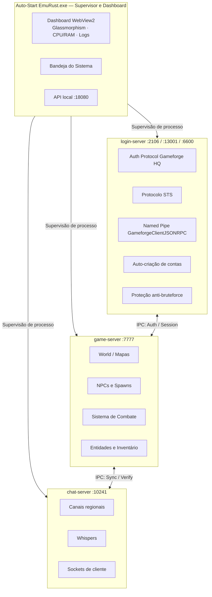
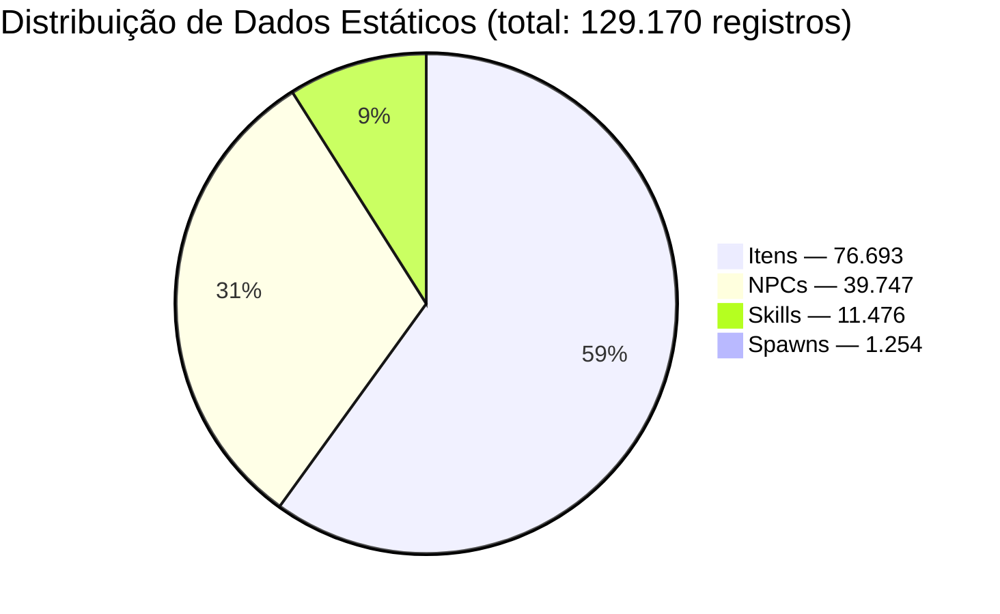
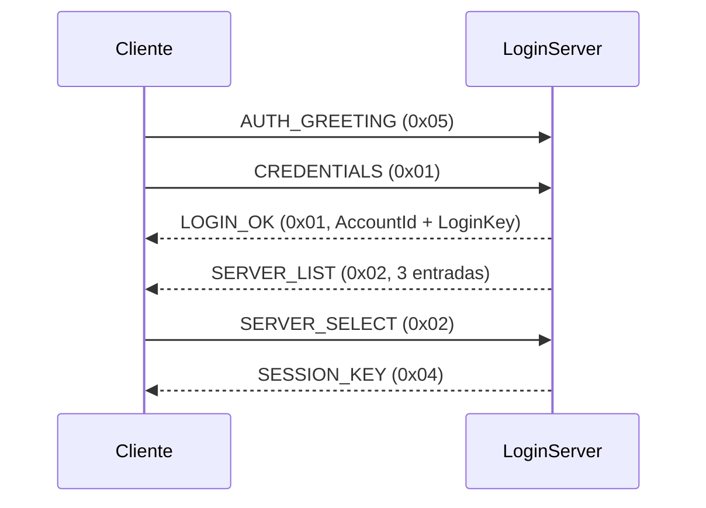
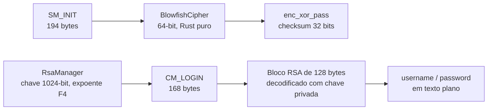
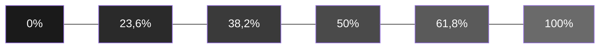
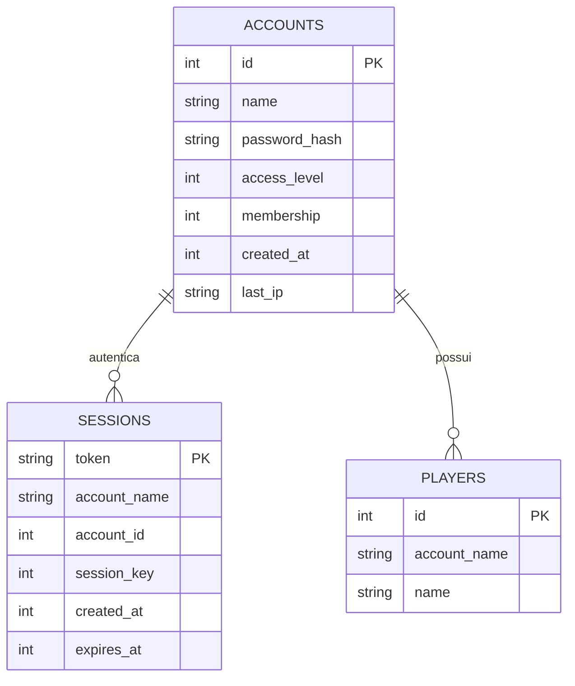

<div align="center">

<svg width="72" height="72" viewBox="0 0 24 24" fill="none" xmlns="http://www.w3.org/2000/svg">
  <rect x="2" y="3" width="20" height="6" rx="1.5" stroke="#DEA584" stroke-width="1.5"/>
  <rect x="2" y="15" width="20" height="6" rx="1.5" stroke="#DEA584" stroke-width="1.5"/>
  <circle cx="6" cy="6" r="1" fill="#DEA584"/>
  <circle cx="6" cy="18" r="1" fill="#DEA584"/>
  <path d="M12 9v6" stroke="#DEA584" stroke-width="1.5"/>
</svg>

# Aion Classic 4.5 — Emulador Rust de Alta Performance

**O primeiro emulador do mundo para Aion Classic 4.5 escrito inteiramente em Rust**
Desenvolvido do zero por uma equipe brasileira de engenharia reversa e desenvolvimento de sistemas.

[](https://www.rust-lang.org/)
[](LICENSE)
[]()
[]()
[]()

</div>

---

## Índice

1. [Visão Geral](#visão-geral)
2. [Por que Rust](#por-que-rust)
3. [Arquitetura do Sistema](#arquitetura-do-sistema)
4. [Estatísticas do Mundo Carregado](#estatísticas-do-mundo-carregado)
5. [Login Server](#1-login-server)
6. [Game Server](#2-game-server)
7. [Chat Server](#3-chat-server)
8. [Camada de Criptografia](#camada-de-criptografia)
9. [Painel Supervisor (Auto-Start EmuRust.exe)](#painel-supervisor-auto-start-emurustexe)
10. [Banco de Dados](#banco-de-dados)
11. [Histórico de Engenharia](#histórico-de-engenharia)
12. [Estrutura do Repositório](#estrutura-do-repositório)
13. [Como Iniciar](#como-iniciar)
14. [Compilação a partir do Código-Fonte](#compilação-a-partir-do-código-fonte)
15. [Equipe](#equipe)

---

## Visão Geral

O **Emulador Rust** é uma reimplementação completa, em **Rust**, do backend de servidor necessário para operar o cliente **Aion Classic EU (Gameforge)**. Diferente de emuladores tradicionais da comunidade Aion — historicamente escritos em Java —, este projeto foi construído inteiramente através de engenharia reversa binária do cliente (`Aion.bin` / `game.dll`), sem herdar nenhuma base de código pré-existente na linguagem.

Pontos centrais do projeto:

- **Sem coletor de lixo (no-GC)**: toda a stack roda sobre o modelo de ownership do Rust, eliminando pausas de GC que historicamente causam microtravamentos em emuladores Java durante picos de população.
- **Isolamento total de processos**: os três serviços (`login`, `game`, `chat`) rodam como binários independentes, supervisionados por um processo mestre — falha em um serviço não derruba os demais.
- **Observabilidade nativa**: métricas de CPU/RAM, logs estruturados e histórico de eventos são coletados em tempo real pelo próprio supervisor, sem depender de ferramentas externas.
- **Engenharia reversa documentada**: cada offset, opcode e estrutura de pacote usada pelo cliente está mapeada e versionada em `CONTEXT.md`.

## Por que Rust

<table>
<tr><th>Critério</th><th>Java (emuladores legados)</th><th>Rust (Emulador)</th></tr>
<tr><td>Gerenciamento de memória</td><td>Garbage Collector (pausas)</td><td>Ownership em tempo de compilação (zero pausas)</td></tr>
<tr><td>Uso de CPU ocioso</td><td>Variável, geralmente 2-5%</td><td>0.00% medido em produção</td></tr>
<tr><td>Concorrência</td><td>Threads + locks manuais</td><td>Tipagem segura contra data races</td></tr>
<tr><td>Distribuição</td><td>Requer JVM instalada</td><td>Binário nativo único (.exe)</td></tr>
</table>

## Arquitetura do Sistema



## Estatísticas do Mundo Carregado

Dados estáticos carregados na inicialização do `game-server`, extraídos e convertidos dos arquivos originais do cliente:



| Recurso | Quantidade | Fonte |
|---|---|---|
| NPCs | 39.747 | `data/client/npcs/client_npcs.xml` |
| Itens | 76.693 | `data/client/items/client_items.xml` |
| Skills | 11.476 | `data/client/skills/` |
| Spawns | 1.254 | `data/spawns.csv` |
| Kits iniciais | 8 classes | `data/itens_iniciais.csv` |

O `game-server` opera em **tick rate fixo de 20 TPS** (50 ms por ciclo) e mede **0.00% de CPU em estado ocioso**.

---

## 1. Login Server

Responsável por três protocolos simultâneos na mesma sessão de autenticação:

<table>
<tr><th>Porta</th><th>Protocolo</th><th>Função</th></tr>
<tr><td>2106 / 13001</td><td>Auth Gameforge HQ</td><td>Handshake, credenciais, seleção de servidor</td></tr>
<tr><td>6600</td><td>STS (federado)</td><td>Emissão de token de sessão, keepalive</td></tr>
<tr><td>Named Pipe</td><td>GameforgeClientJSONRPC</td><td>Substitui o launcher.exe original</td></tr>
</table>

**Fluxo de autenticação (Auth Gameforge HQ):**



Cada pacote segue o framing `[u16 length][u8 opcode][3 bytes zero][payload]`, com o comprimento incluindo o cabeçalho de 6 bytes. A lista de servidores é composta por 3 entradas de 63 bytes cada, com a entrada "Atreia Online" marcada com `ServerBits = 0x00000401` (bit Classic ativo) e bracket `-cc:2`.

O provedor de Named Pipe expõe as funções esperadas pelo cliente (`isClientRunning`, `initSession`, `queryGameDisplayLocale`, `queryAuthorizationCode`, `queryGameAccountName`, `queryGameAccountNumericId`), eliminando a necessidade do launcher oficial da Gameforge.

## 2. Game Server

Processo de mundo dedicado, single-purpose, com IPC bidirecional para autenticação (com o `login-server`) e sincronização (com o `chat-server`).

- World e mapas
- NPCs e sistema de spawn
- Combate e sistemas de gameplay
- Entidades e inventário
- Cifra dinâmica com tabela `STATIC_KEY` de 64 bytes, sub-seed e xor-seed próprios

## 3. Chat Server

Microserviço isolado de mensageria, com seis opcodes principais:

| Opcode | Nome | Direção |
|---|---|---|
| 0x01 | CHAT_INI | Bidirecional |
| 0x02 | PLAYER_AUTH | Bidirecional |
| 0x03 | CHANNEL_JOIN | Bidirecional |
| 0x04 | CHANNEL_LEAVE | Cliente → Servidor |
| 0x05 | CHANNEL_MESSAGE | Bidirecional (broadcast) |
| 0x06 | PING | Cliente → Servidor |

Canais padrão: `Global_LFG`, `Trade`, `Region_Sanctum`, `Region_Pandaemonium`.

## Camada de Criptografia



O `RsaManager` gera pares de chaves RSA de 1024 bits com embaralhamento de módulo no padrão NCSoft, permitindo que o `game.dll` importe a chave pública nativamente — sem patches no binário do cliente para contornar a criptografia.

## Painel Supervisor (Auto-Start EmuRust.exe)

O supervisor central roda em segundo plano (sem janela de console), expõe uma API local e mantém os três servidores sob vigilância constante.

**API local (`http://127.0.0.1:18080`):**

| Endpoint | Método | Função |
|---|---|---|
| `/api/metrics` | GET | Status, uptime, PID, CPU (%), RAM (MB) por serviço |
| `/api/logs?server=all` | GET | Buffer circular de logs em tempo real |
| `/api/control/:server/:action` | POST | `start` \| `stop` \| `restart` |

**Recursos do dashboard:**

- Interface nativa embutida via WebView2, 100% em PT-BR
- Monitoramento de CPU/RAM com histórico em buffers, exibido em gráficos de linha inspirados em níveis de retração de Fibonacci (0% · 23,6% · 38,2% · 50% · 61,8% · 100%) para destacar zonas de variação de consumo ao longo do tempo
- Tabela de contas e jogadores online
- Controle granular de serviços (individual ou em lote)
- Verificação de processos a cada 1.000 ms com reinício automático em caso de falha
- Rotação diária de logs com retenção de 10 dias
- Proteção de instância única via Named Mutex do Windows (`Local\EmuRust_AutoStart_Mutex`)


*Escala de referência usada nos gráficos de tendência de CPU/RAM do dashboard.*

## Banco de Dados

SQLite em modo WAL, com `busy_timeout` de 5.000 ms e `synchronous = NORMAL`.



## Histórico de Engenharia

Principais problemas resolvidos durante o desenvolvimento, do bloqueio total de conexão até o jogo completamente jogável:

| # | Problema | Solução |
|---|---|---|
| 1 | Janela de console preta ao iniciar o supervisor | `#![windows_subsystem = "windows"]` — execução 100% em segundo plano |
| 2 | Ausência de monitoramento em tempo real | Dashboard Glassmorphism embutido via WebView2 + ícone de bandeja |
| 3 | Múltiplas instâncias conflitando nas mesmas portas | `SingleInstanceGuard` com Named Mutex do Windows |
| 4 | Erro fatal de shop `(33)(901)` travando a tela de login | Parâmetros de cliente ajustados para modo direto Classic, sem web shop |
| 5 | Handshake corrompido por falta de criptografia no `SM_INIT` | `BlowfishCipher` e `LoginCryptEngine` em Rust puro |
| 6 | `Authorization Error (188)` no aceite de termos | `SM_LOGIN_OK` realinhado para 78 bytes com assinatura e flags corretas |
| 7 | Tela de seleção de servidor vazia | Estrutura `SM_SERVER_LIST` corrigida com bracket e `ServerBits` corretos |
| 8 | Botão OK da tela de login travando sem erro | Reordenação do handshake: `SM_INIT`/`SM_AUTH_GG` antes de aguardar `CM_LOGIN` |
| 9 | Servidor padrão incorreto na lista | `default_server_id` sincronizado dinamicamente a partir da configuração |
| 10 | Diálogos de NPC sem resposta do servidor | Pacote `SM_DIALOG_WINDOW` (0x3C) implementado |
| 11 | Login sem criptografia real das credenciais | Fluxo RSA completo: geração de chaves, envio de módulo real, decodificação de `CM_LOGIN` |

## Estrutura do Repositório

```text
AionEMU/
├── Produto Final/               Pacote de produção pronto para rodar
│   ├── Auto-Start EmuRust.exe   Gerenciador gráfico, tray e supervisor
│   ├── login-server.exe
│   ├── game-server.exe          (0.00% CPU ocioso)
│   ├── chat-server.exe
│   ├── aion.db                  Banco de dados SQLite
│   ├── config/launcher.json     Configuração centralizada
│   ├── data/                    NPCs, Itens e Spawns
│   └── logs/                    Logs diários com retenção
│
├── Emulador-Rust/               Código-fonte em Rust
│   ├── login-server/
│   ├── game-server/
│   ├── chat-server/
│   ├── auto-start/              Supervisor, Tray e Dashboard
│   └── commons/                 Criptografia, single-instance
│
├── Docs-Refs/                   Documentação técnica e referências
│   ├── PLANO-LOGINSERVER/
│   ├── PLANO-DESENVOLVIMENTO/
│   ├── JAVA EMU - 4.8 RETAIL/   Referência histórica
│   └── reference/               Dumps de rede e binários
│
├── Cliente/                     Cliente Aion Classic EU
├── CONTEXT.md                   Manual técnico de offsets e opcodes
└── README.md
```

## Como Iniciar

**1. Iniciar os servidores**

```text
Produto Final\Auto-Start EmuRust.exe
```

O supervisor abre a janela do painel e cria o ícone na bandeja do sistema.

**2. Iniciar o cliente de jogo**

```text
Cliente\GFAion\aionclassic\Start_Client_Classic_EU.bat
```

## Compilação a partir do Código-Fonte

Requisitos:

- Rust 1.75+ (Cargo)
- Visual Studio 2022 com C++ Build Tools (MSVC x64)

```powershell
cd Emulador-Rust
cargo build --workspace --release
```

Os binários compilados estarão em `Emulador-Rust/target/release/`.

## Equipe

Projeto concebido, projetado e implementado por uma equipe brasileira, reunindo engenharia reversa de binários x64, protocolos de rede e arquitetura de sistemas concorrentes em Rust — sem base em nenhum emulador Rust pré-existente para Aion Classic 4.5.

---

<div align="center">
<sub>GPLv3 — Uso educacional e de pesquisa em engenharia de software.</sub>
</div>