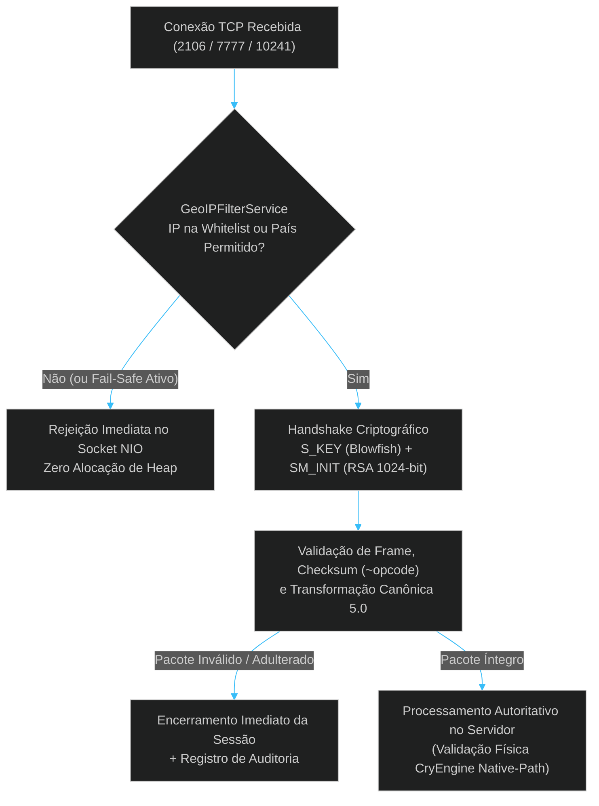

# Política de Segurança e Arquitetura de Proteção — AION CLASSIC 5.0 EMULADOR

  
  

  
  
  
  

> [!IMPORTANT]
> **ISOLAMENTO DE SUPERFÍCIE ADMINISTRATIVA E PROTEÇÃO DE REDE:**  
> O painel web administrativo e o Database Studio do supervisor nativo em Rust (`Aion Classic - EMULADOR.exe`) fazem *bind* exclusivamente em `127.0.0.1` (*loopback*). Além disso, os servidores Java contam com o subsistema nativo `GeoIPFilterService`, que rejeita conexões não autorizadas diretamente no nível do socket TCP NIO antes de qualquer alocação de sessão ou handshake criptográfico.

---

## 1. Versões e Componentes Suportados para Auditoria de Segurança

| Componente / Módulo | Tecnologia / Versão | Status de Auditoria de Segurança |
| :--- | :---: | :---: |
| **Backend Multimodular (`commons`, `login-server`, `game-server`, `chat-server`)** | `Java 25 LTS (jdk-25.0.2)` |  |
| **Supervisor Nativo e Database Studio (`Aion Classic - EMULADOR.exe`)** | `Rust 1.80+ (MSVC x64)` |  |
| **Proxy Hook do Cliente (`version.dll` Standalone)** | `C/C++ (MSVC v143 x64/x86)` |  |
| **Versões legadas abaixo do Java 25 ou com dependências `javolution`** | `Java 8 / 11 / 17 / 21` |  |

---

## 2. Camadas de Segurança e Filtragem de Conexões

---

## 3. Matriz de Controles de Segurança Implementados

| Domínio de Segurança | Mecanismo Implementado | Localização no Repositório |
| :--- | :--- | :--- |
| **Firewall Geográfico no Socket NIO** | Bloqueio pré-handshake por país (IPv4/IPv6 em memória) com política *fail-safe* estrita | `Código Fonte - Emulador/commons` (`GeoIPFilterService`) |
| **Isolamento do Painel Supervisor e DB Studio** | Bind estrito em `127.0.0.1:18080` e controle de ciclo de vida via Windows Job Objects | `Ferramentas e Documentos/Ferramentas Python e PowerShell/Código Fonte - Executável Rust do Emulador` |
| **Higienização Automática de Cache WebView2** | Diretório de dados isolado em `%LOCALAPPDATA%\AionClassicEmulador\WebView2`, limpo e recriado a cada inicialização | `Código Fonte - Executável Rust do Emulador/src/webview.rs` |
| **Runtime Java 25 Determinístico Embarcado** | Distribuição isolada em `Emulador - Produto Final/Config/java-deployment` evitando execução acidental em JVMs vulneráveis do sistema | `Emulador - Produto Final/Config/config.json` |
| **Prevenção de Atravessamento de Paredes (No-Clip)** | Validação física tridimensional autoritativa via `com.lostacademy.nativepath` (`*-path.dat` 0.5m) | `Código Fonte - Emulador/game-server` |
| **Proteção de Credenciais de Banco de Dados** | Exclusão de `database.properties` no `.gitignore` e geração segura com validação contra injeção de quebras de linha | `.gitignore` / `src/config.rs` |

---

## 4. Como Reportar Vulnerabilidades Reais

Caso identifique uma vulnerabilidade técnica real no núcleo NIO (`commons`), na lógica de validação autoritativa (`game-server`, `login-server`, `chat-server`) ou no supervisor nativo (`Rust`), submeta um Pull Request corretivo seguindo rigorosamente as regras de validação descritas em [`CONTRIBUTING.md`](./CONTRIBUTING.md).
